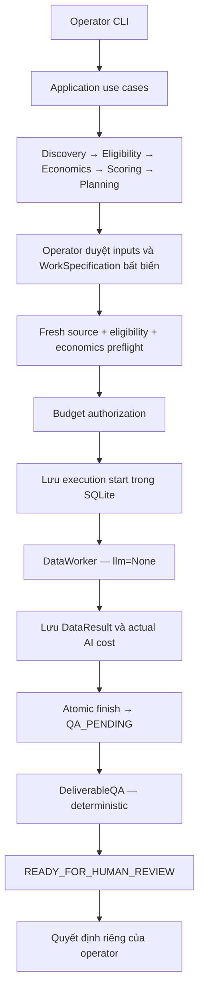

# AgentMine — Phase B.1: Worker Capability & Superteam Bounty Readiness Audit

> Báo cáo audit ngày 02/11/2026, được lưu lại từ báo cáo cuối trong cuộc trò chuyện. Các kết quả kiểm chứng bên dưới thuộc lượt audit đó; việc lưu Markdown không chạy lại tests.

## 1. Executive Summary

**Kết luận: `NEEDS_TARGETED_IMPROVEMENTS`.**

AgentMine hiện có thể thực hiện **xử lý dữ liệu CSV/JSON bằng quy tắc xác định**, lưu kết quả, phục hồi, chạy QA và đưa deliverable đến bước human review. Luồng này chạy được với **SCOUT_ONLY và ngân sách AI $0**.

Tuy nhiên, chưa đủ bằng chứng để kết luận hệ thống có thể hoàn thành một Superteam bounty thật:

- Chưa xác minh listing thật nào có `agentAccess = AGENT_ALLOWED` hoặc `AGENT_ONLY`.
- Adapter hiện không chuẩn hóa listing `type=bounty` hoặc token `USDC`.
- ResearchWorker cần LLM để tổng hợp và chưa có concrete research-tool adapter trong production.
- Production CLI chỉ nối deterministic Data execution.
- Manual handoff mặc định bị chặn vì chưa có kênh được xác minh; payment evidence hiện chưa phải bằng chứng thanh toán độc lập.

**Kiểm chứng mới trong audit: 502 tests passed**, gồm worker, recovery, runtime, CLI, QA, Superteam contracts, budget, revision và architecture. Không dùng kết quả lịch sử làm kết quả hiện tại.

Phạm vi kiểm tra:

| Mục | Bằng chứng |
|---|---|
| Ngày audit | 02/11/2026 |
| Repository thực tế | `D:\DNTU\Tuhoc\AgentMine` |
| Commit | `fa1928b78f9ea43509501c6a1cb905af0cba426e` |
| Python | 3.14.2 |
| Worktree trước/sau audit | Sạch |
| Thay đổi source/tests/config/dependencies | Không |
| Live API, paid provider, submission, wallet | Không gọi |

Đường dẫn `D:\DNTU\Tự Học\AgentMine` trong context không còn tồn tại. Audit được thực hiện trên repository tìm thấy tại đường dẫn nêu trên. Trạng thái SCOUT_ONLY/$0 của workspace vận hành được coi là **ràng buộc do operator cung cấp**; audit không mở một database vận hành cụ thể để xác nhận hoặc thay đổi trạng thái đó.

Việc lưu báo cáo này chỉ bổ sung một file tài liệu; không thay đổi implementation, kiến trúc hoặc dependencies. Không commit hoặc push.

## 2. Current Architecture and Worker Execution Flow

Luồng production local hiện tại:



Các ranh giới quan trọng:

- **Composition root dùng chung SQLite và ledger:** [local_runtime.py:58](../../src/agentmine/bootstrap/local_runtime.py#L58).
- **Specification giữ inputs, digest, actor, source context và acceptance criteria**, đồng thời từ chối semantic columns trong runtime này: [runtime.py:61](../../src/agentmine/application/contracts/runtime.py#L61).
- **Preflight tính lại eligibility và đối chiếu economic/scoring evidence**, không coi eligibility lịch sử là quyền thực thi vĩnh viễn: [worker_preflight.py:33](../../src/agentmine/application/use_cases/worker_preflight.py#L33).
- **ExecuteWorkerTask authorize trước, lưu start trước khi gọi DataWorker**, và dùng `llm=None`: [worker_execution.py:85](../../src/agentmine/application/use_cases/worker_execution.py#L85).
- **SQLite start/finish dùng transaction và optimistic concurrency:** [runtime.py:117](../../src/agentmine/infrastructure/sqlite/runtime.py#L117), [runtime.py:228](../../src/agentmine/infrastructure/sqlite/runtime.py#L228).
- **QA lấy retained evidence**, không nhận kết quả PASS tùy ý từ caller: [operational_qa.py:43](../../src/agentmine/application/use_cases/operational_qa.py#L43).
- **QA PASS chỉ đến READY_FOR_HUMAN_REVIEW**; approval vẫn riêng: [opportunity.py:453](../../src/agentmine/domain/opportunity.py#L453).

Discovery, economics, scoring và planning có đường xử lý không cần LLM: [planning.py:27](../../src/agentmine/application/use_cases/planning.py#L27).

Architecture tests đã pass, gồm kiểm tra import direction và circular dependencies. Đây là bằng chứng về các quy tắc mà test kiểm tra, không phải chứng minh mọi quyết định kiến trúc đều hoàn hảo: [test_architecture.py:56](../../tests/unit/test_architecture.py#L56).

## 3. DataWorker Capability Matrix

Trong bảng, “$0” nghĩa là **không cần chi phí AI**. Không đồng nghĩa CPU, lưu trữ và công thu thập dữ liệu đều miễn phí.

| Khả năng / phân loại | Input và giới hạn thực tế | Output | LLM / $0 | Bằng chứng và giới hạn |
|---|---|---|---|---|
| **Structured collection — IMPLEMENTED_AND_TESTED** | 1–10 snapshot CSV/JSON; JSON phải là array of objects; CSV cần header duy nhất, đủ số cell | Records theo thứ tự nguồn | Không / Có | [data_transform.py:47](../../src/agentmine/application/workers/data_transform.py#L47). Ghép dữ liệu đã cung cấp; không tự thu thập web |
| **Field extraction — IMPLEMENTED_AND_TESTED** | CSV header hoặc đường dẫn qua JSON object, tối đa 10 thành phần | Các cột được khai báo | Không / Có | [data_transform.py:65](../../src/agentmine/application/workers/data_transform.py#L65). Không traverse array hay chạy expression |
| **Normalization — IMPLEMENTED_AND_TESTED** | Trim, lower/upper, integer, decimal, boolean, ngày ISO | Giá trị chuẩn hóa dạng string/null | Không / Có | [data_transform.py:74](../../src/agentmine/application/workers/data_transform.py#L74). Không đoán locale/date; numeric scientific notation không được hỗ trợ |
| **Categorization và lookup enrichment — IMPLEMENTED_AND_TESTED** | Bảng key/value do operator cung cấp, có evidence reference | Giá trị lookup trong dataset | Không / Có | [data.py:84](../../src/agentmine/application/contracts/data.py#L84). Unknown key bị báo lỗi; không tự tìm thêm thông tin |
| **Validation — IMPLEMENTED_AND_TESTED** | Required fields, type, enum, length, bounds, uniqueness, record count; so sánh bằng hoặc numeric ≤ | Typed issues và `validation.json` | Không / Có | [data_transform.py:172](../../src/agentmine/application/workers/data_transform.py#L172). Không phải constraint engine tùy ý |
| **Duplicate detection — IMPLEMENTED_AND_TESTED** | `unique_by` hoặc toàn bộ output columns | Báo DUPLICATE, giữ nguyên các dòng | Không / Có | [test_data_worker.py:319](../../tests/unit/application/test_data_worker.py#L319). **Không tự deduplicate/merge** |
| **Artifact/provenance — IMPLEMENTED_AND_TESTED** | Result hợp lệ và schema đã duyệt | `data.csv`, `data.json`, `validation.json` | Không / Có | [data_artifacts.py:10](../../src/agentmine/application/workers/data_artifacts.py#L10). Có source digest, locator, row, field path; provenance vẫn caller-supplied/unverified |
| **Semantic assistance ở cấp worker — IMPLEMENTED_AND_TESTED** | Chỉ TEXT columns có `semantic_reason`; batch ≤50.000 bytes; model không được thêm dòng/cột | Patch vào đúng semantic fields | Có khi cần diễn giải / Không khả dụng trong production runtime $0 | [data_semantic.py:13](../../src/agentmine/application/workers/data_semantic.py#L13), [data_semantic.py:50](../../src/agentmine/application/workers/data_semantic.py#L50). Kiểm thử bằng fake provider |
| **Semantic execution qua CLI — NOT_IMPLEMENTED** | WorkSpecification hiện từ chối semantic columns | Không có workflow production tương ứng | Không khả dụng | [runtime.py:61](../../src/agentmine/application/contracts/runtime.py#L61) |
| **Recovery/idempotency — IMPLEMENTED_AND_TESTED** | Cùng execution và frozen plan; giữ original IDs | Retained result hoặc typed blocked/recoverable outcome | Deterministic: Có | [data.py:99](../../src/agentmine/application/workers/data.py#L99), [worker_execution.py:197](../../src/agentmine/application/use_cases/worker_execution.py#L197) |
| **XLSX/PDF/HTML/Parquet input, binary output — NOT_IMPLEMENTED** | Format enum chỉ CSV/JSON | Không có artifact tương ứng | — | [data.py:29](../../src/agentmine/application/contracts/data.py#L29) |
| **Join, group-by, aggregation, chart, statistical analysis — NOT_IMPLEMENTED** | Không có operator tương ứng trong plan/transform | Không có bảng phân tích hoặc biểu đồ | — | [data.py:165](../../src/agentmine/application/contracts/data.py#L165), [data_transform.py:116](../../src/agentmine/application/workers/data_transform.py#L116) |

Giới hạn cứng hiện tại: **1.000 records tổng, 50 columns, 50 cross-column constraints, 1.000.000 UTF-8 bytes/source**: [data.py:49](../../src/agentmine/application/contracts/data.py#L49), [data.py:165](../../src/agentmine/application/contracts/data.py#L165).

Những điểm dễ gây hiểu nhầm khi nhận bounty:

- Result không hợp lệ chỉ xuất `validation.json`, không xuất dataset như thể thành công.
- JSON output dùng **string/null**, kể cả giá trị numeric.
- Output tự thêm `_provenance`.
- CSV chống formula injection bằng cách thêm apostrophe; điều này cũng tác động chuỗi số âm. JSON giữ giá trị chuẩn hóa không có lớp bảo vệ CSV. [data_artifacts.py:55](../../src/agentmine/application/workers/data_artifacts.py#L55).
- Zero AI cost được ghi rõ; infrastructure cost chưa đo được có warning: [data.py:117](../../src/agentmine/application/workers/data.py#L117).

Các hành vi trên được kiểm tra trong [test_data_worker.py:32](../../tests/unit/application/test_data_worker.py#L32) và [test_data_recovery.py:20](../../tests/integration/test_data_recovery.py#L20).

## 4. ResearchWorker Capability Matrix

| Khả năng / phân loại | Input/constraints | Output thực tế | LLM / $0 | Bằng chứng và giới hạn |
|---|---|---|---|---|
| **Approved collection orchestration — IMPLEMENTED_AND_TESTED** | 1–10 explicit source steps, tool identity và exact locator allowlist | ResearchObservation | Collection không nhất thiết cần LLM; toàn workflow vẫn cần synthesis | [research.py:68](../../src/agentmine/application/workers/research.py#L68), [research.py:100](../../src/agentmine/application/workers/research.py#L100). Test dùng fake research tools |
| **Concrete web/search research tool — NOT_IMPLEMENTED** | Có port `ResearchTool.collect`, chưa tìm thấy implementation trong `src` | Không có live acquisition production | Không khả dụng hiện tại | [workers.py:19](../../src/agentmine/application/ports/workers.py#L19). Superteam discovery adapter không phải ResearchTool |
| **Provenance và source binding — IMPLEMENTED_AND_TESTED** | Tool, locator, timestamp, content, verification reference | SourceEvidence với digest | Không cần LLM cho kiểm tra này | [research.py:103](../../src/agentmine/application/contracts/research.py#L103). Digest không chứng minh nội dung nguồn là đúng |
| **Facts/analysis/uncertainties — IMPLEMENTED_AND_TESTED** | Source captures và structured model response | ResearchFindings | Có cho analysis mới / Không có đường deterministic thay thế hiện tại | [research.py:217](../../src/agentmine/application/workers/research.py#L217). Facts là excerpt từ verified capture; analysis luôn unverified |
| **Structured synthesis — IMPLEMENTED_AND_TESTED** | 1–20 questions; response có đúng schema và source aliases | Analysis text, evidence references | Có / Không khả dụng production $0 | [research.py:165](../../src/agentmine/application/workers/research.py#L165), [research.py:199](../../src/agentmine/application/contracts/research.py#L199). Chưa xác minh chất lượng model thật |
| **Artifact generation — IMPLEMENTED_AND_TESTED** | Typed findings và retained sources | `report.md`, `sources.json`, `findings.json` | Renderer không cần LLM; fresh workflow vẫn cần synthesis | [artifacts.py:19](../../src/agentmine/application/workers/artifacts.py#L19). Markdown dùng literal blocks; chưa phải report được biên tập theo brief cụ thể |
| **Cost/restart/ambiguous-operation safety — IMPLEMENTED_AND_TESTED** | Durable journal, operation IDs, budget authorizations | Reuse observations/responses, giữ unknown costs | Không tạo quyền dùng paid provider ở $0 | [research.py:84](../../src/agentmine/application/workers/research.py#L84), [research.py:125](../../src/agentmine/application/workers/research.py#L125) |
| **Operational Research workflow qua CLI — PARTIALLY_IMPLEMENTED** | Worker/contracts/journal tồn tại; thiếu operational composition tương đương Data | Chưa có luồng production prepare→execute→export Research | Không khả dụng hiện tại | [local_runtime.py:58](../../src/agentmine/bootstrap/local_runtime.py#L58) |
| **Độ chính xác và khả năng đáp ứng brief thật — UNKNOWN** | Chưa có bounty thật, source thật và model thật được audit | Chưa có deliverable được sponsor đánh giá | Chưa xác minh | Test fake không chứng minh chất lượng research ngoài thực tế |

Bằng chứng test: [test_research_worker.py:217](../../tests/unit/application/test_research_worker.py#L217), [test_research_recovery.py:20](../../tests/integration/test_research_recovery.py#L20).

Không có deterministic-only Research synthesis hiện tại: `_synthesize` gọi `llm.perform_work` khi chưa có retained response. Có thể đọc lại bằng chứng đã lưu mà không gọi model, nhưng đó không phải khả năng hoàn thành research mới với $0.

## 5. Superteam Bounty Compatibility Matrix

**Toàn bộ yêu cầu dưới đây là giả định đại diện**, không phải listing Superteam hiện hành đã xác minh.

| Nhóm công việc | AgentMine làm được hiện tại | Human cần làm | Phần thiếu / nguy cơ deliverable không hợp lệ |
|---|---|---|---|
| Structured data cleaning/transformation | Mapping, chuẩn hóa, lookup và validation trên snapshot nhỏ | Xác nhận schema, chính sách xử lý lỗi/trùng và nguồn | Không tự dedup; output string/provenance có thể khác schema yêu cầu. **Rủi ro thấp–vừa nếu brief khớp** |
| Research/information synthesis | Các thành phần worker được test offline | Thu thập/xác minh nguồn, tổng hợp và biên tập trong điều kiện hiện tại | Thiếu tool adapter, CLI Research và synthesis $0. **Rủi ro cao** |
| Data collection/enrichment | Kết hợp snapshot; enrichment bằng lookup có sẵn | Thu thập hợp pháp và chuẩn bị lookup | Không crawler, browser hoặc API collection tổng quát. **Rủi ro vừa–cao** |
| Content writing | ResearchWorker có model draft ở cấp component | Viết/biên tập, kiểm tra factuality và tiêu chí brief | Không production writing workflow; không semantic QA $0. **Rủi ro cao** |
| Data analysis/reporting | Validation report và dataset chuẩn hóa | Phân tích, tính chỉ số, diễn giải | Thiếu aggregates, statistics, charts và analytical report generator. **Rủi ro cao** |
| Dashboard creation | CLI quan sát AgentMine cho operator | Xây dashboard cho khách hàng | CLI nội bộ không phải dashboard deliverable. **Rủi ro rất cao** |
| Software development | Không có worker thực thi tương ứng | Phải thực hiện ngoài capability hiện tại | Coding execution ngoài V1. **Không phù hợp** |
| Blockchain/smart contract development | Không có capability tương ứng | Không thuộc luồng worker hiện tại | Không contract tooling/test/deployment; financial actions bị giới hạn. **Không phù hợp** |
| Design/multimedia | Không có capability tương ứng | Thiết kế và sản xuất asset | Không image/video/design pipeline. **Không phù hợp** |

Task types V1 chỉ gồm Research và Data Processing: [work.py:17](../../src/agentmine/domain/work.py#L17). Phạm vi loại trừ coding execution được ghi trong [Product Constitution](../product-constitution.md).

**Các blocker phía source đã xác minh trong mã:**

1. Chỉ `AGENT_ALLOWED`/`AGENT_ONLY` được coi là AI participation allowed; unknown không được đoán: [superteam_normalization.py:122](../../src/agentmine/infrastructure/marketplaces/superteam_normalization.py#L122).
2. Chỉ `type=project`, `compensationType=fixed` được chuẩn hóa.
3. Token phải khớp `[A-Z]{3}`; `USDC` bị cách ly: [superteam_normalization.py:167](../../src/agentmine/infrastructure/marketplaces/superteam_normalization.py#L167).
4. Pagination chưa xác minh, adapter giới hạn tối đa 50 listing và từ chối continuation: [superteam.py:60](../../src/agentmine/infrastructure/marketplaces/superteam.py#L60).

Các fixture test chủ động xác nhận `bounty` và `USDC` bị cách ly: [test_superteam_normalization.py:75](../../tests/contract/test_superteam_normalization.py#L75).

Đây là giới hạn có chủ ý của adapter, không phải lý do để ép đổi USDC thành USD hoặc đoán reward semantics.

## 6. Test Results and Evidence

Các lệnh dưới đây chạy từ repository thực tế. Đặt `PYTHONDONTWRITEBYTECODE=1`, dùng `-B` và tắt pytest cache để tránh tạo bytecode/cache trong dự án.

```powershell
$env:PYTHONDONTWRITEBYTECODE='1'

.\.venv\Scripts\python.exe -B -m pytest tests/unit/application/test_data_worker.py tests/unit/application/test_research_worker.py tests/integration/test_data_recovery.py tests/integration/test_research_recovery.py -q --tb=short -p no:cacheprovider

.\.venv\Scripts\python.exe -B -m pytest tests/integration/test_worker_execution_runtime.py tests/integration/test_runtime_operator_cli.py tests/integration/test_operational_deliverable_qa.py tests/integration/test_operator_interface.py tests/e2e/test_local_agentmine.py tests/unit/test_architecture.py -q --tb=short -p no:cacheprovider

.\.venv\Scripts\python.exe -B -m pytest tests/unit/application/test_deliverable_qa.py tests/contract/test_superteam_normalization.py tests/contract/test_superteam_source.py tests/contract/test_llm.py tests/unit/domain/test_budget.py tests/unit/domain/test_budget_resume.py -q --tb=short -p no:cacheprovider

.\.venv\Scripts\python.exe -B -m pytest tests/integration/test_workspace_bootstrap.py tests/integration/test_data_revision_execution.py tests/integration/test_revision_operator_qa.py -q --tb=short -p no:cacheprovider
```

| Nhóm | Kết quả mới | Chứng minh |
|---|---|---|
| Worker và SQLite recovery | **89 passed**, 3,87s | Transform, schema, provenance, budget gating, unknown outcomes, restart và claims |
| Runtime/CLI/QA/E2E/architecture | **136 passed**, 52,20s | Real DataWorker/SQLite/QA, operator-controlled execution, recovery, import boundaries |
| QA/Superteam/LLM/budget | **212 passed**, 2,16s | Deterministic QA, saved contracts, untrusted-data separation, cost/budget rules |
| Workspace và versioned rework | **65 passed**, 134,97s | Workspace isolation, revision consent, fresh checks, retained-result recovery và version-aware QA |
| **Tổng** | **502 passed; 0 failed; 0 skipped** | Các nhóm trên không trùng file test |

Trong nhóm 136 có **6 E2E tests** và **29 architecture tests**, đều được chạy mới.

**Lỗi môi trường đã gặp:** lượt worker đầu tiên, chưa thêm `--tb=short`, cho **78 passed, 11 setup errors** do `PermissionError` tại thư mục tạm pytest. Chạy lại cùng nhóm với quyền truy cập temp phù hợp đạt 89 passed. Đây không phải 11 assertion failures của sản phẩm.

Các lệnh an toàn bổ sung:

```powershell
.\.venv\Scripts\python.exe -B -m agentmine.bootstrap.operator --help
.\.venv\Scripts\python.exe -B -m agentmine.bootstrap.operator work --help
.\.venv\Scripts\python.exe -B --version
git diff --check
git status --porcelain
git rev-parse HEAD
```

CLI help và `git diff --check` thành công; worktree cuối audit vẫn sạch. Các lượt test thành công không báo warning.

**Giới hạn bằng chứng:**

- Network bị chặn bởi [tests/conftest.py:10](../../tests/conftest.py#L10).
- Research tools, LLM responses, marketplace và external effects trong các test liên quan là fake/stub/fixture được xác định rõ.
- E2E acceptance/payment là **synthetic**, không chứng minh kiếm được tiền thật: [test_local_agentmine.py:1](../../tests/e2e/test_local_agentmine.py#L1).
- Prompt-injection tests chứng minh structural isolation; chính test ghi rõ stub không chứng minh khả năng chống semantic attack của model thật: [test_llm.py:438](../../tests/contract/test_llm.py#L438).
- Không chạy toàn bộ pytest suite, Ruff hoặc mypy trong audit này. Không có claim rằng các kiểm tra đó vừa pass.
- Chưa kiểm tra live contract, chất lượng nghiên cứu thật, sponsor acceptance, settlement, load lớn hoặc mất điện thực tế.

## 7. Critical Gaps and Risks

P0 dưới đây là **blocker cho nhận việc thật**, không mặc nhiên là lỗ hổng bảo mật CRITICAL.

| Ưu tiên | Gap và bằng chứng | Hệ quả |
|---|---|---|
| **P0** | Chưa có listing thật được xác minh agent access và toàn bộ eligibility | Chưa thể khẳng định bất kỳ bounty cụ thể nào phù hợp |
| **P0, tùy listing** | Normalizer từ chối bounty/reward model hoặc asset không biểu diễn được | Công việc phù hợp worker vẫn có thể không đi vào application |
| **P0 cho handoff thật** | Default channel UNVERIFIED; readiness hiện chỉ chấp nhận OFFLINE_TEST_ONLY | Chưa có đường production manual handoff được xác nhận |
| **P1** | Output luôn có provenance, numeric JSON là string, CSV có formula protection | Có thể fail schema sponsor dù QA nội bộ pass |
| **P1** | “Cleaning” thiếu dedup policy, joins và các phép biến đổi ngoài danh sách hiện tại | Không nên nhận brief ETL rộng dựa vào tên DataWorker |
| **P1** | QA tái dùng transform/validate của worker | Kiểm tra reproducibility tốt nhưng có nguy cơ cùng mắc một lỗi; thiếu oracle độc lập theo brief thật |
| **P1** | Provenance dữ liệu do caller cung cấp, không xác thực nguồn ngoài | Dataset có thể đúng cấu trúc nhưng sai thực tế hoặc không có quyền sử dụng |
| **P1** | Operator decision và lifecycle save là hai thao tác riêng | Có cửa sổ partial write cần giữ trong operational risk/recovery review |
| **P1 cho financial claims** | Infrastructure cost chưa đo; chưa có độc lập payment authority | Không được suy luận zero total cost hoặc verified profit |
| **P2** | Research production acquisition/composition chưa hoàn chỉnh | Chưa phù hợp chọn Research làm bounty đầu tiên |
| **P2** | Giới hạn format/volume, không streaming/batching tổng quát | Không nhận dataset lớn hoặc format khác mà chưa đánh giá |
| **P2** | Retained inputs/source text/drafts cần bảo vệ local | Cần input minimization, quyền filesystem và retention phù hợp |

Bằng chứng quan trọng:

- Handoff default-denied: [manual_permission.py:13](../../src/agentmine/infrastructure/manual_permission.py#L13); gate chỉ OFFLINE_TEST_ONLY: [manual_handoff.py:70](../../src/agentmine/application/use_cases/manual_handoff.py#L70).
- QA tái dùng transformation rules: [checks.py:268](../../src/agentmine/application/qa/checks.py#L268).
- Decision/lifecycle write window: [operator.py:193](../../src/agentmine/application/use_cases/operator.py#L193).
- Outcome verifier mặc định unavailable: [outcome_verifier.py:14](../../src/agentmine/infrastructure/outcome_verifier.py#L14).
- Payment evidence chỉ có provisional statuses, không có VERIFIED/PAID: [payment_evidence.py:27](../../src/agentmine/application/contracts/payment_evidence.py#L27).

Các bảo vệ hiện có đáng giữ:

- Input root, digest, UTF-8, traversal/symlink/network-path restrictions: [local_data_inputs.py:14](../../src/agentmine/infrastructure/local_data_inputs.py#L14).
- Export local no-clobber và manifest, không phải submission: [local_artifact_export.py:19](../../src/agentmine/infrastructure/local_artifact_export.py#L19).
- BudgetManager kiểm tra persisted authorization và ghi actual cost idempotently: [budget_manager.py:65](../../src/agentmine/application/budget_manager.py#L65).
- Unknown paid outcomes bị chặn thay vì tự retry.

Audit này không phát hiện đường worker trực tiếp submit hoặc thực hiện wallet action trong các luồng đã kiểm tra. Điều đó không thay thế một security audit toàn repository.

## 8. Prioritized Implementation Roadmap

### Bước 1 — Chọn một ứng viên thật trước khi mở rộng code

Operator cần cung cấp hoặc cho phép read-only discovery để giữ lại bằng chứng:

- Stable listing ID, detail và thời điểm quan sát.
- `agentAccess` xác nhận.
- Deadline, requirements, eligibility và submission rules.
- Sample input hợp pháp và output schema.
- Reward semantics thực tế.

**Acceptance gate:** chưa có đủ dữ kiện thì tiếp tục SCOUT_ONLY, không tạo fake eligibility/economics để chạy được.

### Bước 2 — Kiểm tra ứng viên có đi qua adapter hiện tại không

Nếu listing đã thuộc model được hỗ trợ, giữ nguyên adapter.

Nếu bị cách ly, chỉ thiết kế thay đổi cho **contract đã xác minh của ứng viên đó**. Không ép bounty thành fixed project, không đổi USDC thành USD, không suy ra reward obligation.

**Acceptance gate:** contract fixtures từ bằng chứng được phép lưu, normalization tests và bảo toàn potential reward ≠ verified revenue.

### Bước 3 — Đóng khoảng cách output nhỏ nhất

So sánh sample output yêu cầu với output hiện tại. Chỉ bổ sung phần thực sự cần, chẳng hạn:

- Delivery schema chính xác.
- Vị trí provenance được sponsor chấp nhận.
- Quy tắc numeric/null/CSV.
- Explicit dedup policy nếu brief bắt buộc.

Giữ provenance đầy đủ trong retained evidence; không thêm framework ETL tổng quát.

### Bước 4 — Bổ sung acceptance oracle độc lập

Dùng sample được phép sử dụng và expected output do operator xác nhận:

- So sánh giá trị cụ thể.
- Kiểm tra schema, row count, uniqueness.
- Kiểm tra dữ liệu bị bỏ hoặc đổi.
- Không chỉ gọi lại cùng hàm transform rồi so sánh.

### Bước 5 — Rehearsal local với nguồn và input thật đã duyệt

Chạy workflow hiện có tới QA/human review, giữ SCOUT_ONLY/$0:

- Source refresh thật, được phép.
- Approved immutable inputs.
- Execute, restart/recover bằng original IDs.
- QA và operator review.
- Export vào destination riêng.

Không coi fixture replay là live verification.

### Bước 6 — Phê duyệt riêng kênh handoff thật

Hoàn thiện ranh giới F03 cho destination/account/channel được xác minh. Không bật OFFLINE_TEST_ONLY trong production để vượt gate.

Outcome và payment verification vẫn là checkpoint riêng. Hoàn thành deliverable hoặc nhận acceptance không tạo verified revenue.

Research adapters, paid AI, dashboard và AWS không cần thiết cho bounty Data đầu tiên.

## 9. Recommended First Bounty Category

**Dataset nhỏ, nguồn do sponsor cung cấp, cần chuẩn hóa và kiểm tra CSV/JSON bằng quy tắc rõ ràng.**

Ứng viên phù hợp nhất có các điều kiện:

- Agent participation được xác nhận.
- Tối đa 1.000 records và 50 columns.
- Không cần thu thập web, dữ liệu nhạy cảm hoặc semantic inference.
- Yêu cầu chủ yếu là mapping, trim/case, type/date normalization, lookup và validation.
- Output CSV/JSON được thống nhất trước.
- Có sample và acceptance criteria kiểm tra được.
- Không cần wallet, deposit, account mutation hoặc code execution.
- Có đủ thời gian cho human review và rework.

**Không nên chọn “thu thập rồi phân tích dữ liệu thị trường” làm việc đầu tiên:** brief đó kết hợp nhiều capability hiện chưa được operational hóa.

Đây là khuyến nghị về **loại yêu cầu**, không phải xác nhận có listing như vậy đang mở trên Superteam.

## 10. Final Readiness Verdict

| Phạm vi | Đánh giá |
|---|---|
| Deterministic CSV/JSON execution local | Đã triển khai và kiểm chứng mới |
| SQLite persistence/recovery, QA, human review | Đã kiểm chứng trong phạm vi offline |
| Hoạt động Data dưới SCOUT_ONLY/$0 AI | Có bằng chứng test |
| Research production với $0 | Chưa khả dụng |
| Một Superteam bounty cụ thể | Chưa có bằng chứng eligibility/fit |
| Handoff thật | Còn gate chưa hoàn thiện |
| Verified payment/revenue thật | Chưa được xác minh |

**`NEEDS_TARGETED_IMPROVEMENTS`** — nền tảng deterministic Data đủ để tiến tới một thử nghiệm thực tế có giới hạn, nhưng cần chọn listing agent-eligible thật, đối chiếu input/output và hoàn thiện quyền handoff trước khi nhận định AgentMine sẵn sàng hoàn thành bounty. Không cần tăng ngân sách AI hay triển khai AWS để giải quyết các bước đầu này.
