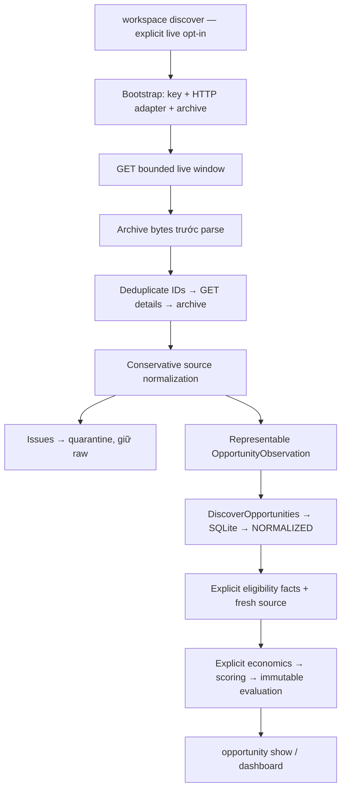

# AgentMine — Phase B.2: Superteam Discovery & Real Bounty Eligibility Audit

## 1. Executive Summary

**Final decision: `BLOCKED_BY_ACCESS_OR_CONTRACT`.**

**Candidate result: `NO_VERIFIED_ELIGIBLE_CANDIDATE` — 0 được xác minh trong audit, không có nghĩa marketplace có 0 cơ hội.**

- Ngày audit: **02/11/2026**, Asia/Bangkok. Mốc audit quan sát: **2026-11-02 11:23:09 UTC / 18:23:09 ICT**; không phải timestamp quan sát listing API.
- AgentMine commit: `fa1928b78f9ea43509501c6a1cb905af0cba426e`, `feat(payment): add provisional offline payment evidence foundation`.
- Repository thực tế: `D:\DNTU\Tuhoc\AgentMine`. Đường dẫn context cũ `D:\DNTU\Tự Học\AgentMine` không còn tồn tại.
- Đã đọc AGENTS.md, Product Constitution, marketplace/Superteam docs, B.1 và mã nguồn liên quan.
- **407 tests passed mới**, 0 failed/errors/skipped. Không dùng kết quả B.1 làm verification mới.

Kết quả xác nhận lại: bounded authenticated GET, raw capture, conservative normalization và stable-ID ingestion đã có. Bounty/hackathon, range/variable và USDC vẫn bị quarantine. Eligibility, economics và scoring có luồng local không cần LLM, nhưng cần operator evidence và representable reward/cost units.

Key `AGENTMINE_SUPERTEAM_API_KEY` **không hiện diện trong process environment**. Chỉ kiểm tra boolean; không đọc `.env`, yêu cầu/in key, tạo key giả hoặc đăng ký account. Vì vậy **không authenticated live discovery**. Official docs/source truy cập được qua web; không chứng minh deployed revision hoặc feed hiện hành.

**Implementation-readiness riêng:** `NEEDS_TARGETED_IMPROVEMENTS / NEEDS_DECISION` cho reward/asset/economic semantics; **BLOCKED** cho candidate/live end-to-end. Không cần tăng AI budget hay đổi SCOUT_ONLY để discovery. Không mở database vận hành cụ thể để xác minh/thay đổi mode/budget; giữ các ràng buộc do operator cung cấp.

Chỉ tạo báo cáo này. B.1 report đã untracked trước audit được giữ nguyên. Không sửa source/tests/config/dependencies/ADRs, không commit/push, không submission/account/wallet/paid-provider call.

## 2. Superteam API Contract Evidence

### Evidence classification

| Nhãn | Bằng chứng | Giới hạn |
|---|---|---|
| O-DOC | Official documentation đọc trong audit | Không phải authenticated response |
| O-SRC | Official SuperteamDAO/earn source trên main | Nhánh mutable/cached, không biết deployed SHA |
| O-PAGE | Official public listing page | Không tự xác nhận machine access/current open/API identity |
| R/T | Current AgentMine source / tests mới | Offline fixtures/fakes không phải live evidence |
| U | Unverified | Không điền bằng suy đoán |

Không dùng community gist/spec, agent comments hoặc search snippets làm contract authority/candidate evidence.

### Verified official surface

| Concern | Evidence |
|---|---|
| Host/auth/restrictions | Canonical host `https://superteam.fun`, bearer agent key. Chỉ AGENT_ALLOWED/AGENT_ONLY cho agent submission. Project cần human Telegram; eligibility questions phải trả lời. Agent không tự OAuth/wallet signing/KYC. Không làm các thao tác đó. [Official agent documentation](https://superteam.fun/earn/agents) |
| Live GET | `/api/agents/listings/live?take=N`: auth wrapper, bare array; default 10/max 50; type bounty/project/hackathon. Source có `excludeIds[]`, không trả next cursor/total; không suy ra stable pagination. [live.ts:14–65](https://raw.githubusercontent.com/SuperteamDAO/earn/main/src/pages/api/agents/listings/live.ts) |
| Visibility | Published, active, non-private/non-archived, allowed agent access, verified sponsor. Sponsor verification không chứng minh payment. [visibility.ts:3–10](https://raw.githubusercontent.com/SuperteamDAO/earn/main/src/features/listings/utils/agentListingVisibility.ts) |
| Deadline | ISO date/datetime; mặc định now, lower bound không lùi về quá khứ. Không thay thế kiểm tra deadline trong AgentMine. [deadline.ts:26–56](https://raw.githubusercontent.com/SuperteamDAO/earn/main/src/features/listings/utils/agentLiveDeadline.ts) |
| Summary | Selector gồm ID/slug, type/status/deadline/access, token/reward/compensation/range/counts. Count không phải success probability. [schema.ts:44–89](https://raw.githubusercontent.com/SuperteamDAO/earn/main/src/features/listings/constants/schema.ts) |
| Detail GET | `/api/agents/listings/details/{slug}`: auth/shared visibility/public selector; object thành công, 404 missing, 500 internal error theo source. Chưa production GET. [detail.ts:12–66](https://raw.githubusercontent.com/SuperteamDAO/earn/main/src/pages/api/agents/listings/details/%5Bslug%5D.ts) |
| Detail fields | Description/requirements, eligibility, skills, region, rewards, compensation/range, sponsor/POC, hackathon context. Không có guarantee về data-file availability hay general submission URL từ selector. [publicListingDetails.ts:1–76](https://raw.githubusercontent.com/SuperteamDAO/earn/main/src/features/listings/constants/publicListingDetails.ts) |
| Reward shapes | Schema có bounty/project/hackathon, fixed/range/variable, token nullable string, rewardAmount nullable Float, rewards nullable JSON. Chưa đủ để diễn giải mọi prize JSON thành payout. [schema.prisma:10–53,1185–1239](https://raw.githubusercontent.com/SuperteamDAO/earn/main/prisma/schema.prisma) |
| USDC example | Official historical Steve Agent Arena page hiển thị pool 500 USDC, prizes 250/150/100. Chỉ minh họa pool khác từng prize; không chọn asset/network cho AgentMine. [Historical listing](https://superteam.fun/earn/listing/steve-agent-arena-launch-your-agent-and-win-500-usdc/) |
| GET rate limit | Chưa xác minh quota discovery/detail riêng; không lấy write quota làm GET quota |

Trang lịch sử hiển thị Winners Announced, timeline kết thúc tháng 10 và bắt buộc trading/on-chain activity ngoài V1. Không thực hiện instructions, không mở submissions tab và không dùng bài của người khác. Không có machine agentAccess trong phần trang đã đọc; không gán AGENT_ALLOWED. Không đưa trang vào candidate set.

### Access/version limitations

`skill.md` và `heartbeat.md` không render vì web tool không hỗ trợ text/markdown; agent specification được đọc trên official `/earn/agents`. Một số raw URLs bị cache miss/unexpected status, sau đó đọc được main live/detail/selectors. Pinned historical SHA trong repository docs không fetch được; không claim revalidate SHA đó.

`master` trả source cũ khác main về validation/detail selection; không dùng làm current deployment contract. Main vẫn mutable/cached. Version 0.5.1 trong fixture provenance là lịch sử repository, không phải version vừa xác minh của production.

**UNKNOWN:** authenticated payload thực tế, complete feed/pagination, settlement identity, approved quote/ask, prize semantics từng listing, asset registry đầy đủ, FX, GET SLA/quota, candidate inputs/output/channel. Không fabricate endpoints hoặc semantics.

## 3. Current Discovery Architecture



| Stage | Actual input/output và failure behavior | Source và test coverage |
|---|---|---|
| Composition | Explicit --live + process key; DisabledOpportunitySource mặc định. Missing config fail trước HTTP, không mock fallback | [operator.py:192](../../src/agentmine/bootstrap/operator.py#L192); workspace/runtime CLI tests |
| HTTP | Route → bytes; fixed origin/two GET patterns, timeout 15s, cap 2 MB. No redirect/retry; safe typed auth/403/404/429/network/HTTP errors | [superteam_http.py:53](../../src/agentmine/infrastructure/marketplaces/superteam_http.py#L53); source/smoke tests |
| Raw | Route/aware timestamp/body → digest ref; archive trước decode. Archive failure stops. Oversized/non-200 không retained thành successful body | [raw_archive.py:16](../../src/agentmine/infrastructure/marketplaces/raw_archive.py#L16), [superteam.py:47](../../src/agentmine/infrastructure/marketplaces/superteam.py#L47); retention/failure tests |
| Discovery | DiscoveryRequest → internal DiscoveryReport, max 50, ID/slug dedup và detail identity match. Conflicts/detail error fail whole returned batch, prior raw retained | [superteam.py:60](../../src/agentmine/infrastructure/marketplaces/superteam.py#L60); duplicate/partial-failure tests |
| Normalization | Detail → NormalizationResult(facts, optional observation, issues, raw ref). Unsupported/unknown quarantine; malformed INVALID_RESPONSE | [normalization.py:143](../../src/agentmine/infrastructure/marketplaces/superteam_normalization.py#L143); normalization tests |
| Ingestion | OpportunityBatch → original observation/aggregate. Namespaced ID; rediscovery không downgrade, identity drift conflict. Không atomic toàn batch | [planning.py:26](../../src/agentmine/application/use_cases/planning.py#L26); source/reopen/use-case tests |
| Lifecycle | Sole workspace ledger checked trước source I/O; DISCOVERED → NORMALIZED; không tự eligible/score/revenue | [workspace.py:48](../../src/agentmine/application/use_cases/workspace.py#L48); workspace tests |
| Eligibility | Facts/profile + fresh status → typed reasons/result. UNKNOWN giữ unknown, blockers thắng review; unavailable fail closed | [eligibility.py:19](../../src/agentmine/application/use_cases/eligibility.py#L19), [rules.py:22](../../src/agentmine/domain/eligibility_rules.py#L22); unit/persistence/operator tests |
| Economics | EconomicInputs → potential × documented subjective probability − four estimated costs. Missing probability/rationale/currency mismatch reject | [economics.py:53](../../src/agentmine/domain/economics.py#L53), [planning.py:79](../../src/agentmine/application/use_cases/planning.py#L79); numerical/use-case tests |
| Score | Policy/signals → components/score/recommendation + EvaluationRecord. Conflicting ID fail; retained-record retry recovery | [scoring.py:104](../../src/agentmine/domain/scoring.py#L104), [planning.py:94](../../src/agentmine/application/use_cases/planning.py#L94); scoring/use-case tests |
| Visibility | Discovery JSON, opportunity show, dashboard; only normalized inventory, no earnings from discovery | [operator_cli.py:335](../../src/agentmine/presentation/operator_cli.py#L335), [runtime_cli.py:192](../../src/agentmine/presentation/runtime_cli.py#L192), [dashboard.py:17](../../src/agentmine/application/use_cases/dashboard.py#L17); CLI/dashboard tests |

Application ports: [services.py:36](../../src/agentmine/application/ports/services.py#L36), [repositories.py:33](../../src/agentmine/application/ports/repositories.py#L33). Infrastructure owns HTTP/SQLite; bootstrap selects adapters. Architecture tests mới kiểm tra dependency direction/cycles.

**Visibility gap:** `.discover()` chỉ trả `.inspect(...).batch`, không đưa structured facts/issues vào Application port. Raw không mất, nhưng CLI `observed` là số observations đã normalize được, không phải raw rows. Toàn window quarantine có thể hiện observed=0. CLI có note giới hạn; chưa có typed durable quarantine index/readback. Existing smoke CLI có summary issues/quarantine, không phải full operator review.

## 4. Normalization & Eligibility Findings

| Case | Current behavior | Safety meaning |
|---|---|---|
| ID/slug | Required safe identity, stable superteam:<id> | Không ID giả; ambiguous mapping fail |
| Missing title/work text | Explicit issue, no observation | Không invent requirements/task type |
| Access | Allowed flags → ALLOWED; HUMAN_ONLY prohibited; new/missing UNKNOWN | Public visibility không phải permission |
| Status/deadline | OPEN/known closed; aware timestamp; winners announced closed | Unknown không thành open/no-deadline |
| project/fixed | Normalize nếu amount/token/fields representable | Potential offer, không guarantee/authorization |
| bounty/hackathon | REWARD_MODEL_UNSUPPORTED | Không pool-as-payout |
| range/variable | REWARD_MODEL_UNSUPPORTED | Không tự chọn min/max/ask |
| USDC | REWARD_ASSET_UNSUPPORTED | Không rename USD |
| Three-letter token | Money syntax chấp nhận nếu còn lại hợp lệ | Không canonical asset/network verification |
| Unknown fields | Full raw preserved | Không automatic semantic mapping |
| Malformed amounts/JSON | INVALID_RESPONSE; negative/nonfinite/duplicate keys rejected | Không coerce/guess |

Evidence: [normalization.py:87](../../src/agentmine/infrastructure/marketplaces/superteam_normalization.py#L87), [normalization.py:122](../../src/agentmine/infrastructure/marketplaces/superteam_normalization.py#L122), [money.py:18](../../src/agentmine/domain/money.py#L18); [normalization tests:30](../../tests/contract/test_superteam_normalization.py#L30), [unsupported tests:75](../../tests/contract/test_superteam_normalization.py#L75).

**Quarantine khác INELIGIBLE:** quarantine có raw/issues nhưng không Domain opportunity decision; INELIGIBLE là kết quả rules từ known blocker. Malformed/read failure không empty success. Full-window marker chỉ là incomplete coverage, không usable next page.

Normalizer không đoán geography/skills/account/identity/physical presence/task/submission/payment/prohibited actions. Full facts không tự tới EligibilityEngine qua OpportunityObservation; operator cần bổ sung evidence.

[EligibilityCheckRequest.refreshed:28](../../src/agentmine/application/contracts/eligibility.py#L28) chỉ refresh open/deadline. [Superteam refresh:105](../../src/agentmine/infrastructure/marketplaces/superteam.py#L105) rechecks access và cung cấp terms hash/requirements. Nó không xác thực mọi caller profile/fact; historical eligibility không thay thế fresh source.

Human resolution chỉ nâng trường hợp duy nhất MANUAL_SUBMISSION_REQUIRED; không approve UNKNOWN/prohibited/closed qua generic override: [Domain resolution:82](../../src/agentmine/domain/eligibility_review.py#L82), [Application resolution:100](../../src/agentmine/application/use_cases/eligibility_review.py#L100). Eligibility và submission approval riêng.

Economics cần potential reward và bốn estimated costs cùng currency; scoring target cùng currency; UNKNOWN signal → WATCH. Score không cấp spending/execution permission: [economics.py:73](../../src/agentmine/domain/economics.py#L73), [scoring.py:113](../../src/agentmine/domain/scoring.py#L113). Chỉ nới token regex không giải quyết cross-asset costs. Không điền p=1/zero costs để tạo candidate score giả; $0 AI không chứng minh mọi cost bằng zero.

## 5. Live Read-Only Discovery Results (if available)

| Mục | Observed result |
|---|---|
| Official docs/source qua web | AVAILABLE, có cache/fetch limits nêu trên |
| Process key presence | False; chỉ boolean, không đọc .env |
| Authenticated agent listing/detail GET | **NOT_RUN — MISSING_PROCESS_API_KEY** |
| Python HTTP egress | Chưa thử; web access không chứng minh process egress |
| New raw API capture / operating-workspace ingestion | Không tạo / không chạy |
| Listing observation timestamps và current agent IDs | Không có |
| Marketplace coverage | UNKNOWN |
| Paid AI/submission/account/wallet calls | 0 |

Không bypass auth bằng public endpoint, tạo account hoặc dùng fake key. Public historical page chỉ là contract illustration, không live candidate. Không có key thì tiếp tục offline theo yêu cầu, không yêu cầu operator gửi secret.

## 6. Verified Candidate Matrix

**`NO_VERIFIED_ELIGIBLE_CANDIDATE`.** Không có candidate thật để chấm. Không invent listing ID, deadline, reward hoặc eligibility.

| Field yêu cầu | Bằng chứng hiện tại |
|---|---|
| ID / official candidate URL | Chưa có authenticated listing observation |
| Type / machine agentAccess | UNKNOWN cho candidate hiện tại |
| Deadline / open status / reward / currency | UNKNOWN |
| Deliverable / input availability / output schema | UNKNOWN |
| Submission channel / account constraints | UNKNOWN |
| DataWorker / ResearchWorker compatibility | Chưa thể chấm cho candidate cụ thể |
| Missing capabilities / risk level | Không gán score/rank cho candidate không có evidence |

Candidate gate: exact ID/slug + observed_at + explicit machine agentAccess + fresh open/deadline + brief/eligibility evidence + lawful input + representable reward/units. Ưu tiên deterministic CSV/JSON nhỏ, không semantic inference, wallet hoặc account mutation.

Capability source hiện tại vẫn compose deterministic Data `llm=None`; Research cần provider và chưa có operational composition tương đương: [local_runtime.py:58](../../src/agentmine/bootstrap/local_runtime.py#L58), [worker_execution.py:197](../../src/agentmine/application/use_cases/worker_execution.py#L197), [research.py:58](../../src/agentmine/application/workers/research.py#L58). Không dùng capability đó để gán eligibility listing thật.

## 7. Adapter Compatibility Matrix

| Official surface / verified local case | AgentMine hiện tại | Gap/decision |
|---|---|---|
| Bounded authenticated GET | Implemented, fixture-tested | Live auth/payload chưa verify |
| ID/slug/detail identity | Guarded | Slug rename conflicts, không alias tự động |
| Access flags | Conservative map + refresh guard | Chưa đầy đủ all eligibility facts |
| Visibility/deadline | Backend source hỗ trợ, application vẫn checks | Không bỏ checks vì endpoint tên live |
| project/fixed/representable reward | Normalize potential | Chưa có real matching listing |
| bounty/prize JSON | Quarantine | Conditional/prize semantics chưa có |
| USDC | Quarantine | Money len(currency)==3; asset/valuation thiếu |
| range/variable | Quarantine | Approved quote/ask semantics thiếu |
| Pagination | Single bounded window, unsupported marker | Không claim completeness |
| New fields/nulls | Raw retained, unknown fail closed | Thiếu operator quarantine readback |
| Malformed/HTTP errors | Typed fail, no partial returned batch | Error/oversized body không captured thành success |
| Raw provenance | Raw ref trong potential reward và original observation | Archive riêng cần giữ cùng workspace; không tự retention guarantee |
| Human approval/handoff | Separate existing approvals | Real manual channel chưa chọn |
| Payment | Không từ discovery | Không mở verifier/PAID ở B.2 |

### Proposed fixes: verified cases, root causes, minimum change, safety và tests

“Failing case” dưới đây là compatibility rejection được tái hiện bằng **passing negative tests**, không phải suite failure hoặc authenticated payload mới.

| Case và root cause | Minimum recommendation | Safety implications / required tests |
|---|---|---|
| Synthetic bounty → REWARD_MODEL_UNSUPPORTED; official source có loại bounty. Normalizer fixed-project-only, Reward single Money | Trước hết typed read-only inspection của unsupported terms; Domain prize semantics chỉ sau candidate contract | Không pool-as-payout. Tests rank/bonus ambiguity, missing reward, no economic execution khi unsupported, raw identity/time |
| Synthetic USDC → REWARD_ASSET_UNSUPPORTED; official historical page có USDC pool. Money currency 3 ký tự, thiếu canonical asset/valuation | Thiết kế asset/quoted reward tách settlement authority, chỉ asset candidate được duyệt | USDC != USD; unknown network/asset; no FX/recipient/obligation giả; no PAID/revenue; currency regressions |
| Synthetic range/variable → quarantine; official enum có các loại này. Thiếu quote binding | Defer nếu first candidate không cần; nếu cần giữ explicit quote + approval | Không tự min/max/ask. Tests absent/reversed range, immutable quote identity và no implicit guarantee |
| Fixture bounty+USDC+future field còn raw nhưng không application observation. `.discover()` bỏ `.items` | Minimal vendor-neutral application inspection DTO/read port, infrastructure projection, thin CLI | Không fabricate Money/Opportunity. Tests nonzero raw/zero normalized, per-ID issues, reopen, unknown fields, read-only/no-budget-side-effects |
| Full fixture window → marker; continuation unsupported. Stable traversal contract thiếu | Giữ incomplete label; thêm traversal chỉ khi verified/approved | No guessed cursor/offset/retry. Tests duplicate/quarantine raw-full window, completeness limits |
| Operator facts/economics chưa có candidate evidence. Discovery không đủ business facts, economics cần prediction | Dùng existing commands sau evidence review; không auto-fill UNKNOWN | Tests unknown block/watch, source drift, narrow MANUAL review, no model/ledger dispatch |

Không đề xuất nới eligibility hoặc tắt freshness check để có output. Với fields tương lai, preserve raw và giữ UNKNOWN cho semantics chưa biết.

## 8. Test Results

### Exact commands thực thi mới

CWD: `D:\DNTU\Tuhoc\AgentMine`. Bytecode/cache disabled; file-backed SQLite trong pytest temp. Không sửa operational workspace. Test process được quyền temp phù hợp.

```powershell
$env:PYTHONDONTWRITEBYTECODE='1'

.\.venv\Scripts\python.exe -B -m pytest tests/contract/test_superteam_normalization.py tests/contract/test_superteam_source.py tests/unit/test_superteam_smoke.py tests/unit/domain/test_eligibility_engine.py tests/unit/application/test_eligibility_use_case.py tests/unit/application/test_eligibility_review.py tests/unit/domain/test_economics_scoring.py tests/integration/test_workspace_bootstrap.py -q --tb=short -p no:cacheprovider

.\.venv\Scripts\python.exe -B -m pytest tests/unit/application/test_use_cases.py tests/unit/application/test_dashboard.py tests/integration/test_runtime_operator_cli.py -q --tb=short -p no:cacheprovider

.\.venv\Scripts\python.exe -B -m pytest tests/unit/test_architecture.py tests/integration/test_eligibility_operator.py tests/integration/test_eligibility_review_persistence.py -q --tb=short -p no:cacheprovider
```

| Nhóm | Passed | Failed / Errors / Skipped | Duration |
|---|---:|---|---|
| Superteam, smoke safeguards, eligibility, economics, workspace | 260 | 0 / 0 / 0 | 5,73s |
| Application orchestration, dashboard, runtime CLI | 69 | 0 / 0 / 0 | 11,46s |
| Architecture, persisted/operator eligibility review | 78 | 0 / 0 / 0 | 18,82s |
| **Tổng, không trùng file test** | **407** | **0 / 0 / 0** | **36,01s tổng pytest duration** |

Không có pytest warnings được báo trong output thành công. 502 tests B.1 và các số lịch sử 6/6, 35/35 không được cộng vào kết quả này.

Safe module commands, cả hai exit 0:

```powershell
.\.venv\Scripts\python.exe -B -m agentmine.bootstrap.operator workspace discover --help
.\.venv\Scripts\python.exe -B -m agentmine.bootstrap.operator opportunity --help
```

Không invoke workspace init/discover --live, smoke --live, evaluate/score trên production database, submission hoặc budget policy apply.

### What tests prove

- [Normalization tests:30](../../tests/contract/test_superteam_normalization.py#L30): exact potential-only/UNKNOWN; unsupported cases là synthetic.
- [Source tests:80](../../tests/contract/test_superteam_source.py#L80): concrete adapter/fake transport, raw/dedup/refresh guards, không live auth.
- [Workspace tests:212](../../tests/integration/test_workspace_bootstrap.py#L212): real SQLite/explicit test source; normalize không tự eligible/score/revenue.
- [Use-case tests:570](../../tests/unit/application/test_use_cases.py#L570): numerical economics/components persisted không AI/ledger; không forecast calibration.
- [CLI tests:284](../../tests/integration/test_runtime_operator_cli.py#L284): eligibility/evaluate/score/plan qua production composition với injected source.
- [Architecture tests:56](../../tests/unit/test_architecture.py#L56): import direction/cycles.
- [Fixture provenance](../../tests/contract/fixtures/superteam/provenance.json): explicitly synthetic, không authenticated recorded samples.
- [Network guard:10](../../tests/conftest.py#L10): automated tests không network.

Không chạy full pytest suite/Ruff/mypy và không claim vừa pass. Live auth, feed completeness, real sponsor acceptance, provider billing và independent settlement vẫn untested.

### Audit-tool limitations

Một lần ghi report bằng command quá dài bị Windows từ chối trước khi process chạy (`os error 206`); sau đó chia làm hai lần ghi cùng file. Không có source/test modification hoặc test failure từ việc này. Các missing-path/read-cache diagnostics trong investigation không được tính là product test failures.

## 9. Prioritized Gaps (P0/P1/P2)

P0 là real-work/candidate gate, không tự là security exploit severity.

| Priority | Gap | Minimum remediation/boundary |
|---|---|---|
| **P0** | Missing process key | Operator tự cấu hình existing secret an toàn nếu muốn live; không gửi key qua chat hoặc đăng ký account hộ |
| **P0** | No current listing evidence | Bounded authenticated read qua existing client; giữ IDs/time/access/details |
| **P0 conditional** | Bounty/prize/asset semantics có thể chặn candidate | Chỉ thiết kế sau candidate contract; giữ quarantine khi chưa representable |
| **P0 real handoff, ngoài B.2** | Production manual channel chưa verified | Separate F03 checkpoint; không dùng OFFLINE_TEST_ONLY làm real authority |
| **P1** | Raw quarantine thiếu operator typed view | Read-only projection; rõ raw != normalized count |
| **P1** | AI access không đủ full eligibility | UNKNOWN không auto-fill; evidence cho skills/profile/channel/requirements |
| **P1** | Reward/cost currency có thể khác | Approved valuation trước economics; no implicit FX hoặc zero cost |
| **P1** | Ingestion không atomic toàn batch, rediscovery giữ original | Reconcile từng record theo existing idempotency; không silently rewrite source history |
| **P2** | Single window, no supported continuation | Incomplete label; không tạo pagination framework |
| **P2** | Cached/mutable official source không deploy proof | Pin approved source + authorized response sau access |
| **P2** | Whole-detail hash có thể block vì metadata thay đổi vô hại | Giữ fail-closed; canonical terms chỉ sau separate design/review |
| **P2** | Research acquisition/composition và synthesis $0 thiếu | Defer, chọn deterministic Data |

Real handoff evidence: [manual_permission.py:12](../../src/agentmine/infrastructure/manual_permission.py#L12), [manual_handoff.py:70](../../src/agentmine/application/use_cases/manual_handoff.py#L70). Không sửa submission/payment trong checkpoint.

## 10. Minimal Implementation Plan

Đây là đề xuất, **không phải authorization implement**.

1. **Access/evidence, không cần code.** Operator cấu hình existing key bằng cơ chế secret an toàn; bounded read-only client với limit nhỏ, preserve raw. Không đổi mode/budget, không .env auto-load. Absence/HTTP errors và unknown coverage phải rõ.
2. **Read-only quarantine visibility.** Nếu unsupported records không vào inventory, thiết kế immutable vendor-neutral inspection contract/read port, adapter projection và thin CLI. Không tạo Money/Opportunity giả để hiển thị. Gate: exact identity/time/digest/issues, zero external/budget effect khi đọc lại.
3. **Một candidate contract decision.** Chọn một listing agent-eligible Data có brief/input hợp pháp. Nếu đã thuộc fixed-project subset thì không sửa normalizer. Nếu bounty/USDC, duyệt conditional reward/asset/valuation design trước, không chỉ relax regex. Defer range/hackathon nếu không cần.
4. **Test-first narrow change sau approval.** Sanitize authorized capture, preserve provenance; unknown semantics block, USDC != USD, no FX/fake revenue, old regressions. Không lưu private metadata vào fixture.
5. **Existing eligibility/economics/score.** Evidence-backed facts/profile/policy; subjective probability có rationale. Fresh source/deadline/access trước work; score không spending/submission approval.
6. **Separate execution/handoff.** Đối chiếu Data input/output và acceptance, immutable scope, real QA/human review. Live channel/submission/payment cần checkpoint riêng; B.2 không triển khai.

Không cần AWS/Bedrock/browser automation/workflow framework/web frontend/autonomous wallet. Không cần tăng budget để đọc discovery/economic state. Target nhỏ nhất: dataset CSV/JSON và transformations hiện hỗ trợ, không mở product scope.

## 11. Final Decision

**`BLOCKED_BY_ACCESS_OR_CONTRACT`**

Official docs/source và offline workflows đã kiểm tra mới, nhưng missing key chặn authenticated current listings. Reward/asset contracts chưa đủ cho một phần official surface. Không có candidate evidence để kết luận nhận việc thật.

**`NO_VERIFIED_ELIGIBLE_CANDIDATE`: 0 verified in this audit; global count UNKNOWN.** Không kết luận marketplace hết việc.

### Separate implementation-readiness assessment

| Scope | Assessment |
|---|---|
| Bounded read-only client/original safety gates | IMPLEMENTED_AND_OFFLINE_TESTED, live chưa verify |
| Representable fixed-project eligibility/economics | Existing workflows; cần real source/facts evidence |
| Bounty/prize/USDC economic execution | NEEDS_DECISION, chưa đủ để nới gate |
| Quarantine diagnostics improvement | READY_TO_DESIGN, cần checkpoint approval |
| First real Data bounty | BLOCKED pending authenticated candidate + contract fit |
| Real submission/verified revenue | OUT_OF_SCOPE / NOT_AUTHORIZED |

**Recommended next action:** operator tự cấu hình existing key an toàn nếu muốn live read, không gửi secret cho assistant. Audit lại bounded authenticated discovery qua adapter hiện có, giữ raw và chọn candidate có explicit access. Không access thì chỉ contract/diagnostic design; không candidate giả, không tăng budget.

### Git status và changes

Audited commit: `fa1928b78f9ea43509501c6a1cb905af0cba426e`.

```text
# Before B.2
?? docs/audits/phase-b1-worker-superteam-readiness-audit.md

# After report creation (verified)
?? docs/audits/phase-b1-worker-superteam-readiness-audit.md
?? docs/audits/phase-b2-superteam-discovery-audit.md
```

B.1 SHA-256 bảo toàn: `1995B68FAFE990B7F7F291C42EB7E21E735B103D6B68FB69A2D61C41B07381E6`. Chỉ B.2 report được tạo trong checkpoint; tracked diff rỗng. Không commit/push.
