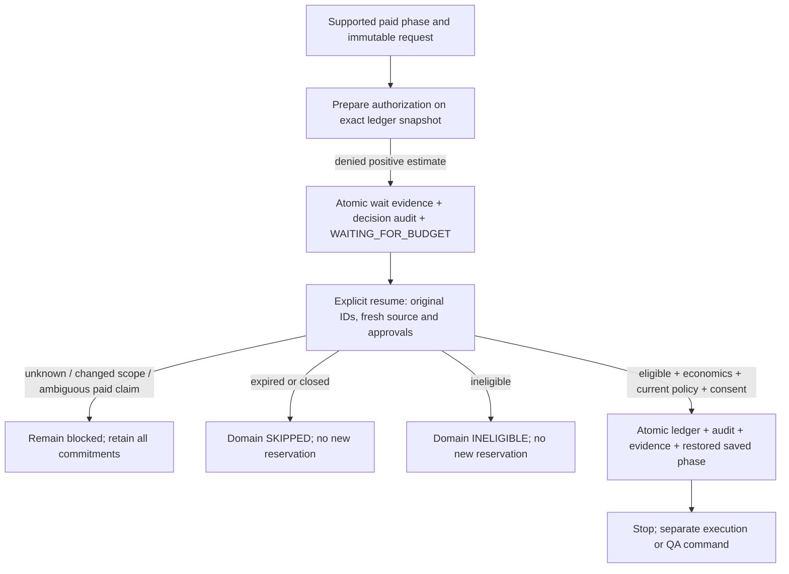

# F02-B4-A: Budget resume and recovery architecture review

Date: 2026-10-26 (Asia/Bangkok). **DESIGN ONLY. Verdict: NEEDS_DECISION.**
No production code, tests, existing ADRs or architecture were changed. No commit,
push, paid operation, external submission or AWS deployment. B4 implementation has
not started. Proposed names and commands below are not currently implemented.

The smallest useful next checkpoint is budget inspection plus explicitly approved,
audited policy/mode changes, preserving existing deterministic Data recovery.
Production paid wait/resume cannot honestly be demonstrated by the current local
runtime: its only execution capability requests exactly zero AI cost. Do not add a
positive-cost provider, falsify estimates or manufacture a waiting transition to
meet a milestone. Operator approval is required for the scope split in section 11.

## 1. Current implementation inventory

Reviewed AGENTS.md, Product Constitution, the approved
[F02-A plan](remediation-03-runtime-plan.md),
[B1](remediation-03-b1-runtime-foundation.md),
[B2](remediation-03-b2-data-execution.md),
[B3-A](remediation-03-b3a-operator-cli.md),
[B3-B](remediation-03-b3b-operational-qa.md), the full audit's F02/F03/F05/F06/F07/F08
findings, and ADRs 0002, 0009, 0013, 0023 through 0026. Source inspection takes
precedence over historical milestone wording.

Paths in the inventory are relative to `src/agentmine/`.

| Authority | Current behavior | Relevant source |
| --- | --- | --- |
| BudgetPolicy | Nonnegative monthly/daily AI limits, all-category task ceiling, human threshold; Decimal saver ratios; aware calendar timezone; common currency | `domain/budget.py:BudgetPolicy` |
| Budget history | Immutable authorizations, actual records and released operation IDs; outstanding excludes recorded/released operations | `domain/budget.py:Budget` |
| Reservations/commitments | Outstanding authorizations are the reservations; no separate reservation balance or TTL. They carry across periods, including zero-cost reservations | `Budget.outstanding`, `_total` |
| Periods/modes | Daily/monthly actual AI costs use configured local calendar; all outstanding estimates count in both periods. Task totals never reset. Requested mode restricts derived FULL/SAVER/SCOUT_ONLY | `Budget.operating_mode` |
| Categories | Daily/monthly ceilings measure AI; task ceiling includes all categories. SCOUT_ONLY denies new positive-cost operations in any category, allows zero | `Budget.authorize` |
| Authorization | New operation checks mode, caps, saver restriction and threshold. Same operation returns original authorization when scope/estimate match; settled/released IDs cannot be reused | `Budget.authorize`, `domain/spending.py` |
| Consent | BudgetManager validates a persisted SPENDING review/APPROVE if a reference is supplied; rechecks a newly lowered threshold for an already-reserved operation | `application/budget_manager.py`, `approval_guard.py` |
| Accounting | Domain records observed actuals even when unauthorized/over estimate, emitting issues rather than hiding cost. Duplicate records require exact cost and context, including timestamp | `Budget.record`, `CostRecord` |
| Ledger persistence | One budget snapshot/revision; CAS budget write and `budget_audit` entry in one transaction, keyed by ledger/revision. History includes unchanged decisions, init and policy/release-only commits | `infrastructure/sqlite/ledger.py` |
| Audit contract | BudgetCommit carries ledger, expected revision, snapshot and AuthorizationDecision/CostRecording/None. It has no policy-change actor, reason or immutable change ID | `application/contracts/records.py` |
| Workspace | Single authoritative selected ledger; initialize repeats matching policy/mode only, otherwise conflicts. Initialization is not a policy reset | `use_cases/workspace.py`, `bootstrap/operator.py` |
| Runtime | Frozen approved WorkSpecification/ExecutionBinding; atomic first-run owner/start and result/finish persistence. Start checks exact Opportunity and Budget snapshots but does not authorize | `contracts/runtime.py`, `ports/runtime.py`, `sqlite/runtime.py` |
| Data accounting | Real deterministic DataResult retains an explicit zero-AI measurement before recording; infrastructure cost remains unmeasured. Result recovery repairs the same record then finishes | `workers/data.py`, `use_cases/worker_execution.py` |
| QA | Deterministic QA configured with neither LLM nor budget; immutable inspection owner, retained report and atomic conditional application. No paid reservation or implicit submission | `use_cases/operational_qa.py`, `sqlite/operational_qa.py` |
| Paid journals | Data AI claims/responses, Research claims/observations/responses, legacy work request/response; Bedrock has a separate SQLite LLMJournal with sticky fingerprint claims/usage metadata | `sqlite/data.py`, `sqlite/research.py`, `sqlite/executions.py`, `infrastructure/llm/journal.py` |
| CLI | dashboard, workspace, opportunity assessment, work prepare/show/execute/recover/status/export/qa; existing eligibility/submission review commands. No budget policy, spending-review preparation or task-resume command | `presentation/operator_cli.py`, `runtime_cli.py` |

`BudgetManager.authorize` commits an audit even for denial or identical outstanding
authorization readback; ledger revision can therefore advance without new money.
Never infer a new charge from revision count. `BudgetManager.record` returns
identical recorded evidence without a new commit. Domain permits a truthful actual
record without authorization; that is accounting of an incident, not permission
to dispatch an operation.

### WAITING_FOR_BUDGET reachability

| Capability | Real local CLI support | Can it naturally enter budget wait? |
| --- | --- | --- |
| Deterministic DATA_PROCESSING, llm=None | Yes, first version only | **No.** Coordinator authorizes zero; nonnegative limits/threshold allow it even in SCOUT_ONLY. Artificial denial tests only verify blocked handling |
| Deterministic operational QA | Yes | **No.** No paid QA budget/provider; semantic criteria yield human-review pending, not invented budget denial |
| Free ingestion/normalization/eligibility/scoring/status | Yes within existing source/configuration boundaries | No paid wait; remain available when AI budget is exhausted |
| ResearchWorker | Application worker exists; no local operational composition/tool capability | Tool denial raises typed UNRESOLVED without exposing its decision; no coordinator persists a mid-worker wait |
| Semantic Data / AI QA / Bedrock | Existing components, deliberately absent from local runtime | Individual paid authorization can fail, but operational wait/resume is unavailable |
| Legacy ExecuteTask | Application use case; not current Data CLI dispatcher | Positive estimate DENIED can call Opportunity.wait_for_budget, then separately save Opportunity. It is not safe new runtime wait/resume composition |
| Domain / synthetic E2E | Pure rules / test-only composition | Yes for positive paid requests. E2E commits ledger and Opportunity separately; not proof of atomic operational resume |

Missing provider, unknown source, missing consent and REQUIRES_HUMAN_APPROVAL are
not budget exhaustion. Domain requires an actual DENIED positive-cost decision
matching task/opportunity/phase. Existing waiting records must be inspectable;
their existence does not make them compatible with deterministic Data execution.

## 2. Confirmed gaps versus F02-A

1. No operator policy/mode update or detailed outstanding-operation/history view.
   Existing audit captures snapshots but not explicit approval of a policy delta.
2. No application resume coordinator or atomic Opportunity/ledger/evidence commit.
   Calling BudgetManager.authorize and subsequently saving a Domain resume result
   could overwrite a newer ledger or leave an orphan reservation.
3. No operational paid-denial wait record binding the original specification,
   execution/operation/deliverable IDs and exact source/eligibility/economic evidence.
   Legacy waiting_request stores operation/task/opportunity, not the full binding;
   a denied legacy request need not have a durable work_request at all.
4. Current B1 start deliberately accepts only zero AI authorization, and B2
   preflight requires zero estimated AI economics. A legacy positive-cost wait
   cannot be adopted by setting llm=None or replacing its execution ID.
5. Domain resume clears structured economic/scoring assessments and changes Task
   wait/deadline fields. B2 requires exact immutable Task/spec/plan and complete
   assessment equality. Scalar score/expected value from resume cannot satisfy it.
6. Domain resume calls Budget.authorize directly. A bare human approval reference
   is not persisted consent. Repeated authorization also retains old policy/mode;
   its existing-operation branch does not reapply every new task/SAVER restriction.
   BudgetManager adds threshold enforcement, but not a comprehensive fresh paid
   dispatch policy check. This is a paid-resume design gap, not a zero-Data exploit.
7. F04 review preparation does not target WAITING_FOR_BUDGET; historical MANUAL
   resolution is not new waiting-context consent. Keep that resume unavailable.
8. Sticky uncertain paid claims and abandoned reservations have no operator
   reconciliation/release workflow. F08 remains open; B4 must not clear them.

## 3. State and transaction diagrams

Current supported local path (no new state machine):

```mermaid
stateDiagram-v2
    PLANNED --> IN_PROGRESS: preflight + zero authorization + atomic start
    IN_PROGRESS --> IN_PROGRESS: same-ID deterministic recovery / no result
    IN_PROGRESS --> QA_PENDING: actual result + accounting + atomic finish
    QA_PENDING --> READY_FOR_HUMAN_REVIEW: deterministic QA PASS
    QA_PENDING --> QA_PENDING: human QA required
    QA_PENDING --> IN_PROGRESS: FAIL / NEEDS_REVISION; F05 blocks replay
    READY_FOR_HUMAN_REVIEW --> APPROVED_FOR_SUBMISSION: separate operator decision
```



Future guarded paid wait/resume, **not enabled by this proposal's first checkpoint**:



Policy update transaction proposed for the first implementation checkpoint:

```mermaid
sequenceDiagram
    participant O as Operator CLI
    participant U as Application use case
    participant D as Domain Budget
    participant S as Shared SQLite authority
    O->>U: prepare(change ID, expected revision, proposed policy/mode, reason)
    U->>S: load ledger; retain immutable reviewed delta
    U-->>O: before/after, commitments, projected mode, warnings, change ID
    O->>U: apply(change ID, explicit confirm)
    U->>S: load change and authoritative ledger
    U->>D: with_policy / with_requested_mode preserving history
    U->>S: atomic CAS budget + budget_audit + actor decision + applied receipt
    S-->>U: committed original receipt or typed conflict
    U-->>O: applied/readback; never dispatch
```

Short BEGIN IMMEDIATE transactions; no source/provider/filesystem call under lock.
Same-ID readback happens before rejecting an old expected revision, but only if the
immutable command matches the original receipt. Never reapply a historical policy
over newer changes. Authorization/start and actual-cost/finish are deliberately
separate existing transactions; a design must account for the gaps, not label them
one distributed transaction.

## 4. Authorization, commitment and settlement invariants

Existing rules to preserve, plus explicit obligations for future paid support:

- One authoritative workspace/ledger, explicit currency and calendar; no new ledger
  or workspace initialization to reset limits. All changes compare full snapshots
  and expected revisions. Conflicts require reread, never last-write-wins.
- Estimates are commitments, actuals are measurements. Outstanding commitments
  survive midnight/month boundaries, policy changes, cancellation, outages and
  timeouts until truthful settlement or separately authorized F08 reconciliation.
- Operation identity includes operation type, task, opportunity, category,
  estimate and scoped approval. Same execution/operation/spec/deliverable IDs on
  retry. A new execution ID cannot evade an existing commitment or first-run owner.
- Authorize before dispatch; persist dispatch ownership before any paid effect.
  Never repeat a claimed paid action with missing/unknown response/usage.
- No duplicate authorization on retries: same operation returns its original
  commitment; no duplicate actual: exact original cost/context/time is idempotent.
  Scope, timestamp, currency, estimate or amount disagreement is a conflict, not an
  invitation to choose a new ID or replace recorded actuals.
- Current threshold and persisted spending consent apply before paid dispatch,
  including after a lowered threshold. Approval never overrides caps/mode, never
  authorizes different inputs and never implies external-submission approval.
- Future paid resume must enforce current task/SAVER/daily/monthly rules for the
  existing commitment without counting it twice. Do not call authorize for a new ID
  or release/recreate it to force that calculation. Policy changes cannot cancel
  an already issued provider request; actual usage still must be recorded.
- Record observed overruns and unauthorized expenses with issues. Never truncate
  actuals to the estimate/limit, reject incurred cost merely because funding fell,
  or silently forgive unknown usage. Negative remaining budget is visible.
- Deterministic Data records zero **AI** cost from its real retained result.
  Missing cost or unknown infrastructure/tool/transaction cost remains unknown.
  Partial usage on a paid operation is not a complete settlement; B4 must not feed
  it to Budget.record as a final actual and thereby discard the residual unknown.
- No B4 release/delete/reset, including for expiry, rejected QA or stale terms.
  State cancellation is not proof that an earlier external operation cost zero.
- Resume only restores the saved phase through Domain methods; never dispatches,
  grants eligibility, approves spending/submission, or creates verified revenue.

## 5. Crash and retry matrix

| Checkpoint | Current evidence / required safe response |
| --- | --- |
| Source unavailable / stale terms before work | No new work; typed source block, retain plan/ledger. Current B2 behavior |
| Authorization commit fails or acknowledgement is lost | Read original operation and ledger history; no dispatch based on uncertain acknowledgement. No new ID |
| Reservation exists, runtime start absent | Preserve it. Original binding may retry after preflight; different ID must not adopt it. No cleanup release |
| Start committed, acknowledgement lost | Reopen/inspect original run; original call does no work after failure |
| Start exists, deterministic result missing | Same frozen deterministic replay only, current preflight and existing authorization checks; no paid claims permitted |
| Worker failed midway | Retain start and costs; identical deterministic replay permitted; paid/tool claim with unknown outcome blocks |
| Data result committed, cost commit failed | Recover exact result cost/context/time; idempotent record, no work/provider call |
| Actual committed, finish failed | Same retained result and atomic finish; already recorded actual is not charged again |
| Finish or QA applied, later lifecycle advanced | Historical same-ID readback only; do not rewind approval/revision state |
| Paid response absent / invalid / usage missing | Retain claim and commitment even if content invalid. Known costs remain recorded. F08 reconciliation; never assume free/no effect |
| Prepared policy persisted, apply absent | No policy change; inspect/explicitly apply same change if expected ledger is still exact |
| Policy commit fails at any write | Whole budget/audit/decision/receipt transaction rolls back; no partially approved policy |
| Policy commit succeeds, response lost | Original change-ID receipt readback; do not apply again or overwrite subsequent policy |
| Ledger changes between preview and apply | Stale proposal blocked even if only an authorization audit advanced the revision; prepare a new reviewed delta |
| Two policy changes race | One CAS winner; loser unchanged. Identical same-ID apply is readback, conflicting payload is rejected |
| Future wait/resume fails mid-commit | All Opportunity/ledger/audit/binding/evidence/receipt writes roll back together |
| Future resume committed, acknowledgement lost | Read immutable resume receipt; never reauthorize or dispatch. Later execution is explicit |
| Expired/closed/ineligible while waiting | Fresh authoritative observation, Domain terminal path, retain any pre-existing commitments. Unknown availability stays waiting |

SQLite unavailable/commit ambiguity is not evidence of a provider outcome. An
inspect/recover command must return typed PERSISTENCE_UNAVAILABLE, STATE_CONFLICT,
RECONCILIATION_REQUIRED or equivalent enums, never parse exception text.

## 6. Operator approval and policy-change boundaries

Use one configured local operator; no second role, IAM system or self-approving
background task. A policy proposal is not an approval. Require explicit apply
confirmation bound to its exact change ID and displayed delta. Persist actor,
prepared/approved timestamps, nonempty bounded reason, original ledger revision,
old/new policy and requested mode, plus resulting revision. Preparing/applying must
not alter authorizations, actual records, released IDs, Opportunity state or IDs.

Recommend allowing numeric policy limits/threshold/saver ratios and requested mode
changes, validated by existing Domain rules. Freeze currency and calendar timezone
in B4: changing them would reclassify historical costs/periods and needs a separate
accounting migration decision. Lowering limits below commitments is allowed with
explicit warning and visible negative remaining; it neither erases liabilities nor
asserts all previously authorized paid work still qualifies. FULL requested mode
does not force derived FULL when actual budget is constrained.

Store policy consent in an application-owned change record, not a new Domain
financial action or an EXTERNAL_SUBMISSION/SPENDING review. BudgetPolicy approval
is authority to change limits, **not** a purchase or approval for a specific task.
Reuse existing ApprovalScope.SPENDING, PrepareOperatorReview, DecideOperatorReview
and ApprovalGuard for any future scoped paid request. Current show-review/decide
already understand retained spending scopes; the missing CLI preparation must
derive one from a supported authoritative request, not arbitrary caller amounts.
There is no such paid request in today's deterministic runtime, so do not add a
free-form spending-consent command in the first checkpoint.

Keep input/scope approval, F04 eligibility resolution, spending approval and
submission approval distinct. New MANUAL waiting consent requires a separately
approved waiting-context F04 contract; historical APPROVE is not permanent permission.

## 7. Proposed minimal changes

### Checkpoint B4-1: useful now, after scope approval

Application contracts (proposed `contracts/budget_recovery.py`):

- BudgetRecoveryView: ledger snapshot/revision/time, requested/derived mode,
  limits, actual/committed/remaining AI, outstanding operation scopes, known actuals,
  linked existing run/wait evidence and explicit unknown/unlinked classifications.
  A missing ledger/evidence is not a zero result or proof of no external effects.
- BudgetPolicyChange: immutable ID, actor/time/reason, original revision/policy/mode,
  proposed policy/mode. No serialized Budget supplied by the operator.
- BudgetPolicyChangeReceipt: same change, applying actor/time and resulting revision.
  An unchanged-policy confirmation is a no-op receipt, not a budget reset.

Use cases: InspectBudgetRecovery, PrepareBudgetPolicyChange,
ApplyBudgetPolicyChange. Reuse Budget.with_policy/with_requested_mode and existing
BudgetCommit. Keep its audit-event union and old snapshots compatible; a narrow
BudgetControlRepository port atomically stores change/receipt with the existing
budget and budget_audit rows. Its SQLite adapter must compare the full retained
change and current ledger, preserve all history, and reject mismatches. No generic
UnitOfWork, accounting ledger duplicate, database migration or framework.

Proposed CLI under existing `--db`/`--ledger`:

| Command | Responsibility |
| --- | --- |
| `budget show` | Show live ledger revision, modes, limits, spent/reserved/remaining, outstanding operations and recovery classification; read only |
| `budget policy prepare --change-id ID --inputs FILE --expected-revision N --reason TEXT` | Strict bounded policy/mode input; retain and display exact delta, no effect on limits |
| `budget policy show --change-id ID` | Show proposal/receipt, history links and stale status without renewing consent |
| `budget policy apply --change-id ID --confirm` | Explicit configured actor, atomic apply or original receipt readback; no automatic resume |

`budget show` can report that a paid/legacy wait is UNSUPPORTED_CAPABILITY or
RECONCILIATION_REQUIRED. Do not add an apparently functional `task resume` that
merely rejects everything, or alter deterministic work to generate a wait.
Continue using `work recover --execution-id ID --confirm` for supported Data;
budget restoration does not execute it automatically. No provider/MockLLM wiring.

Likely implementation files, subject to approved tests first: new application
contracts/port/use-case files for budget control, one SQLite adapter, one small
budget CLI module, explicit bootstrap/operator wiring, snapshot allowlist, focused
unit/integration tests, operator guide and implementation report. No Domain change
is needed for B4-1. Keep current worker/QA use cases and their contracts unchanged.

### Checkpoint B4-2: guarded resume design; unavailable until capability approval

Do not implement this as dormant machinery in B4-1. Before enabling paid runtime,
approve the following focused additions with its worker capability:

1. Immutable BudgetWaitBinding links denied request/phase to original approved
   scope and execution/operation/deliverable IDs, ledger and expected revisions.
   Atomic enter-wait stores the denied audit, wait evidence and Domain transition.
   A legacy wait lacking this evidence is inspect-only, not auto-adopted.
2. ResumeBudgetTask request supplies stable resume ID, expected Opportunity/ledger
   revisions and references to fresh reviewed facts/economics/consent. It does not
   supply authorization, result or a replacement execution ID. Keep repeated denied
   attempts auditable; a later explicit attempt can use a new resume-attempt ID but
   **must retain the same execution/operation** and all commitments.
3. Use observe_status (not refresh alone) so fresh closed/expired observations can
   reach Domain cancellation. Require known open/deadline, source identity/version/
   requirements, current facts/profile/policy, time remaining, current reward/cost
   assumptions and recomputed scoring components. Unknown/review-required remains
   waiting. Changed scope/inputs/cost/provider requires renewed reviewed scope,
   never mutation of the frozen plan. Default MANUAL resume remains unavailable.
4. Extract side-effect-free BudgetManager decision preparation shared with authorize;
   validate scoped ApprovalGuard consent and current threshold on the same snapshot.
   Define/test current-policy checks for existing paid reservations; if Domain resume
   and application decision disagree, fail closed. Any correction of Domain's
   existing-reservation policy semantics needs focused ADR/tests, not repository logic.
5. Retain full fresh economic/scoring assessments and source/eligibility evidence in
   an immutable resume record. Approve a narrow new resumed-context contract consumed
   by future runtime preflight without overwriting the original spec/Execution/plan.
   Domain resume clears structured fields and changes Task; B2 equality checks must
   not be weakened to accept scalar evidence or silently replaced Task objects.
6. Atomic resume commit checks wait binding, Opportunity/ledger snapshots, applicable
   recorded approval and original IDs; writes result.budget, budget_audit, Domain
   Opportunity, complete assessment evidence and original-ID receipt together.
   No prior committing BudgetManager.authorize followed by a second ledger write.
7. Restore saved phase only, no execution. Existing IN_PROGRESS/QA_PENDING paid
   checkpoints require typed worker denials and resumable suboperation identities.
   Sticky tool/model claims with unknown outcomes remain F08-blocked even when
   funding is restored. Spending review and actual settlement remain separate.

Future CLI, only when a supported waiting capability exists:
`task resume --opportunity ID --resume-id ID --revalidation FILE
--expected-opportunity-revision N --expected-ledger-revision N --confirm` and
`budget review-spend` deriving the existing SPENDING scope. Resume needs explicit
source selection and never uses saved observations as fresh remote evidence.
Infrastructure implements atomic ports; Application/Domain import no SQLite/AWS.

## 8. Acceptance tests

Write failing acceptance tests before each implementation checkpoint. All tests
are offline; any source/clock/paid-request fixtures are explicitly test-only.

### B4-1 gates

1. Real SQLite policy prepare/show/apply/reopen; exact actor/reason/delta/revisions
   and audit/receipt retained. Confirm is required; prepare/show spend nothing.
2. Every numeric policy field and mode validated; invalid ratios, negative/mixed
   currency, unknown fields and timezone/currency changes fail with no ledger change.
3. Outstanding authorizations, all actual records and released IDs byte/value-equal
   before/after policy changes, including unknown positive commitments and measured
   zero Data cost. Unmeasured infrastructure remains unknown.
4. Increasing limits requires explicit approval; no automatic restoration. Lowered
   limits preserve liabilities and show constrained mode/negative remaining. Rollover
   respects timezone and carries outstanding commitments/task totals unchanged.
5. Stale revision, same-ID conflicting input, two competing applies, identical
   concurrent apply, failure after every transaction write and lost acknowledgement.
   Retry returns original receipt even after later policy changes; no second update.
6. Real DataWorker still executes zero-cost work in SCOUT_ONLY, with the same
   preflight and identities. Missing source/approval/economics still blocks. No
   synthetic WAITING_FOR_BUDGET and no paid provider fallback.
7. Existing worker result-before-accounting/finish recovery, cost deduplication,
   runtime owner collisions, QA state/readback and CLI compatibility remain intact.
8. Budget inspection of missing/unlinked/corrupt evidence fails or flags unknown;
   it cannot infer a free operation, release a reservation, submit, or create revenue.
9. Architecture tests, full pytest, Ruff, format, strict mypy and diff checks.

### Future B4-2 gates, not claimed by zero-Data tests

Use real SQLite and pure Domain decisions against explicitly synthetic positive
requests, never a fake production provider. Test atomic wait/resume rollback at
each write; still-denied resume; restored budget; expiry/closed/ineligible;
UNKNOWN/MANUAL review block; changed terms/input/economic scope; refreshed complete
assessment compatibility; lowered threshold and task/SAVER caps; missing/rejected/
wrong-scope consent; unchanged original IDs; duplicate resume/settlement; concurrent
policy/resume/accounting; crash/receipt recovery; sticky paid claims; partial/unknown
actuals; no dispatch/submission/revenue. These prove contracts, not operational paid
support. A real worker checkpoint still needs its own approved capability tests.

### Evidence executed for this review

Ran existing tests without editing production or tests:

```powershell
.\.venv\Scripts\python.exe -m pytest tests/unit/domain/test_budget.py tests/unit/domain/test_budget_resume.py tests/integration/test_worker_execution_runtime.py tests/e2e/test_local_agentmine.py tests/unit/test_architecture.py -q --tb=short -p no:cacheprovider
```

Result: **130 passed in 19.25s**, exit 0. This covers existing Domain budget/resume,
real deterministic Data orchestration/recovery, synthetic E2E wait branches and
architecture; it does not validate the proposed policy/resume implementation.
No live calls or paid effects. No full-suite/static rerun is claimed for this
documentation-only checkpoint. `git diff --check` is the final document check.

## 9. Scope exclusions and remediation ownership

| Deferred area | Owner / boundary |
| --- | --- |
| Positive-cost Research, semantic Data, Bedrock and AI QA runtime | Separately approved F02-C/capability checkpoint; no provider invented in B4 |
| Real submission receipts, outcome/payment proof, independent settlement | F03; accepted/potential reward never becomes verified revenue through budget restoration |
| Revised deliverable execution, changed approved scope, v2 | F05; no fresh execution ID to bypass first-run ownership or failed QA |
| AWS deployment/shared paid journals and archive | F06; local SQLite plan does not solve cross-instance ownership |
| Changed source terms and profile authenticity | F07 remains relevant; exact source binding/preflight is preserved, not universal authenticity proof |
| Abandoned reservation release, provider billing reconciliation, unknown/partial usage, backup/restore across stores | F08, and F09 economic completeness; no release command or manual SQL workaround |
| Fresh waiting-context MANUAL eligibility review | Separate narrow F04 extension if approved; no historical approval reuse |
| Multi-user roles, wallets, scheduler/framework, frontend | Outside this checkpoint/V1 boundaries |

## 10. Implementation checkpoints and risks

1. **Operator scope decision first.** Approve the useful B4-1 slice and deferred
   paid resume, or explicitly authorize a different capability checkpoint. Do not
   mark the full F02-A wait/resume objective complete from B4-1 alone.
2. B4-1 acceptance tests, immutable contracts and consistency port; atomic SQLite
   policy/audit/receipt implementation; fault injection before CLI wiring.
3. Thin CLI and explicit DI on the same authoritative database/ledger. Documentation
   and full checks; stop for review. A focused implementation ADR should record
   policy approval/atomicity and the currency/calendar freeze if approved.
4. Future capability checkpoint defines durable paid wait/suboperation ownership
   and runtime-compatible fresh evidence before implementing B4-2 resume. Test-only
   contracts do not constitute permission to deploy or use a paid provider.
5. F08 handles reconciliation before blocked paid claims can progress. F03/F05/F06
   gates remain independent; no automatic cross-remediation completion.

Risks: the local operator/store remains trusted; stored hashes are not authentication.
Ledger audit rewrites full snapshots and may grow; no compaction is proposed.
Concurrent read-only refresh does not lock remote terms. Policy changes can constrain
future dispatch but cannot reverse in-flight expense. Current same-operation
authorization policy semantics must be settled before enabling paid resume.
No claim of complete infrastructure cost, billing reconciliation or production
readiness follows from these tests.

## 11. Decisions and verdict

**NEEDS_DECISION** for F02-B4 as a whole. B4-1 has a bounded design ready for
implementation after operator review; full paid resume remains unavailable.

Operator decisions required before implementation:

1. Approve B4-1 as inspection + immutable policy preparation/explicit application,
   preserving deterministic Data recovery; defer paid resume to its actual worker
   capability rather than manufacture a positive-cost path. Record F02-A resume as
   incomplete, not silently removed from the roadmap.
2. Approve policy-change consent as a distinct application audit record and atomic
   budget/audit/receipt commit, with one trusted operator and no automatic changes.
3. Approve currency/calendar immutability in this checkpoint; allow validated
   numeric/mode changes with preserved commitments and visible overcommit warnings.
4. Confirm inspect-only treatment of incompatible legacy waits, MANUAL waiting
   reviews and ambiguous paid outcomes until their explicit remediation contracts
   exist. No adoption, claim release, fresh-ID workaround or fabricated zero cost.

No credentials or operator action were needed for the review's offline tests.
Stop here for operator review. Do not implement B4 in this checkpoint.
