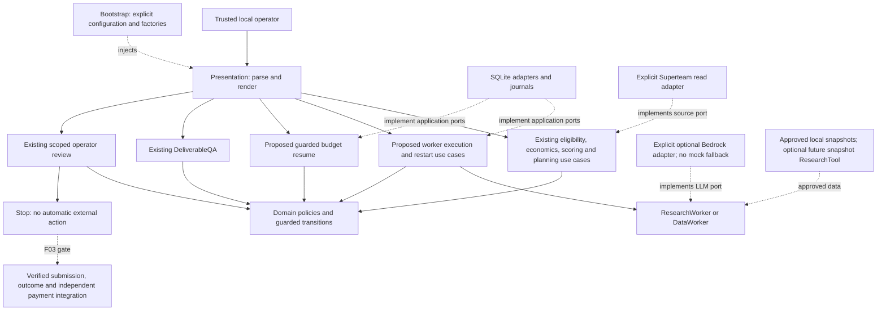

# F02-A: Local operational runtime architecture plan

Date: 2026-10-25 (Asia/Bangkok). **Design proposal, awaiting operator review.**
This document does not implement F02-B/F02-C or change an accepted ADR. F02 remains
open. F01 and F04 are resolved within their documented boundaries; F03 and F05
remain blockers for real settlement and revision execution respectively.

Recommendation: extend the existing single-operator CLI with explicit application
steps. First ship deterministic Data work on approved local snapshots through QA
and human review. Then add bounded Research/optional semantic assistance with
explicit real-provider selection and conservative checkpoint recovery. Stop before
external submission/settlement where no verified adapter/procedure exists. Do not
turn the test E2E composition into a production runner.

## 1. Current runtime inventory

Paths in this report are relative to the repository root. Inventory reflects source
inspection, not the historical milestone claims alone.

| Boundary | Current implementation and evidence | Operational limit |
| --- | --- | --- |
| Default entry point | `pyproject.toml` maps `agentmine` to `bootstrap/main.py`; it only loads validated Settings | It does not run work or compose workers |
| Local operator root | `bootstrap/operator.py:compose_operator/main`, `presentation/operator_cli.py` | Existing module entry point is usable; no background scheduler, execution or settlement commands |
| Workspace | `InitializeWorkspace`, `LoadWorkspaceOpportunities` in `application/use_cases/workspace.py` | Init requires explicit policy and one ledger; ingestion invokes discover/normalize only |
| Source | `infrastructure/marketplaces/superteam.py`, `superteam_http.py`, `raw_archive.py` | Explicit authenticated, bounded read path; no verified live run evidenced here; no complete pagination; unsupported rewards quarantine |
| Offline source | `DisabledOpportunitySource`; Algora/Opire deferred adapters | Fail closed; they are not substitute sources or synthetic opportunities |
| Planning | `planning.py`: DiscoverOpportunities, NormalizeOpportunity, EvaluateOpportunity, ScoreOpportunity, PlanTask | Explicit DI and typed economic/signals/policy inputs; most steps lack operator commands |
| Eligibility | `eligibility.py:CheckEligibility.inspect/execute`; `eligibility_review.py` prepare/get/resolve | F04 now resolves only an otherwise eligible MANUAL condition; assertions still require operator evidence |
| Existing execution use case | `application/use_cases/execution.py:ExecuteTask` | Direct `LLMProvider.perform_work`, not ResearchWorker/DataWorker dispatch; cannot serve as the operational worker coordinator unchanged |
| Research capability | `application/workers/research.py`, `contracts/research.py`, `ports/workers.py` | Real worker orchestration; no shipped concrete ResearchTool; requires an LLM; journals claims/observations/responses, not a final ResearchResult |
| Data capability | `application/workers/data.py`, `contracts/data.py`, `ports/data.py` | Runs real deterministic CSV/JSON processing with `llm=None`; semantic fields require a configured LLM; no live collection adapter |
| QA | `use_cases/deliverable_qa.py:DeliverableQA`, `contracts/qa.py`, `SQLiteQAJournal` | Needs exact worker plan/result and trusted acceptance criteria; PASS means READY_FOR_HUMAN_REVIEW |
| Approval | `use_cases/operator.py`, `ApprovalGuard`, `SQLiteApprovalRepository` | Version/content/destination-bound local operator consent; spending and submission scopes differ; CLI creates submission reviews, not spending reviews |
| Budget | `BudgetManager`, `domain/budget.py`, `domain/spending.py` | Authorizes before dispatch and records actual costs separately; no operator policy-update/resume coordinator |
| Persistence | `bootstrap/local.py:open_local_repositories` | Composes opportunity/evaluation/execution/submission/ledger/eligibility-review repositories, not all worker/QA/approval dependencies |
| Journals | SQLite Research/Data/QA adapters; separate `infrastructure/llm/journal.py:LLMJournal` and RawArchive | Durable local stores; worker plans are write-only through their ports; no unified operational run inspection or restart command |
| Submission | `settlement.py:SubmitTask`, `manual_submission.py:RecordManualSubmission` | F01 atomic API intent exists; MANUAL packaging/receipt logic exists; no concrete real SubmissionGateway |
| Outcome/payment | `TrackOutcome`, `VerifyPayment`, metrics/history use cases | No real outcome gateway or independent PaymentVerifier; typed proof validation is not proof authentication |
| E2E | `tests/e2e/local_flow.py`, `test_local_agentmine.py` | Manually composes lifecycle, workers, bundle/QA and resume with fake sources/model/gateway/verifier; not an operational entry point |
| Cloud | Existing DynamoDB and Lambda composition; Bedrock optional adapter | Unneeded for this local plan; shared cloud journals/deployment remain F06 |

### Existing contracts to preserve

- `Worker[PlanT, ResultT].execute(plan)`: Research takes TaskPlan and returns
  ResearchResult; Data takes DataPlan and returns DataResult. Both require an
  Execution containing a persisted budget authorization. A structurally valid plan
  is not evidence that a bounty is eligible or that its inputs are approved.
- Research plans have 1–20 questions and 1–10 explicitly approved source steps.
  Each tool/locator is allowlisted before collection, with stable per-step cost IDs.
  Model-generated plans and links never select tools or inputs.
- Data plans bound sources (1–10, each at most 1,000,000 UTF-8 bytes), columns
  (1–50), records (at most 1,000) and declarative constraints. Deterministic-only
  plans require a zero AI estimate. Invalid data returns issues/validation artifacts,
  not a successful dataset. Source authenticity remains explicitly unverified.
- DeliverableQA binds bundle bytes, plan, result and deliverable version. Free
  validation precedes optional AI. REQUIRES_HUMAN_REVIEW retains QA_PENDING;
  FAIL/NEEDS_REVISION returns IN_PROGRESS. REQUEST_REVISION also returns IN_PROGRESS,
  but there is no application rework execution workflow (F05).
- Budget periods, outstanding commitments, category/task ceilings and operating
  modes belong to Domain. SCOUT_ONLY permits zero-cost deterministic work and free
  discovery/check/scoring, while blocking new paid operations. It is not a shutdown.

### Reviewed evidence and verification

Read AGENTS.md, the Product Constitution, the full repository audit (especially
F02/F03/F05/F07/F08), completed F01/F04 reports, current source above, E2E and
recovery tests, architecture/operator/worker/budget/persistence/LLM documentation,
and relevant ADRs 0002, 0004, 0007, 0009–0015, 0019–0022. Historical documentation
is qualified by current source: for example, F04's missing resolver is now fixed,
but no worker runtime appeared as a consequence.

Executed the following existing offline tests during this review, without editing
production code or tests:

```powershell
.\.venv\Scripts\python.exe -m pytest tests/e2e/test_local_agentmine.py tests/integration/test_submission_cancellation.py tests/integration/test_eligibility_review_persistence.py tests/unit/test_architecture.py -q --tb=short -p no:cacheprovider
```

Result: **106 passed in 21.54s**, exit 0. This is existing behavior evidence, not
validation of the proposed runtime. No full suite/static rerun is claimed for this
documentation-only review. No live source, paid inference, external submission,
payment, dependency installation or AWS resource was used.

## 2. Missing operational capabilities

1. Commands and bounded input parsing for deterministic eligibility, economic
   inputs, scoring policy/signals and task planning. Do not invent predictions or
   infer permission from source prose.
2. A persisted, actor-attributed work specification, approved input snapshots,
   acceptance criteria and source-context binding, independent of a not-yet-created
   Execution. Current worker plans require Execution/authorization first.
3. Application coordination of authorization → Execution → worker → retained
   result → digest-bound deliverable → QA. E2E currently performs this wiring itself.
4. Readable durable run/plan/result inspection and safe replay of incomplete local
   writes. Current worker ports do not retrieve plans, Research has no final-result
   journal, and ExecuteTask cannot redispatch uncertain work or perform rework.
5. Guarded budget-wait/resume coordination. Domain supports it; E2E persists budget
   and opportunity separately. Production needs an atomic commit or equivalent
   explicit crash-safe protocol, plus existing application approval checks.
6. Explicit provider capability/configuration validation before reserving or
   claiming work. No automatic selection of MockLLMProvider after real-provider failure.
7. Scoped spending-review preparation and minimal safe budget-policy update for
   operator restoration. `workspace init` must not be repurposed to reset a ledger.
8. Safe local artifact export and an execution report. Outputs currently live as
   persisted text bundles; workers do not write files.

Missing external settlement adapters (F03), executable revisions (F05), general
incident/billing reconciliation (F08/F09) and AWS deployment (F06) are not to be
implemented as incidental runtime wiring.

## 3. Proposed runtime architecture

Use the current module entry point, one explicit command per step, one local
workspace/ledger, short SQLite transactions and immutable evidence. No poll loop,
workflow interpreter, plugin registry, queue, web frontend or microservice.



Bootstrap may import all layers. Presentation invokes typed use cases; it never
calls `Opportunity.start/finish`, records arbitrary QA/payment or edits snapshots.
Application depends only on ports and domain values. SQLite implements consistency;
it does not decide eligibility, budget caps, economics or QA.

Keep legacy ExecuteTask and its tests compatible. Introduce a narrowly named
ExecuteWorkerTask use case for structured worker dispatch; do not disguise a
ResearchWorker/DataWorker as LLMProvider to reuse the wrong execution path.
Select the two supported workers explicitly, without dynamic class imports or a
generic orchestration framework. Domain lifecycle need not change for first runs.

### Smallest justified application additions (proposed names)

| Contract/use case | Minimal responsibility and reason |
| --- | --- |
| WorkSpecification | Immutable identity, task/opportunity/ledger references, actor/time, existing normalized eligibility/economic/scoring evidence references, current source requirements/version, Data work parameters and QA criteria. In C add a typed Research variant. Contains no Execution, SDK object or executable expression |
| Execution command/binding | Execution/operation/deliverable/version IDs, specification reference, estimate/category and optional scoped spending approval. Actual authorized Execution and worker plan are constructed from authoritative state; JSON cannot supply an authorization or lifecycle |
| WorkerRun view | Retained specification/plan, Opportunity revision/phase, worker/result/bundle references, measured/outstanding costs, warnings, source binding and recovery reason. Derive status from durable evidence; do not create a competing business state machine |
| PrepareWorkerRun | Load approved local snapshots and normalized inputs, validate supported scope/QA criteria, retain actor and exact content digests, and freeze the specification. Preparation never spends or starts work |
| ExecuteWorkerTask | Refresh/revalidate against reviewed context, authorize, conditionally start or enter budget wait, call selected Worker, retain typed result, finish via public Domain methods; return an explicit result/blocked reason |
| GetWorkerRun / RecoverWorkerRun | Inspect through ports; recover retained results/partial local persistence using original identities. Deterministic replay is allowed; paid/tool recovery follows sticky claims and checkpoints |
| ResumeBudgetTask | Recompute current eligibility/economics/score and validate approval, then call `resume_after_budget` and persist its result with ledger consistency. Never executes work as a side effect |
| UpdateWorkspaceBudgetPolicy | Explicit operator/reason/expected revision; apply existing `with_policy`/requested-mode operations and audited ledger commit. Preserve all costs, commitments and history; no reset or silent release |
| WorkerRuntimeRepository | Narrow immutable specification/run lookup and conditional start/finish/resume commits. Atomic boundaries span existing Opportunity, execution/plan and budget records; not a generic unit-of-work API |

Reuse EconomicInputs, ScoreRequest, PlanTaskRequest, EligibilityCheckRequest,
DataSource/DataColumn/constraints, TaskPlan/ResearchStep, QAInspection and
ManualEligibilityEvidence. External input envelopes omit server-owned Execution,
authorization, result, QA outcome, approval and payment fields. Keep money as exact
decimal strings with explicit currencies, timestamps aware and policies explicit.
Do not add another scoring formula, eligibility engine, accounting ledger or Worker port.

Free-step CLI handlers can call existing use cases directly. A small application
input-recording helper/use case may retain their trusted evidence for the later
specification; that is not permission for a new all-purpose workflow service.

## 4. CLI and workflow design

All command names below are **proposals**, not commands available today. Reuse
existing workspace/dashboard/eligibility-review/review/decide commands unchanged.
Keep commands under `python -m agentmine.bootstrap.operator`; do not change the
validation-only console entry point as an unrelated compatibility change.

| Step/command family | Inputs/effect | Required stop |
| --- | --- | --- |
| Existing `workspace init`, `workspace discover`, `dashboard` | Explicit limits and live read opt-in; persisted normalized opportunities | No implicit eligibility/work |
| `eligibility check --facts FILE --minimum-time-seconds N` | Existing deterministic CheckEligibility with explicit profile/facts; retain source/version context | UNKNOWN/INELIGIBLE cannot progress; MANUAL uses existing F04 prepare/show/decide |
| `opportunity evaluate --inputs FILE`, `opportunity score --inputs FILE` | Existing calculation/policy, stable evaluation ID and rationale/evidence | Forecasts are subjective; no earned value or spend |
| `task plan --opportunity ID --task ID --type data_processing|research --description FILE` | Existing PlanTask; refresh source; supported task only | Does not reserve or execute |
| `work prepare --opportunity ID --spec-id ID --spec FILE` | Read explicitly named approved local sources, freeze bytes/digests and QA criteria, show bounds/provider/estimate | Actor required; no automatic source traversal or credential-bearing files |
| `work show --execution ID` (or `--spec-id` before execution) | Application read view and exact retained artifact/evidence metadata | No refresh, spending, repair or side effect on show |
| `work execute --spec-id ID --execution ID --operation ID --deliverable ID --version 1` | First-version execution; estimate and approvals must match retained spec | Return WAITING_FOR_BUDGET / REQUIRES_HUMAN_APPROVAL / UNAVAILABLE explicitly; never fall back |
| `work recover --execution ID` | Explicit original-ID recovery using persisted plan/result | Unknown external effects block; new ID is not a retry strategy |
| `work qa --execution ID --inspection ID` | Build QAInspection from stored plan/result/criteria and run DeliverableQA | PASS stops at human review; fail/revision stops for F05 |
| `work export --execution ID --directory PATH` | Export exact retained allowlisted artifacts and digest manifest | Local files only; no upload, URL opening or submission |
| Existing `review`, `show-review`, `decide` | Inspect deliverable/economics and record approve/reject/request-revision | Separate external-submission consent; revision does not execute |
| `budget review-spend --spec-id ID --operation ID --review-id ID` | Construct existing SPENDING ApprovalScope from authoritative request; existing show-review/decide records consent | Does not reserve, spend or approve submission |
| `budget policy --inputs FILE --expected-revision N --reason TEXT` | Explicit policy/mode change preserving history | Not an automatic response to denial; no releasing unknown operations |
| `task resume --opportunity ID --revalidation FILE --resume-id ID` | Fresh source/profile/facts/economics/signals, same waiting operation and expected revisions | Reauthorization/restored phase only; operator runs execution/QA separately |

For new source-refreshing commands require explicit live-read selection; extend the
bootstrap's current allowlist of `--live-superteam-refresh` commands deliberately.
The current bootstrap rejects that flag for most of these proposed commands.
Source-disabled mode must continue to fail, not recycle a saved response as fresh.

Normal first-run lifecycle remains DISCOVERED → NORMALIZED → ELIGIBILITY_CHECK →
ELIGIBLE → EVALUATED → SCORED → PLANNED → IN_PROGRESS → QA_PENDING →
READY_FOR_HUMAN_REVIEW. UNKNOWN/manual pending stays at ELIGIBILITY_CHECK until
resolved; INELIGIBLE/SKIPPED are explicit stops. Existing separate approval can
then reach APPROVED_FOR_SUBMISSION without sending. No command sets state directly.

For F02-B execution allow deterministic Data only (`llm=None`, no semantic fields,
zero AI estimate). Research/semantic/AI-QA requests report UNAVAILABLE before
reservation or a paid claim. C enables only individually configured capabilities.
There is no `run-all`, auto-approve, auto-submit, fake-paid, or generic state-set command.

Artifact export is a small infrastructure filesystem adapter behind an application
capability, not worker I/O or handler business logic. Use fixed worker artifact
names, resolve paths within the explicitly chosen output directory, reject traversal,
symlink/junction escape and conflicting overwrite, bound bytes, write atomically,
and return a manifest of exact digests. Same content export can be idempotent.
Do not open CSV/Markdown in an executable consumer automatically.

## 5. Dependency injection plan

Extend the existing composition explicitly; do not load test helpers or inspect
installed adapters to select a provider.

| Dependency | F02-B selection | F02-C extension |
| --- | --- | --- |
| Clock | Existing UTCClock | Same; FakeClock only injected by tests |
| Persistence | One SQLiteDatabase shared by repositories, approvals, worker/QA journals and runtime repository | Same authority, not per-run temporary databases |
| Source | Existing DisabledOpportunitySource for commands not needing refresh; explicit Superteam HTTP + RawArchive for permitted live reads | Same; no Algora/Opire guessing or automatic fixture source |
| Worker | DataWorker(BudgetManager with approvals, SQLiteDataJournal, llm=None) | ResearchWorker with explicit ApprovedResearchTool tuple; optional Data semantics |
| QA | DeliverableQA with SQLiteQAJournal; no paid provider | Optional same explicit budgeted LLM only when semantic QA genuinely required |
| LLM | None; reject paid capability rather than instantiate mock | BedrockLLMProvider only after explicit provider/model/region/tariff/token bounds/journal configuration and paid-use opt-in |
| Research tool | Unavailable; no concrete tool exists | Small read-only approved-local-snapshot ResearchTool, if approved; no general web search/browser/fetcher |
| External action/payment | No gateway, no verifier | Remain absent until independently approved F03 adapters/procedure |

Construct SDK clients lazily for the selected paid command, never dashboard/help or
deterministic work. Bedrock uses the existing credential chain; do not embed secrets
in run manifests or copy the environment into inputs. Its exact-input token preflight
is a remote data disclosure too, even before paid inference. Validate approved data,
provider capability/configuration and privacy before constructing/sending requests.

One durable LLMJournal belongs to the workspace/ledger, not an invocation. Reuse
the same BudgetManager/approval repository and stable operation namespace for all
workers/QA. Do not share a journal while splitting the authoritative ledger, or
change journal paths to force a retry. No AWS deployment is needed for Data; an
explicit local Bedrock call in C still uses AWS and may cost money.

In C a local snapshot tool can implement the existing ResearchTool port without
inventing an external API. It accepts only operator-approved bounded text captures,
exact locators and digests; no recursive file search, URLs, redirects, shell or
model-selected path. Preserve original source locator/capture notes and actual local
capture time. A file hash does not prove remote authenticity: use UNVERIFIED unless
the adapter can substantiate the precise captured-content provenance it claims.
QA source requirements must remain honest; do not lower criteria or mark unknown
evidence VERIFIED_CONTENT simply to obtain PASS. Research still requires a real
configured synthesis provider; there is no mock-based operational Research mode.

## 6. Persistence and recovery semantics

### Local data and minimal changes

Use the existing snapshot schema/indexes and allowlisted codec. Add typed snapshot
kinds for immutable work specifications/input evidence, run bindings, final Research
results and resume records. Reuse existing data_plan/data_result/research_plan,
Execution/content/deliverable, QA and budget/audit kinds; do not duplicate large
source/result bodies into every checkpoint. A runtime read view can load these by
stable references through one application port. Extend snapshot allowlists narrowly,
without resetting old data or changing existing domain snapshot meanings.

WorkerRuntimeRepository's proposed business operations:

- Save/get an immutable specification and associated normalized evidence.
- Start once against a reviewed Opportunity revision: atomically bind the execution,
  operation, deliverable/version and exact authorized plan, save Execution and move
  Opportunity to IN_PROGRESS. Enforce one first-version owner per task even with
  different execution IDs. An unknown commit acknowledgement grants no new dispatch.
- Retain/get final typed worker results: reuse DataJournal's existing result;
  persist ResearchResult separately because its journal only retains observations
  and LLM response today. No fake result on error.
- Finish against the matching active execution/revision: verify bundle digest,
  retain content/deliverable and apply public `finish` in one local transaction
  where practical. A retained result can repair a failed finish without more work.
- Commit a resume result together with the ledger snapshot/audit and Opportunity
  CAS, checking both expected revisions and immutable resume identity.

These are application consistency contracts, implemented with short SQLite
BEGIN IMMEDIATE transactions on the shared file. Do not hold a database lock during
file reads, source HTTP, tool calls, CountTokens or inference. No distributed lock,
lease expiration, global service locator or workflow-state table is needed.

BudgetManager may authorize/commit before start as today. If the later start CAS
fails, retain the unused reservation and show it; no dispatch is permitted. Identical
same-operation retry may complete the same start if context still matches; a lost
acknowledgement is recovered by inspection, not another paid dispatch. Safe explicit
release/reconciliation of abandoned reservations is F08, not a hidden cleanup action.

For deterministic Data, identical execution can recompute from immutable inputs
when no result exists; concurrent computations have no external effects and
immutable-result/CAS writes select the same completion. For Research/semantic work,
continue through existing operation claims: cached responses/observations may be
reused, genuinely unclaimed future steps may proceed only after fresh checks, and
claimed-without-response operations stop as OUTCOME_UNKNOWN. Never treat a process
exit or a timer as proof that an external effect did not occur.

### Crash/restart matrix

| Durable evidence at interruption | Allowed recovery | Forbidden recovery |
| --- | --- | --- |
| Specification only | Inspect/revalidate and explicitly execute | Assuming authorization exists |
| Budget reservation, no start | Inspect exact reservation, revalidate same binding, conditionally start | New IDs or automatic release to regain headroom |
| Started, deterministic Data has no result | Recompute exact frozen plan, persist once | Reread edited input file or alter the plan |
| Tool/model claim, no checkpoint | Show unresolved operation/reservation; stop for evidence reconciliation | Blind redispatch, reclaim, timeout-based unlock or mock fallback |
| Observation/response retained, ledger write failed | Reuse checkpoint and idempotently record actual usage | Recollect/reinvoke to obtain another result |
| Worker result retained, bundle/finish failed | Reconstruct identical bundle and CAS completion | Repeat paid work or overwrite another execution |
| QA report retained, lifecycle write failed | Reapply matching report under current identity/state checks | Generate a conflicting QA result under the same inspection ID |
| QA fail or operator revision | Inspect/export earlier evidence; state is visibly blocked by F05 | Invoke first-run execution with a new ID to simulate v2 |
| Submission intent/unknown effect | Preserve F01 authority and evidence; F03 observation-only recovery when available | Clear intent or switch mode/ID to resend |

No automatic cross-file transaction is claimed: main workspace, raw archive and LLM
dispatch journal are separate authorities. For local restart retain all files.
Before backups/restores, quiesce the single operator's commands and preserve them
together with input/export manifests. Do not restore only the main DB and lose paid
claims. A general backup/reconciliation tool and quantified RPO/RTO remain F08.

### WAITING_FOR_BUDGET and restoration

New paid execution denial uses `wait_for_budget` only with an actual positive-cost
denied decision matching task/opportunity/phase. Missing provider/configuration and
REQUIRES_HUMAN_APPROVAL are distinct blocked results, not invented budget exhaustion.
Current ResearchWorker tool denial returns UNRESOLVED rather than its denied
decision; before enabling mid-Research wait in C, expose that typed decision in a
narrow worker error/result contract. Do not infer denial by parsing exception text.
The coordinator owns the corresponding domain transition and retains checkpoints.

Resume must use `observe_status`, not only `refresh`: the latter raises on closed
or expired sources before the domain can mark a waiting task cancelled/expired.
Require known availability/deadline, fresh complete facts/profile, current source
version/requirements and recalculated EconomicAssessment/ScoringAssessment. Only
then construct ResumeAssessment and invoke `resume_after_budget` at the same
evaluation instant. Persist the full assessments as resume evidence: Domain
intentionally clears its old structured assessments while retaining fresh scalar
expected value/score. Reporting must not pretend the old recommendation is current.

Domain resume authorizes internally, but a human approval reference alone is not
persisted consent. Application must run ApprovalGuard and the current threshold
checks equivalent to BudgetManager before the atomic resume commit, including a
lowered threshold on a previously outstanding operation. The smallest justified
BudgetManager extension is a side-effect-free decision-preparation method shared
with `authorize`, so resume can validate the same policy/approval semantics against
the exact ledger snapshot and commit the result atomically with Opportunity.
Do not call BudgetManager.authorize separately and then overwrite its newer ledger
with the domain resume result. Treat mismatched decisions as blocked; test them.

On restored budget, resume returns to the saved phase (PLANNED, IN_PROGRESS or
QA_PENDING) without dispatch. Expired → SKIPPED/Task EXPIRED; closed → SKIPPED/Task
CANCELLED; newly ineligible → INELIGIBLE. UNKNOWN/review-required remains waiting.
Current estimates/policy must still apply; changed costs/provider/requirements
require fresh reviewed scope, not mutation of an immutable plan or guessed repricing.
Rollover never clears old commitments or per-task costs. Budget-policy changes are
explicit and audited; no automatic budget increase.

**Manual resume limitation:** F04 reviews require NORMALIZED/ELIGIBILITY_CHECK and
bind their exact Opportunity revision. They cannot be re-prepared directly on a
waiting Opportunity. Replaying a historical manual approval is readback, not fresh
consent. B therefore supports automatic deterministically ELIGIBLE resume only;
MANUAL/review-required waits remain blocked. In C either retain this limitation or,
after explicit operator approval of a narrow contract, add a waiting-context review
record binding the same F04 domain resolution policy to the current waiting
snapshot/source/facts and a new operator decision. Commit that evidence with resume;
do not reset lifecycle to NORMALIZED or broaden reviewable reasons. Do not claim
manual wait/resume works until this extension and its stale/concurrency tests pass.

## 7. Budget and approval safeguards

Retain three distinct permissions: eligibility resolution, spending consent and
submission approval. Preparing a specification is permission to process only its
approved inputs/scope, not blanket permission to spend or submit.

Before paid dispatch, require current persisted sufficient authorization for the
right ledger, operation, category, task and opportunity; scoped recorded approval
above threshold; correct plan/deadline/source context; and existing worker/provider
claims. Bedrock's tariff and exact-input/max-output funding checks still apply.
No numeric prediction can override a denial. SAVER does not silently select a
different model, and SCOUT_ONLY still permits free operational commands/Data.

Workers own cost recording; runtime should not invent additional actuals or treat
estimates as incurred expenses. Same records must remain idempotent if Bedrock also
records usage. Unknown usage keeps reservations; observed overruns remain recorded
and visible. Local deterministic Data records zero AI usage, not zero infrastructure
cost. Preserve per-currency totals and recorded-cost limitations in the dashboard.

Record exact input/spec digests, actor/time, current source body version/requirements,
eligibility reasons/profile/policy, economic assumptions, scoring components and QA
criteria. Before new work compare refreshed context to the approved context. Changed
or unknown terms block and require review; do not reuse scalar ELIGIBLE as timeless
permission. This is a narrow runtime preflight, not a claim that broader F07 is closed:
source content cannot be locked during execution or later submission.

Preflight/revalidation uses `CheckEligibility.inspect` (or the pure engine), not
`CheckEligibility.execute` on PLANNED/WAITING_FOR_BUDGET: its applying transition
cannot rewind those states. For a first-run MANUAL task, require the retained F04
decision and unchanged reviewed facts/profile/policy/source, linked through the
recorded planning evidence; progression alone must not invent another decision.
Changed context blocks. Budget-wait manual reapproval remains the separate explicit
limitation above. If resumed task deadlines or scope no longer match a retained
Execution/worker plan, block continuation rather than mutate its immutable task;
supported replan/revision needs its own reviewed path (F05 where rework applies).

Never accept arbitrary serialized Domain aggregates or private-field updates from
JSON. Enforce bounded bytes/counts, duplicate/extra-key rejection, strict boolean
types, finite Decimal values and known enums. Local paths belong to trusted operator
configuration, not bounty prose. No scripts, formulas, executable archives, arbitrary
URLs, environment inspection, credential files or model-selected file/tool access.
Input and model output remain untrusted data. Use existing literal/CSV protections,
schema validation and terminal escaping.

Every new mutating operational command requires the configured operator actor.
Help/show/dashboard remain read-only; show does not automatically reconcile. Log
correlation/run/operation IDs, phase, error/reason codes and provider selection;
omit raw source/model text, full local input, profile details and credentials.
Do not claim host access control or remote authentication from an actor string.

## 8. Fake/real integration boundaries and availability gates

No operational `--mock` selection is proposed. Keep the existing E2E simulation in
tests, using fresh temporary workspaces. Tests may inject fakes through the explicit
composition seam; installed production modules must not import `tests`/`fakes` or
create synthetic acceptance/payment. A fixture demonstration is a separate test
process, never an operational fallback or an import into the operator's real DB.
No new simulation engine or synthetic-money production path is needed.

| Operation | Existing concrete capability | Proposed availability/gate |
| --- | --- | --- |
| Workspace/dashboard, deterministic economics/scoring | Real local adapters/use cases | B can expose now; predictions need explicit inputs |
| Real marketplace discover/refresh | Superteam read adapter only | B explicit live opt-in and authorized key; external compatibility remains unverified; unsupported listings stay quarantined |
| Deterministic eligibility | Real pure engine + source refresh | B typed facts; F04 workflow for manual; no guessed UNKNOWN |
| Data on approved supplied CSV/JSON | Real DataWorker and SQLiteDataJournal, no LLM needed | B primary operational path through QA/human review |
| Research evidence collection | ResearchTool protocol; only test fixture tool currently | Unavailable with current concrete adapters alone; C requires approved local snapshot adapter (no F03 external submission API needed) |
| Research synthesis, semantic Data, AI QA | Bedrock adapter exists; Mock exists for offline testing | Disabled in B. C explicit paid configuration/approval and durable journal; no model quality/live compatibility claim |
| QA/review/approval | Real local components | B can expose; requirements must be explicit; approval performs no send |
| QA fail/requested revision/new deliverable v2 | Guarded Domain transitions only | Execution remains UNAVAILABLE until F05; C must not disguise retry as rework |
| Manual submission package | Real SubmitTask mode MANUAL with gateway=None | Optional C local preparation after separate submission approval/current supported destination evidence; package is HUMAN_ACTION_REQUIRED, not a send |
| Real human send/manual receipt | RecordManualSubmission exists; channel/procedure not yet selected/validated | Do not enable as a real experiment completion path until F03 validates the permitted mechanism and receipt evidence. Operator-reported receipt is not independent outcome/payment proof |
| API send/reconcile/outcome | No concrete SubmissionGateway | UNAVAILABLE until F03. Preserve F01 atomic claim/in-flight semantics; never synthesize a gateway |
| Independent payment/verified reward | No concrete PaymentVerifier | UNAVAILABLE until F03, including C. No command accepting amount/reference can substitute for independent proof |
| Real verified net value | Metrics calculation exists | Read existing legitimate persisted evidence only. New local work has zero verified revenue until F03 real proof; costs may make net value negative; missing costs remain unknown |
| Wallet, financial transfer, sensitive account action | No V1 executor | Unsupported, regardless of any approval or milestone |

If a future demonstration CLI is separately approved, it must have an immutable
simulation workspace marker, distinct paths, banner and export prohibition into
operational stores. Merely printing a warning while injecting fake payment into a
real ledger is insufficient. This is not required for B/C; tests already demonstrate
synthetic PAID safely without a product feature.

## 9. Required tests and acceptance criteria

All automated tests remain offline with the repository socket block. No production
API key, real Bedrock invocation, real submission or synthetic proof in an operator
workspace. Existing tests are regression evidence, not substitutes for runtime tests.

| ID | Testable acceptance criterion | Required evidence |
| --- | --- | --- |
| B1 | New operational commands invoke application use cases; no business rules/storage/SDK calls move into presentation | Architecture/import checks; injected composition tests; no production imports of test helpers |
| B2 | Init → discovery/normalize → explicit eligibility → evaluate → score → plan → approved real local CSV/JSON bytes → DataWorker → QA → human review works via the actual CLI boundary | Integration/E2E using real SQLite and DataWorker; fake read transport explicitly injected only by test; zero model/gateway/verifier calls; verify input/output digests, provenance and 0 verified revenue |
| B3 | Persisted input edits, swapped plan/type/opportunity, unknown fields, unsafe paths, oversized/malformed data and unsupported coding instructions cannot change frozen scope | Parser/contract/adversarial tests; no reserve/dispatch for invalid capability/input; no arbitrary file/URL execution |
| B4 | Reopen/retry at every local write boundary preserves recoverable state and identities | File-backed crash-injection tests around reservation/start/result/ledger/bundle/finish/QA; original IDs; identical output; no duplicated actual costs |
| B5 | Conflicting concurrent first-run commands cannot start two executions for one task; ambiguous commit never grants a second effect | Real SQLite transaction tests, same and different IDs, lost commit acknowledgement; conditional rollback assertions |
| B6 | Missing providers fail explicitly; deterministic work/help/dashboard never load Bedrock or contact any network by default | CLI/bootstrap tests that spy on SDK construction, provider calls and injected fixture selection; no fallback on errors |
| B7 | Exhaustion derives SCOUT_ONLY while discover/check/score and zero-AI Data still run; paid denial is durable WAITING_FOR_BUDGET | Application fake-provider tests plus SQLite persistence; no paid calls, no system-wide exit, approval-required distinguished from denial |
| B8 | Budget restoration via policy change or clock rollover preserves actuals/commitments and requires fresh revalidation/re-score | Explicit audited policy command tests; resume atomicity/concurrent ledger change/lost acknowledgement; no automatic execution |
| B9 | Closed/expired/newly ineligible waiting work cannot resume; UNKNOWN or manual pending remains waiting | Exact deadline boundary/unknown source/version/profile tests; EXPIRED/CANCELLED statuses; historical F04 decision does not grant new authority |
| B10 | Spending threshold/approval/category/current policy cannot be bypassed during resume, including lowered threshold and forged approval reference | ApprovalGuard + BudgetManager decision-preparation equivalence tests; no reservation/transition partial commit |
| B11 | QA PASS stops at READY_FOR_HUMAN_REVIEW; approved review still causes zero submissions; failures/revision stop pending F05 | CLI integration across all outcomes; retained reports/version binding; no rerun under replacement execution ID |
| B12 | Export contains exact allowlisted artifacts and manifest only | Digest/idempotency tests; traversal/junction/symlink/overwrite/partial-export cases; terminal content rendered safely |
| C1 | Research executes through an approved bounded local ResearchTool with real worker orchestration and test-injected fake LLM only | Source allowlist/provenance tests; claimed tool/model checkpoint recovery; unknown claims remain blocked; fixture source labels remain honest |
| C2 | Explicit local Bedrock composition and semantic/AI-QA configuration never substitute mocks | Stub SDK/contract tests; exact-input cost gating, invalid output, outage, unknown usage and actual-over-estimate; no live paid test |
| C3 | Mid-worker/QA budget wait records the denied request and resumes the right phase without replaying completed steps | Typed denial tests; stable per-step IDs; cached observations/results reused; spending approval path remains separate |
| C4 | Manual eligibility revalidation in wait is either explicitly unavailable or implemented under a separately approved narrow contract | No historical-approval replay; if enabled, fresh operator/source/version/rationale/evidence, concurrent/stale/atomic-resume tests matching F04 restrictions |
| C5 | No operational settlement can be faked around F03; no v2 execution can bypass F05 | Assert unavailable API/outcome/payment commands and no fake verifier construction; optional package tests need separate submission approval and remain unsent |

For B/C completion run focused unit/contract/integration/CLI/E2E/recovery and
architecture tests, then the full pytest suite, Ruff check, Ruff format check,
strict configured mypy and `git diff --check`. A live read-only compatibility check
requires separate explicit operator action; a paid provider experiment is a further
gate, never the default test. Full runtime acceptance reports must identify every
injected fake and label synthetic financial values as synthetic.

## 10. Dependency-ordered implementation steps

### F02-B: smallest operational Data foundation

1. Approve this plan's scope and unresolved decisions below. Record a focused new
   ADR for worker lifecycle coordination/atomic resume before implementation;
   preserve ADRs 0021/0022. Add failing runtime regressions B1/B2/B4/B7 first.
2. Add typed work-specification/execution/run/resume contracts and the narrow
   runtime repository port. Reuse all existing business values. Define immutable
   IDs, strict input formats, actor/source binding and capability rejection first.
3. Implement SQLite runtime storage/codec registration and atomic start/finish/
   resume behavior; prove rollback, concurrent ownership and restart. Reuse existing
   snapshot/index schema; no DynamoDB/cloud work for this local increment.
4. Implement bounded worker coordination for deterministic Data only, frozen
   inputs, retained result/bundle and explicit QA invocation. Preserve legacy
   ExecuteTask; block non-first-run/revision execution. Add read/recover use cases.
5. Implement guarded resume and auditable budget-policy update; share the
   side-effect-free BudgetManager approval/decision preparation rather than
   duplicate policy. B may exercise paid waiting with injected test workers, while
   installed production composition keeps paid capabilities unavailable. Automatic
   eligibility resume only; manual waiting remains explicitly blocked.
6. Extend explicit local bootstrap and CLI/free steps, source refresh opt-in,
   spending-review preparation and safe export. No optional SDK initialization on
   free paths, no fake production provider and no generic service locator.
7. Complete B1–B12 regressions and an operator runbook on a separate local workspace.
   Full checks must pass. Report **F02 partially addressed**, not source-to-payment
   production readiness. Stop for operator review before C or a real experiment.

Proposed B file scope (final list to be confirmed after the initial tests):

- New `application/contracts/runtime.py`, `application/ports/runtime.py`,
  `application/use_cases/worker_execution.py`, `worker_recovery.py`,
  `budget_resume.py`; keep specification/read/policy helpers cohesive and small.
- Focused `application/budget_manager.py` change for reusable decision preparation;
  no new budget rules or domain transitions.
- New `infrastructure/sqlite/runtime.py`; narrow codec registration in
  `infrastructure/snapshots.py`. New local input/export adapter only if its I/O
  warrants a port; reusable typed specifications stay application-owned.
- Extend `bootstrap/operator.py` and explicit local composition. A small
  `bootstrap/local_runtime.py` is justified if worker wiring would otherwise bloat
  the existing root. Extend `presentation/operator_cli.py` with delegation to
  focused runtime command/input modules, not hundreds of business-rule lines.
- New focused application unit, SQLite/CLI integration and runtime E2E tests;
  extend `tests/unit/test_architecture.py` if needed. Update operator/runtime docs
  and one new ADR. No new dependencies are expected for B.

### F02-C: bounded Research and optional paid capabilities

1. Review B's failure/restart evidence and approve C separately. Implement the
   bounded read-only local snapshot ResearchTool if approved; otherwise Research
   remains unavailable. This requires no marketplace submission contract.
2. Add the Research WorkSpecification variant and persist its final ResearchResult
   for inspection/QA/recovery. Reuse ResearchWorker, tool allowlists and journals.
   Add typed denied-decision propagation for mid-worker waits and integrate phase
   restoration without clearing existing claims or rerunning completed operations.
3. Add explicit local Bedrock configuration/lazy wiring using the existing optional
   dependency only when needed; require provider/model/region/pricing evidence,
   token bounds, durable journal and paid-use opt-in. Add semantic Data and AI QA
   only through their existing contracts. Do not add an alternate paid provider.
4. Keep manual waiting blocked unless the operator approves the narrow fresh
   waiting-context review contract described above. Implement/test that extension
   separately if approved; do not weaken F04 or add a general approval framework.
5. Optionally expose local MANUAL packaging with the existing separate submission
   approval and gateway=None. Keep actual sends/receipts/outcomes/payment behind
   F03's verified contracts/procedure. Do not write a new gateway/verifier in C.
6. Complete C1–C5, full regression/static checks, explicit provider selection and
   no-cost execution reports. Operator review comes before any live read/paid
   walkthrough; separately document what cannot run because F03/F05 remain open.

Expected C edits are limited to runtime contracts/coordinator, local bootstrap/config,
the new snapshot ResearchTool adapter and its tests, typed worker-denial contract,
runtime CLI/docs and focused recovery tests. Existing Research/Data/QA policy stays
in Application/Domain. No new AWS service, deployment template or automatic agent loop.

## 11. Risks, open decisions and architecture gate

| Decision requiring operator review | Recommended choice / consequence |
| --- | --- |
| B acceptance boundary | Deterministic Data through QA and human review, first deliverable only; no claim that F02/F03/F05 are all closed |
| Evidence freshness | Bind exact source body version/requirements and operator-normalized facts; block changed/unknown context before new work. Exact body hashes are conservative; no undocumented semantic version API or guessed TTL |
| Runtime consistency port | Approve narrow atomic start/finish/resume contracts on the shared SQLite authority; no generic transaction framework or Domain persistence dependency |
| Manual wait/resume in C | Default to unavailable until a fresh waiting-context review contract is approved; never reuse historical approval as new consent |
| Research inputs | Prefer explicitly approved bounded local text captures; general network research is deferred until its own verified tool/security contract |
| Paid capability | None in B; explicit existing Bedrock adapter in C only. An offline test pass does not establish current model access, tariff validity, research quality or bill correctness |
| Budget restoration | Explicit actor/reason/revision policy update or real calendar rollover; preserve commitments/actuals, no automatic limit raising or release |
| External progression | Separate F03 gate for permitted manual/API send/receipt/outcome/payment; no new financial/wallet scope. Eligibility/submission/spending approvals stay distinct |
| Revisions | F05 remains required for v2; show blocked work and evidence rather than enable unsupported replay |
| Operational trust | One trusted local host/operator; private workspace/journals/input files, sanitized logs and quiesced backups. Remote IAM, host validation, comprehensive billing/backup tooling remain separate findings |

Other limitations: provider response-to-checkpoint crash gaps may remain irrecoverably
ambiguous without independent evidence; hashes are integrity checks, not signatures;
large retained inputs/results grow SQLite and need bounded work; source terms may
change after preflight; cross-file restore can lose duplicate/cost authority; no real
reward is guaranteed even after all gates pass. Surface these limits, do not replace
them with inferred success, a synthetic payment or a silently changed provider.

**Disposition:** F02-A planning complete; F02-B/F02-C not implemented. Only this new
report is changed by this task. No commit or push. Stop for operator review.
