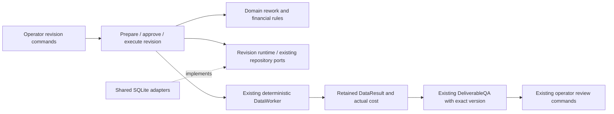
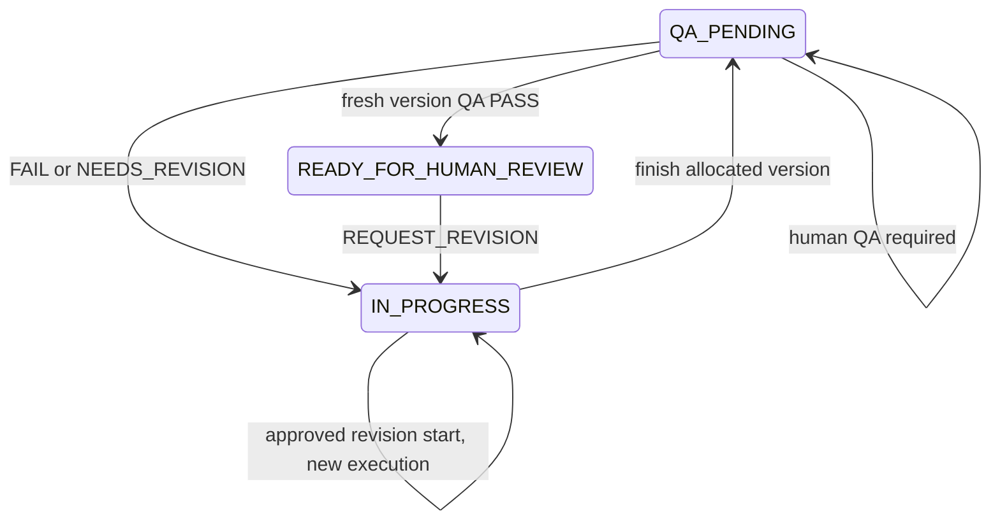

# F05-A: Versioned deterministic Data rework plan

Date: 2026-10-27 (Asia/Bangkok). **DESIGN ONLY — NEEDS_DECISION.**

Reviewed source at `7f1bcc967df09dcb24baebd1e97f79f144fcb891`, together with the
existing untracked F02-B5 audit report. This checkpoint adds only this plan.
No production code, tests, existing ADR, dependency or infrastructure is changed.
No commit or push. Proposed names and commands below are not implemented features.

## 1. Current-state inventory and confirmed gaps

Read AGENTS.md, Product Constitution, original audit F05, approved F02-A plan,
F02-B5 audit, ADRs 0023–0027 and the current runtime, worker, QA, approval and
SQLite paths. Source takes precedence over historical descriptions.

| Component | Current behavior and consequence |
| --- | --- |
| Domain `Opportunity.review_qa` / `request_revision` (`domain/opportunity.py:412,425`) | Failed lifecycle QA or operator revision returns IN_PROGRESS, clears deliverable/approval, retains execution and QA. The parent artifact survives in repositories |
| QA report mapping (`application/contracts/qa.py`) | FAIL and NEEDS_REVISION map to failed lifecycle QA; PASS permits human review; REQUIRES_HUMAN_REVIEW keeps QA_PENDING. Human-pending is not a revision trigger |
| `Opportunity.start` / `finish` (`domain/opportunity.py:272,398`) | Start only accepts PLANNED. Finish requires matching current execution and a version newer than retained QA. There is no guarded operation to replace the active execution for authorized rework |
| WorkSpecification / WorkerRunStart / WorkerRunFinish (`application/contracts/runtime.py`) | Immutable specification; start requires PLANNED and no prior execution/QA; finish requires no QA and constructs version 1 |
| ExecuteWorkerTask (`application/use_cases/worker_execution.py:84`) | Completed run plus IN_PROGRESS returns REWORK_REQUIRED. A new ID still fails phase/ownership checks. This is intentional protection, not a retry bug |
| SQLite runtime (`infrastructure/sqlite/runtime.py:117,228`) | Permanent `runtime_owner` per Task; immutable execution/plan/result; finish key and deliverable version fixed to 1. Deleting owner or inventing a Task would evade history |
| DataWorker (`application/workers/data.py:106`) | Plans/results cached by execution ID; returns real DataResult, saves result before accounting. A new version needs a new execution and operation, not overwritten cache entries |
| ExecutionRepository (`infrastructure/sqlite/executions.py`) | Already supports `(deliverable reference, version)` and versioned QA. Content is digest-addressed. No replacement storage model is necessary |
| Operational QA (`application/use_cases/operational_qa.py`) | Exact retained inspection/result/criteria binding and conditional completion exist, but deliverable lookup hardcodes version 1 |
| Operator decision (`application/use_cases/operator.py:169`) | REQUEST_REVISION is recorded in a submission review, distinct from approving future inputs. Decision is saved before Opportunity save, in separate operations |
| WorkerPreflight (`application/use_cases/worker_preflight.py:61`) | Refreshes source and rechecks eligibility; checks frozen economics against current aggregate/evaluation. Cannot simply install new revision forecasts into IN_PROGRESS via existing evaluate/score lifecycle transitions |
| Budget / policy control | Existing BudgetManager and B4-1 atomic policy consent are reusable. New version is a new zero-AI operation; old commitments/actuals cannot be reset or repurposed |

F02-B5 closed only bounded local first-version Data with explicit exclusions. F05
remains open. Domain version checks alone do not supply revision ownership,
consent, allocation or a safe v2 runner.

Important existing partial-write window: operator decision can exist while its
REQUEST_REVISION lifecycle transition has not committed. Rework must require both
the retained decision and the matching authoritative IN_PROGRESS state. Retrying
the original decision can complete its existing transition if its original
snapshot still matches; a stale/conflicting state must block. A lone decision is
not dispatch permission. This plan does not broaden into rewriting all approval
transactions; targeted tests must prove containment of this window.

## 2. Proposed bounded architecture

Keep Presentation → Application → Domain. SQLite implements application-owned
atomic ports. One local actor, one authoritative database/ledger, DataWorker with
`llm=None`, existing DeliverableQA with no AI. No workflow framework or new service.

Recommend a narrow revision path alongside the existing first-run path. Preserve
v1 start guards and `runtime_owner`; do not weaken them to accept any IN_PROGRESS
opportunity. Reuse WorkSpecification, DataPlan, DataResult, WorkerResult validation,
BudgetManager, source/eligibility rules, economic/scoring models and QA engine.
Factor only genuinely shared preflight/evidence checks needed by both paths.



### Identity policy

Retain the **same Task identity and exact Task value** for this first slice.
Revised processing instructions live in a new WorkSpecification. Changed bounty
terms/deadline or a fundamentally different task require a separately reviewed
replanning capability; do not silently relabel them rework.

Use the same deliverable reference as a **lineage reference**, with a new immutable
`version = parent.version + 1`. `(reference, version)` is the artifact identity.
V1's tuple, execution and digest never change. V2 has new specification, execution,
budget operation, inspection and operator-review IDs. A new content digest is
derived from the actual bundle; identical output may legitimately share a content
digest, but never inherits QA or approval. Reject operator-selected version numbers.

Retain explicit parent execution, parent deliverable tuple/digest, triggering QA
inspection/report or operator review/decision and the authoritative parent-state
revision. Only the current completed lineage tip can have one approved successor.
No branching from old versions, multiple active successors or version reuse.
The same design can handle v3 after a completed v2 failure; this is a linear chain,
not a generic revision graph.

### Minimal typed application contracts

- `DataRevisionRequest`: immutable request ID, opportunity/Task/ledger, parent
  execution and exact deliverable/digest, trigger type and evidence references,
  parent Opportunity snapshot/revision, actor/time/reason, new frozen specification,
  fresh eligibility/economic/scoring evidence and explicit change summary.
- `DataRevisionApproval`: exact request identity/digest, trusted actor/time,
  explicit consent. Preparation is a proposal; a populated WorkSpecification inside
  a proposal is not execution authority. Execution requires this separate record.
- `RevisionAllocation`: approved successor version, fixed execution/operation/spec
  identities, parent link and consent reference. Allocate IDs once before budget
  authorization; retries load them, never generate replacements.
- `RevisionRun`: existing WorkerRun plus immutable allocation/parent binding.
  Reuse existing plan/result records rather than copy them into another journal.
- Typed view/outcome/reasons: DRAFT, APPROVED_NOT_STARTED, IN_PROGRESS,
  RESULT_RETAINED, COMPLETED history plus BLOCKED/RECOVERABLE reasons. These are
  derived operation checkpoints, not new Opportunity lifecycle states.

Errors must distinguish stale parent, trigger incomplete, consent missing,
successor already owned, source unavailable/changed, eligibility blocked,
assessment conflict, unsupported scope, budget denied, unknown external evidence,
result invalid and persistence outcome unknown. Never parse exception strings.

`RevisionRuntimeRepository` owns prepare/read, atomic approve-and-allocate, start,
result retention and finish. Internal persistence commands carry validated
authoritative snapshots; CLI input must never contain Budget snapshots,
authorization decisions, selected QA results or arbitrary lifecycle fields.
Shared storage helper reuse must not turn this into a generic UnitOfWork.

## 3. Scope and approval rules

Allowed triggers are a completed operational QA FAIL/NEEDS_REVISION applied to the
parent, or a recorded REQUEST_REVISION for that exact parent's review with its
transition applied. Require the parent's completed run, real result, content and
original approved criteria. Legacy runs without these records remain unsupported.
Block QA_PENDING human-review, SKIPPED/rejected operator decisions, approved-for-
submission, in-flight, submitted, accepted and paid states. No implicit revocation
of submission authorization is introduced.

Preparation captures revised local CSV/JSON snapshots via the existing bounded
reader and expected digests, never URLs/scripts or model-selected files. Changes
to columns/constraints/input selection must be displayed against the parent and
explained against its failure/revision reasons. No requirement coverage invented
from the new output. Parent provenance remains untouched; revised input provenance
must describe the actual newly approved data.

Recommended first-slice acceptance policy: retain all existing required artifacts
and exact existing QA requirements; permit additions. Do not remove/change old
requirements or relax constraints merely to obtain PASS. Proposed changes that
cannot be proven non-relaxing by supported structural checks fail closed. Legitimate
correction of erroneous parent criteria needs a separately approved extension,
not an implicit exception. Semantic requirements remain human-pending; this slice
does not invent a human-QA resolver. This restriction is an operator decision below.

Review the immutable request, then explicitly approve it. Approval is consent for
that bounded rework only; QA failure and REQUEST_REVISION alone do not approve new
inputs. Eligibility resolution, rework consent, spending approval, budget-policy
consent and submission approval remain distinct. No decision accepts arbitrary
caller identity; use the configured trusted local operator.

## 4. Freshness, economics and budget

Before preparation, approval and any new computation/replay without a result:

1. Resolve parent chain, authoritative Opportunity revision, Task, ledger and
   complete trigger. Require no active successor or conflicting/unknown effects.
2. Refresh the real configured source. Require known open/deadline/requirements/
   version, enough time remaining and unchanged parent task terms. No source
   refresh means BLOCKED, never a fallback. Inputs/profile assertions require
   explicit operator review; hashes do not independently authenticate them.
3. Recompute deterministic eligibility at current time. Reuse F04 only where the
   existing matching facts/profile/policy/source-bound resolution still applies.
   If a new MANUAL resolution is necessary, block: current F04 preparation cannot
   operate in IN_PROGRESS. No historic ELIGIBLE flag or general UNKNOWN override.
4. Require newly reviewed forecast inputs/signals for the revision and compute
   EconomicAssessment/ScoringAssessment using existing rules. Store a new immutable
   EvaluationRecord with timestamp and rationale. Show cumulative recorded prior
   costs separately from estimated incremental revision cost; never subtract sunk
   costs twice or claim success probability is objective. Do not rewind lifecycle
   through ELIGIBLE/EVALUATED/SCORED to refresh forecasts.
5. After consent/allocation, authorize exactly zero AI through BudgetManager under
   the allocated new operation. SCOUT_ONLY may still permit deterministic work.
   Persist the authorization before start; validate current ledger snapshot at
   atomic start. Denied/review-required results block. No paid wait/resume path.

A narrow revision assessment path should reuse CheckEligibility.inspect and the
Domain economic/scoring constructors. Split common pure preflight checks if needed;
do not fabricate a transient authoritative Opportunity to fool the old equality
checks. At revision start install the approved freshly calculated assessment into
the current aggregate through a Domain method, atomically with the new execution.
Historical parent evaluation stays immutable. At dispatch recheck exact approved
inputs and eligibility; a changed result invalidates consent rather than updating
it silently. New forecasts are operator-reviewed, not automatically calibrated.

Unrelated ledger revisions need not void rework-input consent: budget authority is
separately checked at dispatch. A ledger change between authorization and start
fails the start CAS and requires same-allocation inspection/retry. All outstanding
commitments, actuals and released IDs survive. Unknown paid claims tied to either
the parent or proposed operation block rework; changing IDs cannot evade them.

## 5. Domain changes and lifecycle ownership

One focused guarded `Opportunity.begin_rework(...)` is justified. It should require
IN_PROGRESS after a parent QA/revision, matching retained parent QA/deliverable
identity, no current deliverable/approval/external outcome, same Task, a distinct
authorized execution/operation and valid eligibility/economic/scoring assessments.
It replaces the *current* execution/assessment while keeping the parent QA until
finish for the version lower bound. It must be impossible to call again for an
active successor whose execution differs from the parent QA execution.

The method performs a guarded same-state update inside Domain. Do not add a broad
IN_PROGRESS self-loop to `_move`, expose dataclass mutation to Application or add
a new public arbitrary-state setter. No fake lifecycle history traversal is needed;
the revision records provide the audit event. Domain cannot validate repository
consent authenticity; Application and the atomic port verify that part.

Keep the existing finish rule requiring newer version and matching execution.
A narrow finish adjustment should clear the old current QA/approval after checking
the version bound when entering QA_PENDING, so old PASS is not represented as
current QA for v2. Parent QA remains in its immutable journal. The revision finish
contract additionally enforces exact allocated version, not merely any larger
number. Keep first-version start semantics unchanged. No new Task, Opportunity
state, financial semantics or marketplace-specific Domain model is needed.



The IN_PROGRESS self-arrow depicts only the proposed guarded Domain operation,
not permission for arbitrary self-transitions. Approval/allocation/preparation do
not dispatch or advance the Opportunity. QA PASS never submits.

## 6. Atomic persistence and recovery

Use the same SQLiteDatabase and snapshot codec; new typed kinds, no reset/migration
of existing evidence. Keep `runtime_owner` as immutable v1 ownership. Add successor
ownership keyed by parent execution and version ownership keyed by lineage/version.
Since each completed tip can acquire only one successor, an unstarted or incomplete
allocated version cannot be skipped to create another one.

| Boundary | Atomic writes/checks | Crash/retry behavior |
| --- | --- | --- |
| Prepare | Immutable request/specification/evaluation evidence; check parent snapshot and trigger | No policy, allocation, budget or execution change; same ID/payload readback, conflicting payload rejected |
| Approve and allocate | Under BEGIN IMMEDIATE recheck request/actor/parent/trigger; write consent, parent-successor ownership and allocated version/IDs together | Same ID returns original allocation; concurrent different proposals have one winner; no max(version)+1 outside transaction |
| Authorize | Existing BudgetManager ledger/audit operation for allocated operation | Crash may leave commitment without start; inspect/retry original allocation, never release or allocate new IDs automatically |
| Start | Compare approved allocation, parent Opportunity snapshot and latest ledger; create revision run, Execution, DataPlan, and Domain-updated Opportunity in one transaction | Roll back all writes on failure. Lost acknowledgement means inspect original IDs before any dispatch |
| Worker/result | Existing real DataWorker journal and immutable result under new execution ID | Missing result permits only identical deterministic replay after fresh preflight. Result already present prevents worker rerun |
| Actual settlement | Existing idempotent BudgetManager.record from real retained cost | Result-before-cost crash repairs same operation. Missing/unknown cost blocks; no guessed zero |
| Finish | Exact run/result/allocation/current execution CAS; content, `(lineage,n)`, Opportunity QA_PENDING and finish marker together | Retain result through failure. Same-ID completion/readback; stale state conflicts, never rebase onto a later version |
| QA | Existing claim/report/conditional completion with allocated version | Retained report recovery; one inspection owner per version; later versions untouched by old retry |

No transaction holds a lock across network, filesystem reads or worker execution.
No claim of exactly-once CPU computation: simultaneous same-version deterministic
recovery may recompute identical frozen work, but immutable result, cost identity
and completion must converge or fail explicitly. No paid or external replay.

An allocated approved request that becomes stale before start stays blocked and
inspectable. This minimal slice has no cancel/reallocate/lease-expiry tool; changing
approved inputs requires a separately designed supersession operation. Unapproved
proposals may be replaced by new proposal IDs while the parent snapshot is unchanged;
only one can win approval. This liveness tradeoff needs explicit operator acceptance.

Completed old executions remain historical readback/export even when the current
Opportunity points to a newer run. Status must separate the requested execution's
history from current active version. Recovery of v1 must never launch v2, and v2
recovery must never mint v3. Retained-result completion during source outage is
local recovery only, not renewed execution or submission permission.

## 7. Versioned QA and approval safety

Resolve deliverable/version from the persisted finish/allocation, not a caller's
`--version` or a hardcoded 1. Reuse RunOperationalDataQA/DeliverableQA and existing
SQLiteQAJournal/OperationalQARepository. Extend the runtime read projection narrowly
to return the exact completed deliverable for either v1 or a revision; do not create
a second QA engine or merge first-start and revision-start permissions.

Each version gets a new inspection ID, exact plan/result/digest/criteria and bound
Opportunity revision. Existing version-keyed QA storage already fits. Completed
v1 inspection retry may return historical evidence but cannot affect v2 state;
unapplied stale v1 report must fail. Never reuse v1 inspection as v2 authority.

After v2 PASS, use existing `review` / `show-review` / `decide` with a **new review
ID** and exact v2 content/deliverable/ledger snapshot. Old decisions must fail to
authorize changed content even if output bytes happen to be identical. Existing
approval checks bind execution/version, not merely content hash. Revision consent
is never passed to SubmissionGateway; no external gateway is wired in this scope.

## 8. Proposed CLI

Existing `work status`, `work show`, `work export` and review commands remain usable.
Add only a revision subcommand family:

```text
work revision prepare --parent-execution ID --revision-id ID --spec-id ID
  --inputs FILE --input-root DIRECTORY --facts FILE --economics FILE --scoring FILE
  --evaluation ID --expected-revision N --reason TEXT
work revision show --revision-id ID
work revision approve --revision-id ID --approve-inputs --confirm
work revision execute --revision-id ID --confirm
work revision recover --revision-id ID --confirm
work qa --execution-id NEW_EXECUTION --inspection-id NEW_INSPECTION --confirm
work status --execution-id NEW_EXECUTION
work export --execution-id NEW_EXECUTION --directory NEW_LOCAL_DESTINATION
```

All use existing global database/ledger/source opt-in and trusted actor. Trigger is
resolved from retained evidence, never `--qa-result FAIL`. Show parent and proposed
scope/criteria diff, trigger, forecasts, prior actuals/unknown costs, consent and
allocated identities. Execute uses stored allocation; operator cannot substitute
IDs at dispatch. A proposed recover command delegates to the same revision executor
with original IDs. Export manifest identifies lineage/version/execution and remains
local-only, no overwrites. No automatic chaining of execute, QA, approval or send.

## 9. Required tests and acceptance gates

Write failing acceptance tests before implementation; use real SQLite, DataWorker,
DeliverableQA and CLI. Explicit test-only sources/clocks, no paid calls/live bounty.

1. QA FAIL, NEEDS_REVISION and operator REQUEST_REVISION each produce an authorized
   v2 and fresh QA/human review; parent evidence and costs remain byte-for-byte
   unchanged. V2 failure can lead to authorized v3, never two successors of v1.
2. Reject human-pending, missing/unapplied trigger, cancelled/submitted/paid parent,
   missing consent, wrong actor/ledger, unsupported/semantic processing and legacy
   parent evidence. Inject crash between operator decision and lifecycle save;
   require same-decision recovery or safe block before revision creation.
3. Immutable request, inputs, acceptance, economic evidence and allocations;
   wrong digests, edited files, attempted criteria removal/weakening, forged version,
   identity collision and old-parent branching fail without dispatch.
4. Source unavailable/changed/closed, exact deadline boundary, inadequate time,
   eligibility UNKNOWN/ineligible, stale MANUAL resolution and changed forecast
   evidence block. No lifecycle rewind to refresh economics; no fabricated facts.
5. Budget before start, denial/review-required, SCOUT_ONLY zero-AI execution, ledger
   race, original commitment/actual/released-ID preservation and unknown paid-claim
   blocking. One new measured AI cost record per executed revision, not per retry.
6. Rollback after every approval/allocation/start/finish write, reopen and lost
   acknowledgement at each boundary; concurrent same/different requests/IDs yield
   one successor/version, original receipt and no orphan authority.
7. Worker failure, crash after start/result/before accounting/finish; exact frozen
   replay only without result, original execution/operation/version retained;
   retained result finishes without recomputation; stale state never overwritten.
8. Old QA reports, same-ID/conflicting inspection, old reviews/approvals and identical
   content across versions cannot authorize v2. Fresh PASS stops at human review;
   FAIL/revision returns blocked rework; semantic QA remains pending.
9. History/status/export distinguish old completion from active v2; no overwrite,
   no automatic resume, mocks, external submission, payment or verified revenue.
10. Existing v1/legacy execution/QA, F01/F04 and budget-control regressions pass.
    Run focused tests, architecture tests, full pytest, Ruff, format, strict mypy
    and git diff --check. Do not certify live contracts from offline fixtures.

## 10. Dependency-ordered implementation checkpoints

**F05-B1 — contracts and ownership.** Approve decisions below; add a focused ADR,
typed revision contracts/port and Domain method/finish semantics with tests. Add
SQLite immutable request/consent/allocation/start/finish transactions and codec
allowlist. Test rollback/CAS/identity invariants before enabling execution.

**F05-B2 — application execution.** Preparation/assessment/approval/execute/recover
use cases, fresh checks and existing deterministic worker/cost settlement. Keep
ExecuteWorkerTask first-version behavior unchanged; share only validated pure
helpers. Prove new-work versus same-version replay and unknown-outcome blocking.

**F05-B3 — CLI and version-aware QA.** Explicit bootstrap on the same database;
revision commands, bounded JSON, status/export and exact-version QA read projection.
Reuse operator approval; end-to-end tests for all three triggers and stale evidence.

**F05-B4 — independent audit.** Execute all gates, fault/concurrency/reopen drills,
review financial preservation and close only deterministic local rework. No F02-C,
B4-2, F03, F06 or F08 closure is implied.

Expected production touchpoints (proposal, not changes in this checkpoint):
`domain/opportunity.py`; new `application/contracts/data_revision.py`,
`application/ports/data_revision.py`, `application/use_cases/data_revision.py`
(split execution into a focused module if needed);
`application/use_cases/worker_preflight.py`, `operational_qa.py`, `local_runtime.py`;
`application/contracts/runtime.py` / `ports/runtime.py` only for the narrow completed
deliverable read projection; new `infrastructure/sqlite/data_revision.py`, existing
`sqlite/runtime.py` / `codec.py`; `bootstrap/local_runtime.py` / `operator.py`;
new `presentation/revision_cli.py`, existing `runtime_cli.py`. Proposed tests:
Domain rework tests and focused revision persistence/execution/CLI-QA integration
files under the existing test areas. Do not edit DataWorker/QA algorithms merely
to make revision results pass. No dependency installation is justified.

## 11. Risks, decisions and verdict

**NEEDS_DECISION**, not blocked by a missing provider for offline implementation.
The design is bounded, but these policy/identity choices need operator approval:

1. Same Task and deliverable lineage; new execution/operation/spec/QA/review IDs,
   strict parent.version+1, one successor per completed parent, no branch/reuse.
2. Scope restricted to existing deterministic local parents and unchanged source
   terms/Task; changed terms, new MANUAL resolution, legacy imports and human-QA
   resolution remain unavailable rather than forcing permission.
3. Acceptance requirements retained/additive only, with supported non-relaxing
   scope changes. Corrections requiring weaker/different criteria are a separate gate.
4. Explicit prepare → inspect → approve/allocate → execute; consent/allocation
   atomic before budget, no cancellation/supersession of an approved allocation
   in the first slice. Stale approved requests remain safely blocked.
5. Narrow Domain begin_rework and finish clearing current QA after its version
   check; historical evidence remains immutable. No broad lifecycle relaxation.

Residual risks: source TOCTOU and trusted profile assertions (F07); poisoned or
incorrect operator criteria; growing local snapshots; host/store trust; ambiguous
paid operations and backup/restore (F08); source body-hash false conflicts; operator
decision/lifecycle split commits. All require explicit failure states and evidence,
not guessed recovery. Financial cost completeness remains limited to recorded costs.

No tests were added or executed for new functionality in this design checkpoint;
there is no implementation to certify. F02-B5 test results are historical evidence,
not rerun results. Only report/worktree whitespace checks are appropriate here.
Paid Research, semantic Data/AI QA, submission, payment, AWS deployment, wallets,
budget resume and generic orchestration are excluded. Stop for operator review.
