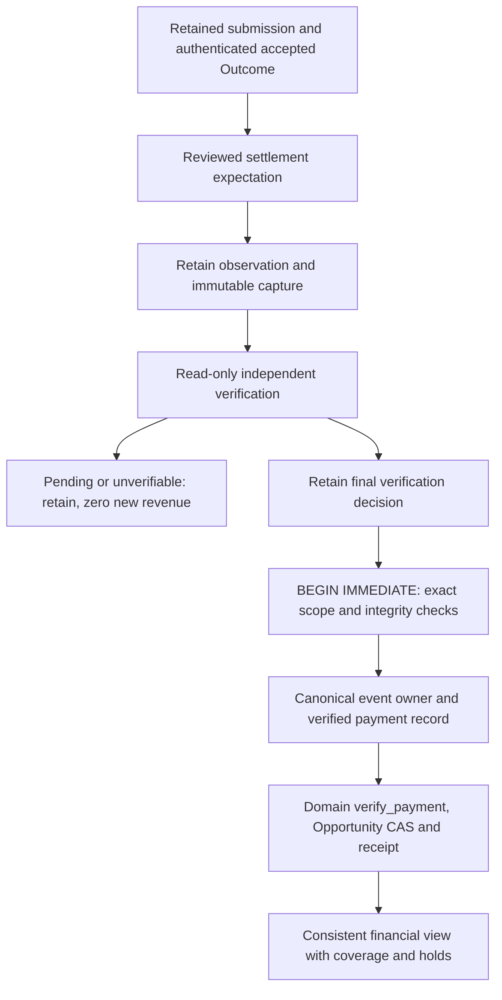

# F03-B4: Independent Payment Verification Contract and Financial Policy Decision

Date: 2026-11-01, Asia/Bangkok.
Audited commit: `e4f5789d74e28527cdaeaf36014360b9035563db`.
Starting worktree: clean.

**Verdict: BLOCKED for real payment verification.** No actual bounty settlement,
asset/network, authorized recipient, authoritative payout-to-submission mapping or
independent settlement contract has been selected and evidenced. Offline foundation
is designable but NEEDS_DECISION before a separately approved implementation.
This report does not authorize implementation or live PAID.

Design-only: only this document is added. No production code, tests, existing ADR,
infrastructure, dependency or provider configuration changed. No submission,
transfer, signing, wallet, KYC/account mutation, paid API, commit or push.

## 1. Current-state inventory

Read AGENTS.md, Product Constitution, original F03/F07/F08/F09 findings, F03-A,
B1/B2/B3 reports, ADRs 0029-0031 and current payment, settlement, budget, metrics,
SQLite and runtime code. Source takes precedence over milestone claims. Official
public documentation was read; no authenticated payout/account or actual settlement
evidence was obtained.

| Concept / path | Current behavior and evidence meaning |
| --- | --- |
| Potential reward | `domain/finance.py` POTENTIAL Reward is an advertised offer, never income. A listing symbol does not establish actual payout asset/network |
| Expected value | Subjective probability and estimated costs produce a forecast, not cash or an observed receivable |
| Accepted reward | Optional Outcome.accepted_reward, stage ACCEPTED. B3 does not copy the potential amount into it; unknown stays None |
| Operator-reported payment | B1 PAYMENT_REPORT captures provisional metadata/text only. A screenshot, URL or transaction hint cannot construct independent proof |
| PaymentEvidence | `domain/payment.py:18`: VERIFIED_PAYMENT Reward, external payment reference/time, source/record and verification method. A trusted adapter assertion, not authentication by itself |
| Domain PAID | `domain/opportunity.py:509` requires ACCEPTED, matching submission/payment/evidence, chronology and currency. verified_revenue is zero without matching PAID/payment proof |
| Legacy VerifyPayment | `application/use_cases/settlement.py:262` reuses retained payment history or calls PaymentVerifier, validates submission/time, derives the Domain update, retains observation then CAS-saves Opportunity |
| SQLite histories | `infrastructure/sqlite/submissions.py:138`: immutable observations, conflicting same-submission proof rejected. Cross-submission duplicate key is `(verification_source, payment_reference)` under BEGIN IMMEDIATE |
| Aggregate save | OpportunityRepository.save has its own CAS transaction. Legacy proof/history retention and PAID save are separate evidence-first transactions, not one payment-owner/PAID/receipt transaction |
| Recorded costs | CostRecord distinguishes actual from optional estimate. `domain/budget.py:347` preserves prior operation records and rejects changed same-operation actuals; ledger snapshot/audit commit atomically |
| Cost currency | Budget.record requires policy currency across categories; it cannot record a differently denominated native-network fee without a reviewed model change |
| Per-opportunity net | `domain/metrics.py`, `application/use_cases/metrics.py`: revenue minus recorded attributed costs, outstanding operations separate, mixed currencies rejected; opportunity/ledger reads are separate |
| Dashboard | `application/use_cases/dashboard.py`, `sqlite/operator.py`: consistent workspace snapshot and per-currency lifetime rows, no FX. CLI explicitly labels recorded-cost basis and unknown unmeasured costs |
| Revenue queries | `sqlite/opportunities.py:verified_revenue` sums matching PAID aggregates, without a reversal/settlement-integrity hold projection |
| Runtime | Local CLI has no enabled payment verifier. LambdaDependencies accepts an explicitly supplied PaymentVerifier but defaults to None; this is a seam, not a deployed independent adapter |
| B3 prerequisite | Production UnavailableOutcomeVerifier blocks authoritative Outcome finalization. Synthetic ACCEPTED fixtures are not real accepted-work evidence |

Paths above are relative to `src/agentmine/`. PaymentEvidence currently lacks explicit
recipient/payer, canonical asset/network, integer units, finality/reversal policy,
authenticated capture digest/parser contract and exact accepted-Outcome binding.
PaymentVerificationRequest carries Submission/Outcome but no reviewed settlement
expectation. PaymentStatus has VERIFIED/PENDING/UNVERIFIABLE, not reversal/hold states.

Legacy Domain permits actual verified amount to differ from accepted/potential
amount and does not enforce full-payment fulfillment. The old test example potential
100, accepted 90, verified 85 is synthetic, not an evidenced real deduction. No
production earning is established by fixtures. CostRecord is a recorded actual
assertion, not automatically a reconciled provider bill. Deterministic AI zero does
not measure all host/tool/infrastructure/transaction expenses.

### Confirmed enablement gaps

- Recipient/asset/network/finality remain adapter obligations rather than complete
  persisted proof. A method enum or reference cannot authenticate settlement.
- The legacy duplicate pair relies on stable source identity; another source alias
  does not supply a canonical physical-transfer guard across providers.
- The legacy accepted enum does not require an applied authoritative B3 decision.
- VerifyPayment returns early for PAID. Reversal monitoring/holds are absent; current
  lifecycle/metrics cannot certify a subsequently disputed or reversed receipt.
- F09 accounting completeness remains open. Recorded-cost net is not complete profit.

These are hard pre-live gaps, not findings of observed theft or false live revenue.
No fixes are implemented in this design-only checkpoint.

## 2. Provider and settlement feasibility

Official evidence reviewed on 2026-11-01:

- [Superteam agent documentation](https://superteam.fun/earn/agents) describes human
  claim linking submissions for payout eligibility. It is not a settled payment
  record. Direct skill.md access failed due to the tool's Markdown content-type
  support; the official agent page exposes the skill content. No private endpoint
  was accessed.
- [Superteam terms](https://superteam.fun/earn/terms-of-use.pdf), effective June 24,
  2026, sections 5-7, permit fiat/digital-asset payment under the parties' private
  agreement and allow fees. This does not select AgentMine's asset, recipient,
  amount, rail or verification interface.
- [Official Earn FAQ](https://docs.superteam.fun/the-superteam-handbook/community/faqs/superteam-earn-faq)
  describes sponsor-dependent payment forms/KYC and account-associated wallets.
  Process guidance is not a versioned settlement API or proof for this submission.
- [Solana getTransaction](https://solana.com/docs/rpc/http/gettransaction) documents
  lookup/version configuration and nullable results/metadata/time;
  [getSignatureStatuses](https://solana.com/docs/rpc/http/getsignaturestatuses)
  describes status and recent-cache/history behavior. Neither proves bounty identity.
- [Solana RPC overview](https://solana.com/docs/rpc) distinguishes network/commitment
  levels and warns against treating shared public endpoints as production service.
  [getGenesisHash](https://solana.com/docs/rpc/http/getgenesishash) provides cluster
  identity information. These are candidate read primitives, not a selected asset,
  network, provider service or enabled adapter.

No evidence supports assuming all Earn payments are SOL, USDC or USD. No official
read contract tying a particular accepted agent submission to its payout obligation,
recipient and final settlement was established. This means unverified for AgentMine,
not a universal claim that no private provider API exists. Old public implementation
fields, marketing text and example transaction IDs do not establish a deployed
permitted contract or actual payment.

| Required fact | Available evidence | Missing / resulting gate |
| --- | --- | --- |
| Authoritative payout identity | Human claim and sponsor payment processes documented | No authenticated obligation ID tied to an actual accepted submission |
| Recipient account/wallet | General account/wallet process exists | No selected authorized public recipient and authenticated account binding; no secret/private key needed |
| Asset/network | Advertised symbols and private settlement terms possible | No exact asset identity or production network selected |
| Amount/units | Potential/optional accepted model exists | No authoritative payable amount, net basis, minor units or asset precision |
| Settlement reference | Generic independent ledger read is documented | No actual transfer/event correlated to this reward; operator hash is only a hint |
| Finality | Candidate RPC status semantics exist | No selected policy/provider or successful final observation with adequate historical access |
| Reversal/refund/dispute | Current model explicitly lacks support | No applicable provider correction rules or approved integrity/hold policy |
| Permitted verification | Generic read contracts documented | No authorized provider/account access, authentic captures, contract fixtures or payout correlation |

| Candidate mechanism | Feasibility / safe disposition |
| --- | --- |
| Marketplace claim/winner/paid label | Provisional only; not recipient settlement |
| Authenticated marketplace payout statement | May prove obligation/correlation, not automatically final credit |
| Authenticated settlement-provider record | Candidate if it proves recipient credit, asset/units, finality, corrections and correlation; no bank/provider selected |
| Independently read public-ledger transfer | Candidate with authoritative payout correlation and exact successful final event; unrelated deposit/self-transfer is not bounty revenue |
| Authenticity-verifiable issuer artifact | Possible only with an actual official authenticity/signing contract and exact recipient/submission binding; none established |
| Screenshot/unsigned statement/explorer URL | Provisional only; no scraping or invented authentication |
| Algora/Opire | Repository connectors do not establish settlement; no alternative is selected to evade the current blocker |

Recommended smallest mechanism shape: one authenticated accepted-work/payout
obligation plus a permitted independent settlement read, matched under one reviewed
expectation. One settlement-provider record may satisfy multiple predicates if its
actual contract proves them; two RPC services are not automatically required.
There is currently no evidence-supported concrete mechanism to enable.

## 3. Minimal asset/network and financial policy

These are proposals requiring approval, not current behavior changes.

| Topic | Proposed initial policy |
| --- | --- |
| Selection | DEFERRED until a genuine supported Research/Data opportunity and evidenced settlement agreement are selected; no default SOL/USDC/USD or test network |
| Exact identity | Fiat: approved currency plus real settlement/rail context. Token: canonical network plus native asset or issuer/contract/mint identity, never ticker alone. Provider parsing stays in adapters |
| Precision/units | Authenticated scale/minor units; exact integer or decimal strings. Reject nonintegral smallest units, rounding, unsupported precision/bounds and floats |
| Existing Money | Three uppercase letters are syntax, not a registry or ISO certification. USDC cannot be relabelled USD. A representable symbol still lacks asset/network identity |
| Necessary model decision | A verified compatible fiat lane may reuse Money with strict precision/scope. Token/unrepresentable asset needs a focused generic asset/proof/migration ADR first; no provider SDK in Domain or casual Money widening |
| Fiat versus token | Neither selected. Do not choose a convenient fixture currency to make a real payout fit the model |
| Payable amount | Authenticated obligation and reviewed exact net-credit expectation. Unknown accepted amount cannot be replaced with potential reward/operator guess |
| Actual recognition | Decode actual recipient-credit units independently; never copy expected units into reward. Initial full-payment gate requires exact approved net-credit match |
| Fees/payer | Retain who bears each fee and whether already withheld. AgentMine-borne fees require actual evidence; sponsor fees are not automatically our expense. Unknown responsibility is not zero |
| Partial payment | Retain observed funds provisionally; no full PAID until separately approved aggregation. Do not pretend no external money arrived |
| Overpayment | Hold for attribution; do not credit excess, silently cap or bypass exact expected fulfillment |
| Multiple transfers | Unsupported initially; retain every leg without summing/choosing arbitrary transfers |
| Reversals/refunds | Append authenticated correction and integrity hold, preserve original receipt, suppress certified current totals; no deletion, automatic refund or unapproved PAID reset |
| FX | None initially. Separate native buckets, no stablecoin=fiat assumption. Later FX needs explicit pair/source/time/exact rate/rounding and realized/unrealized policy |
| Valuation time | Distinguish settlement, observation, verification and capture times. No approved FX means no converted-value timestamp or USD profit claim |

Operational revenue should mean actual correlated recipient credit, not advertised
gross. Hypothetically, gross 100 with a fee withheld to credit 98 must not become
98 minus the same 2 again. A separately evidenced expense still needs correct
attribution. These are hypothetical units, not chosen currency or actual earnings.
If unknown fees prevent deciding full award fulfillment, block PAID. If receipt and
fulfillment are verified but unrelated operating costs are incomplete, revenue can
be known while complete net remains uncertified.

Budget.record enforces its policy currency. Native-network fees in another asset
cannot be recorded as fiat or silently ignored. Any multi-asset cost/valuation model
requires approval; no duplicate-ledger workaround or arbitrary conversion.

## 4. Independent evidence trust matrix

| Evidence | Meaning | PAID authority |
| --- | --- | --- |
| Operator note/screenshot/URL/hash | Candidate hint with provenance/time/digest | None |
| Accepted/winner/claim status | Work outcome, selection or eligibility as actually authenticated | Not settlement |
| Marketplace payout statement | Obligation/correlation if origin and scope authenticated | Insufficient unless an approved contract also independently proves final credit |
| Authenticated provider payout record | Distinguish initiated, debited and finally credited; match exact scope | Only with all credit/correlation/finality predicates and configured trusted authority |
| Independent settlement record | Proves a transfer under rail/network rules | Only with exact bounty/payer/recipient/asset binding; unrelated deposits do not qualify |
| Pending/unfinalized/unknown | Retained PENDING/UNVERIFIABLE observation | No; zero verified revenue |
| Successful final full settlement | Authenticated immutable capture, approved decision, canonical event owner | Eligible for conditional Domain PAID, never directly from report import |
| Conflicting/reversed/disputed | Correction evidence plus integrity hold | Block new credit/certified totals; preserve history |
| Synthetic/testnet/devnet | Explicit test-only provenance | Never production revenue |

An accepted deliverable and an operator-supplied transaction hash are separately
insufficient. A final transfer to the right address still needs exact award
correlation. Read-only verification authorizes no money movement/sensitive account
action; no private key, wallet signing or transfer endpoint belongs in this lane.

## 5. Financial invariants and reporting

1. Potential, expected, accepted, reported and verified amounts stay distinct.
   Unverified reward contributes zero verified revenue.
2. PAID binds exact retained submission/version, applied authenticated accepted B3
   Outcome, account/recipient, actual asset/network/amount, final successful event
   and authoritative payout obligation.
3. No floats, precision truncation, implicit aliases or guessed FX.
4. One physical settlement event is credited at most once across opportunities,
   verification IDs, endpoint aliases and observation providers.
5. Operator transaction hints neither reserve monetary ownership nor authenticate.
6. Captures, expectations, decisions and receipts retain IDs/digests/actor/time/
   contract versions. Changed same-ID payloads conflict.
7. Same-ID applied retries return original credit; new IDs cannot evade stale state,
   prior ownership, holds or unknown effects.
8. Costs, commitments and released operation identities are not reset by payment;
   corrections require preserved history and approved append-only treatment.
9. Unknown costs/fees/FX/shared allocation stay unknown. No outstanding reservation
   or no cost rows does not establish free execution.
10. Principal/fee basis prevents double deductions; measured zero needs evidence.
11. Reversal evidence preserves original historical receipt; current certification
    is held/adjusted only under approved policy, never by erasing PAID history.
12. Contradictory observations cannot be ignored merely because state is PAID;
    every financial reader must honor the same integrity state.
13. Legacy/unsupported proofs do not upgrade via default fields or parser changes;
    migration/reverification preserves original bytes and requires actual evidence.

For compatible units and a non-conflicting verified receipt:

`recorded_net = independently_verified_recipient_credit - recorded_attributable_actual_costs`

This is a recorded-cost subtotal. Complete verified net additionally requires cost
coverage, fee treatment, shared allocation and any approved valuation. Unknowns
produce INCOMPLETE/UNKNOWN certification, not profit. Different assets/currencies
cannot be summed into a global earnings number. Known revenue need not imply known net.

Propose a consistent financial read view with as-of revisions, settlement integrity,
per-category coverage (measured, evidenced-zero, pending, unknown, conflict),
outstanding operations, unallocated costs and valuation state. Current recorded-cost
labels are useful but do not enforce future holds. Before any live PAID, dashboard,
metrics, revenue queries and financial exports must all honor integrity or refuse
certified totals; do not hide a hold in a side table only one view reads.

## 6. Proposed architecture and immutable contracts

No contracts or classes below are implemented by this document; names are illustrative.

- Domain keeps Outcome, guarded PAID and exact arithmetic. Only an approved generic
  asset/settlement identity or integrity model is added if genuinely needed after
  selection. SDK/network/provider/database details remain outside inner layers.
- SettlementExpectation: immutable ID/version/digest, original handoff/envelope/
  submission/deliverable, applied B3 Outcome/decision, workspace/ledger/actor,
  authenticated obligation/payer, authorized recipient, exact asset/network/scale,
  net-credit units, fee/finality policies and source evidence. Reuse the one operator
  role for explicit scope review; consent cannot authenticate money or invent debt.
- PaymentObservation: immutable capture reference/digest, provider/contract/parser,
  provenance/trust, independently decoded canonical event if known, raw units and
  effective/observed/captured times, pending/final/conflict/reversal status. Missing
  data remains absent. Reuse B1 PAYMENT_REPORT only for provisional reports.
- PaymentVerificationRequest/Decision: evolve/version the existing PaymentVerifier
  responsibility with reviewed expectation, exact accepted snapshot and authentic
  capture binding. Retain decision ID, authority/proof references, actual parsed
  recipient/asset/amount/event/finality, rationale and verification time. CLI cannot
  supply a replacement Opportunity or an authoritative PaymentEvidence object.
- PaymentApplicationReceipt: original expectation/decision, canonical event owner,
  verified units and PAID revision, persisted atomically.
- SettlementIntegrity evidence/projection: immutable correction/conflict facts and
  consistent hold state; no destructive correction of old proof.
- Persistence ports: reuse immutable histories and BudgetManager for cost actuals;
  add only a narrow conditional payment-completion operation for one SQLite
  transaction. No generic UnitOfWork, workflow framework, scheduler or second
  Outcome/payment domain. Adapters implement business-shaped ports.

Before live enablement, route legacy VerifyPayment through the same strong gates
or keep it unavailable in every operational composition, including Lambda. A bare
accepted enum or injected VERIFIED result cannot bypass B3, expectation or canonical
ownership. Runtime factories remain trusted, not selected by event/marketplace text.
Production defaults stay UNVERIFIABLE/BLOCKED; test authorities are never selectable.

### Canonical identity and legacy ownership

Identity is independent of Opportunity, verification ID, verifier name and endpoint.
An approved ledger key contains immutable network identity and exact transfer-event
identity; an approved fiat/provider key contains the actual issuer/rail namespace
and stable settlement event under its documented scope. No concrete identity is
selected here. A single-transfer parser must prove that supported shape; ambiguous,
mixed or batched transactions remain unsupported.

Two providers observing one event append provenance, not another credit. Canonical
mapping must also consult/migrate legacy verified payment ownership before live
activation; unresolved aliases block credit, not create a fresh namespace.
Provisional operator hints cannot acquire global monetary ownership and deny the
rightful correlated submission. Only independently derived facts qualify for the
final unique credit transaction.

### Application and SQLite transaction sequence



Commit raw evidence before parsing/application. Freeze original verification
request/identity before the independent read. Hold no SQLite lock across I/O.
The final transaction checks current accepted snapshot, applied B3 authority,
expectation and configured verifier contract, authentic proof, no hold or conflicting
canonical credit. It atomically commits owner, verified observation, Domain PAID,
audit and receipt; costs/commitments are untouched. A decision retained before this
commit is not booked revenue. Retry local completion using original IDs only while
facts remain valid. Never send a transfer to repair uncertain evidence.

Pending-to-final appends a new immutable observation and decision for the same
physical event, linked to prior evidence. Do not overwrite pending captures. A new
observation identity is not permission to credit again. Authority validation on
retained-decision recovery must fail closed under unconfigured/untrusted composition,
as in the B3 boundary; a persisted VERIFIED label alone is insufficient.

## 7. State-transition and crash/recovery matrix

Evidence statuses below are proposed Application projections, not arbitrary new
Opportunity lifecycle states. Only eligible full verified settlement uses existing
ACCEPTED -> PAID. Correction/hold projection requires its own approved design.

| Case | Required behavior |
| --- | --- |
| Observation retained, verification unavailable | Retain UNKNOWN/UNVERIFIABLE with reason; accepted-but-unpaid has zero revenue |
| Pending becomes final | Append authentic observation/decision, retain pending history, match original obligation, claim event once |
| Duplicate transaction across opportunities | Canonical owner allows one credit, including across data providers/IDs; other submission conflicts |
| Same ID, changed amount/asset/network/recipient | Immutable conflict; no replacement, conversion or PAID |
| Provider outage/missing historical data | Do not infer success or nonexistence; retain unresolved evidence; a permitted later read cannot send funds |
| Unknown finality/time/unsupported transaction | No PaymentEvidence/PAID; polling time is not actual settlement time |
| Stale/unrelated Outcome or submission/version | Fail exact binding/CAS; preserve decision, no rebase or overwrite |
| Verification succeeds, Domain application fails | Preserve decision; zero newly booked revenue until atomic apply; inspect/retry original ID if still valid |
| Failure after each final write | Roll back owner, verified record, Opportunity and receipt together; capture remains |
| Lost commit acknowledgement | Original receipt/amount returned; no second credit/source alias/new owner |
| Concurrent verification/two observers | Equal immutable readback or explicit conflict, one canonical credit |
| Reversal/refund/dispute after finality | Append authentic correction and hold certified current totals. Preserve original PAID proof; no automatic refund/backward transition |
| Late cost invoice | Record original actual-cost identity under ledger rules; update coverage/net without a second reward |
| Backup restore/replay | Restore one authoritative set of snapshots, raw captures, owners, decisions, receipts, costs and holds. Old backup is not proof an event was never credited |

Ledger finality does not eliminate a separate later business refund or dispute.
Current Domain cannot express reversal by overwriting payment. A focused integrity
hold applied by every financial consumer is a minimum live-enablement gate; generic
refund/reconciliation tooling remains F08. Otherwise keep live PAID disabled.

On restore uncertainty, stop certification/new credit, retain all copies and
original IDs, never run two restored authorities. B2's local backup/no-resend
procedure is useful but is not a complete multi-store F08 drill. No external/paid
operation is replayed to repair missing proof or actual cost.

## 8. Proposed ADR decisions and open operator decisions

No ADR is created or existing ADR changed here. Require focused approval before the
corresponding implementation, without reserving ADR numbers:

| Proposed ADR | Required decision |
| --- | --- |
| Settlement identity/precision | Actual asset/network/recipient namespace, minor units and supported Money mapping or bounded migration |
| Independent authority | Official contract, authentic capture/provenance, parser/finality, payout correlation and authority validation on recovery |
| Atomic ownership/application | Cross-provider canonical event identity, legacy coexistence, exact CAS and immutable application receipt |
| Amount and fee basis | Gross obligation vs exact recipient credit; initial partial/over/multi-transfer refusal |
| Integrity/reporting | Reversal/dispute holds, all financial consumers, historical vs current certified amounts, no history erasure |
| Cost completeness/valuation | F09 coverage, allocation, fees and late actuals; no initial FX, later valuation separately approved |

Open decisions for operator review:

1. Select one genuine supported Research/Data opportunity and authoritative accepted
   work/payout obligation. Fixtures do not satisfy this prerequisite.
2. Identify actual payer/settlement rail and permitted independent read or official
   authenticity-verifiable artifact contract. Public contract/evidence references
   are needed, not secrets in chat.
3. Select actual asset, production network if applicable, authorized public recipient
   and exact payable units/scale. Unknown fields keep real payment BLOCKED.
4. Approve one-full-settlement, explicit credit/fee basis, no aggregation and no FX;
   any requested exception needs its own bounded design before implementation.
5. Approve integrity/hold semantics and restore authority before live recognition;
   no autonomous refunds, transfers or wallet actions.
6. Approve the reporting claim and cost coverage: recorded-cost subtotal versus
   complete verified net. No profit/converted-value claim while F09 remains open.

These are review decisions, not instructions to transfer/claim money, sign anything,
reveal credentials, mutate an account or start the next implementation checkpoint.

## 9. Dependency-ordered future test-first checkpoints

All are proposals and separately gated; none starts in this document.

| Checkpoint | Scope and acceptance gates | Hard stop / dependency |
| --- | --- | --- |
| P0: contract/policy approval | Official permitted contract, authorized sanitized captures proving recipient/asset/network/units/finality/obligation; freeze parser/identity/unsupported shapes | Actual accepted B3 authority and settlement selection missing; no fabricated live proof |
| P1: offline evidence foundation | Immutable provisional observations/expectations/decisions, IDs and strict inspection; defaults denied. Tests: actor/ledger/version/digest mismatch, unknown/conflicts, capture crash/reopen, no production PAID | Operator-approved policy/contracts; positive verifiers only isolated test fixtures |
| P2: selected independent read-only verifier | Exact actual units and authentic origin. Fixtures: wrong network/recipient/payer/asset, unrelated/self-transfer, pending/null/error/finality, unsupported version, missing time/precision, partial/over/multi-transfer | Real contract, F07 correlation/identity, asset representation and permitted access; no send/paid API |
| P3: conditional atomic PAID | Owner + accepted scope + proof + PAID/audit/receipt. Tests: same-ID conflicts, provider aliases, two opportunities, concurrency, each-write rollback, stale Outcome, lost acknowledgement and disabled-authority recovery | B3 real acceptance, P2 authority, legacy gate closure, minimum F08 ownership/restore/integrity and all-consumer hold enforcement |
| P4: financial accounting/read view | Consistent per-asset recorded/covered totals, no duplicate fee deduction, actual-zero vs unknown, outstanding/shared/late costs, integrity holds. Numerical negative/unpaid/mixed-asset and reversal tests | F09 evidence/attribution and approved cost/fee representation; no implicit FX/profit |
| P5: independent offline E2E audit | Explicit fixture acceptance -> independently simulated proof -> one PAID -> native-asset/covered metrics. Unknown/provisional/reversed/duplicate cases fail safely; isolated restore/replay drill | Synthetic money is never real reward or production readiness |
| P6: optional separately authorized real read-only validation | Correlate an actual accepted obligation and existing settlement under approved config, preserve all proof; initiate no payment | Actual contract/recipient/asset/evidence, F07/F08/F09 gates appropriate to claim, separate operator authorization |

F07 is hard for authentic payer/account/submission correlation, not merely a real
transaction. F08's minimum canonical ownership, restore and integrity/no-replay
safeguards are hard before live credit; generic reconciliation remains deferred.
F09 is hard for complete net/profit claims, though a fully verified native receipt
can be known independently of unrelated missing costs. Real authenticated B3
acceptance is hard before initial Domain PAID. F06/cloud deployment is unnecessary
for a single-authority local lane.

## 10. Executed verification and final disposition

Existing tests were executed unchanged:

```text
.venv/Scripts/python.exe -m pytest tests/unit/domain/test_payment_tracking.py tests/unit/application/test_outcome_payment.py tests/integration/test_outcome_payment_sqlite.py -q --tb=short -p no:cacheprovider
```

**26 passed in 1.43s**, exit 0. Offline fake gateway/verifier and real model/SQLite
coverage validates existing separation, evidence shape, same-source duplicate guards,
recovery and recorded metrics. It does not authenticate a provider, certify proposed
new contracts or establish real earning. No full suite/new implementation tests were
run for this documentation-only checkpoint; earlier B3 results are not B4 evidence.

Read-only source searches and official-document browsing were performed. No financial
API, transaction RPC query, private account or wallet was accessed. The generic
`/earn/terms` page was unavailable and not used; the actual official terms PDF above
was inspected. The initial oversized document-write command exceeded Windows command
length and did not execute; the document was subsequently written in bounded parts.
Final report checks passed: no trailing whitespace and balanced fenced blocks.
`git diff --check` exited 0; final status contains only this new report.

**BLOCKED** for real payment verification and PAID enablement. Asset/network and
financial policy need explicit decisions. The offline foundation may proceed only
in a separately approved checkpoint. No code, tests, existing ADRs or infrastructure
changed. No commit or push. No next checkpoint started. Stop for operator review.
