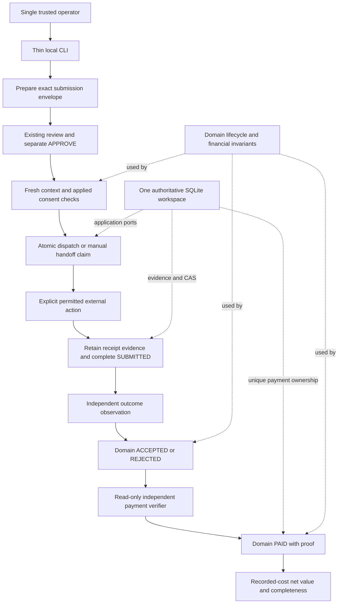
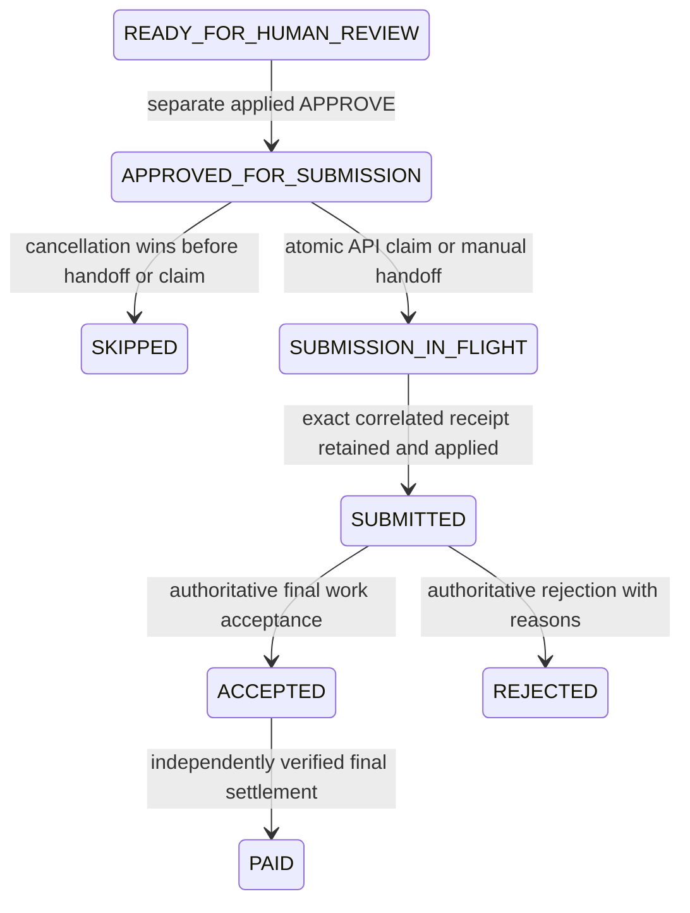

# F03-A: Submission, outcome and verified-payment architecture plan

Date: **2026-10-29**, Asia/Bangkok. **DESIGN ONLY — NEEDS_DECISION.**
Reviewed commit: `9748fc6f275dfdb68466785a9dbf95ccfda48912`.
The worktree was clean at review start. This report is the only repository change.
No production code, tests, existing ADRs, dependencies or infrastructure changed.
No submission, authenticated marketplace request, payment lookup/transfer, account
registration/claim or paid inference was performed. Public documentation/source
retrieval was read-only. No commit or push.

## 1. Recommendation and scope

Approve a **local manual-first evidence foundation**, followed by separately gated
provider-specific observation and settlement adapters. Reuse current lifecycle,
versioned QA, operator approval, submission claims and BudgetManager. Add only the
missing immutable submission context, manual handoff ownership, evidence provenance
and conditional completion boundaries. No framework, wallet, frontend, scheduler,
microservice, hosting service or AWS deployment is justified.

Do not activate an API send merely because a POST endpoint exists. The complete
Superteam deliverable-to-verified-value path is currently **BLOCKED** on a selected
permitted opportunity/channel, authoritative outcome evidence, payout correlation
and a supported asset/recipient contract. Offline implementation of the proposed
foundation can proceed after the decisions in section 12; this report is not that
approval and does not close F03.

Submission received, project application selected, completed work accepted and
money settled are different facts. Potential/expected/accepted amounts, a platform
paid label, an operator note and a model prediction never establish verified revenue.

## 2. Current-state inventory: source is authoritative

Read AGENTS.md, Product Constitution, original audit F01/F03/F06/F07/F08, F02-A,
F02-B5, F05-A/B1/B2/B3/B4 and FIX1, relevant ADRs 0013–0015, 0021–0028 and the current
submission, approval, lifecycle, budget, source, persistence, runtime and metrics
paths. Historical descriptions are qualified below by current implementation.

Paths in this report are relative to `src/agentmine/` unless stated otherwise.

| Area | Actual behavior | Missing boundary / operational limit |
| --- | --- | --- |
| Local Data/F05 | Explicit local execution, retained real result, exact-version QA, revision lineage and operator review exist | Export is local; no submission permission follows from export or QA PASS |
| Operator review | `application/use_cases/operator.py:34,168` freezes Opportunity revision, content, deliverable/version, destination, ledger revision, costs/risks; APPROVE installs HumanApproval | Target is an opaque Reference. Mode, marketplace account, complete form answers, remote artifact identity and provider contract are not a typed approved submission context |
| Decision persistence | Decide saves decision before Opportunity CAS; same-decision retry can repair matching state | Decision alone is not an applied approval; future send preflight must verify both records. No generic approval-transaction rewrite is proposed |
| API submission | `use_cases/settlement.py:39` checks matching content/QA/approval, refreshes, calls atomic claim_dispatch, then submit once; existing intent uses reconcile only | No concrete production SubmissionGateway. Existing refresh is availability/deadline, not full worker-style eligibility/terms comparison |
| Cancellation/F01 | `domain/opportunity.py`, `contracts/submission.py:75`, SQLite/DynamoDB claim_dispatch atomically bind intent plus SUBMISSION_IN_FLIGHT to exact approved revision | Preserve F01. Unknown commit never grants send. In-flight has no skip/cancel transition; legacy inconsistent states need explicit reconciliation |
| MANUAL | SubmitTask retains an immutable version-owned package and HUMAN_ACTION_REQUIRED; no gateway call; Opportunity remains APPROVED_FOR_SUBMISSION | Package preparation does not atomically reserve an in-flight human handoff. It cannot prevent a human sending a stale/cancelled package or clicking twice |
| Manual receipt | `use_cases/manual_submission.py:21` records trusted local operator, send time, reference, response, optional external ID/URL; validates current approval | Explicitly operator-reported. No independent receipt authentication or provider/account identity contract |
| Receipt recovery | `use_cases/submission_result.py:14` validates result, records attempt, saves Submission, then Opportunity CAS | Evidence-first separate transactions; a retained result repairs compatible state without resending. Conflicting/stale state stays blocked |
| Outcome | TrackOutcome polls gateway for SUBMITTED; pending observation leaves state; final observation -> immutable Outcome -> aggregate ACCEPTED/REJECTED | Observation has reference/time and optional Outcome, without structured provenance, received/under-review/disputed statuses or independently authenticated reader |
| Payment | VerifyPayment requires ACCEPTED, reuses retained verified observation, validates PaymentEvidence and then moves PAID | PaymentVerifier is a port, not a proof-authentication implementation; no real verifier exists. Recipient/network/asset matching is delegated to trusted adapter configuration |
| Financial storage | SQLiteSubmissionRepository retains attempts/history, rejects conflicting finals and duplicate `(verification_source,payment_reference)` across submissions | Source IDs must be canonical across adapter instances/providers; a new URL/source label cannot be allowed to credit the same real transfer twice |
| Financial model | `domain/payment.py`, `domain/opportunity.py:verify_payment/verified_revenue` require matching VERIFIED_PAYMENT proof, time and currency; only PAID counts | One final outcome/payment; no partial accumulation, refunds, acceptance corrections or reversal journal |
| Metrics | `domain/metrics.py`, `use_cases/metrics.py` derive current verified reward minus attributed actual category costs; dashboard separates forecasts and currency buckets | Individual metrics require matching currencies; Opportunity/ledger reads are separate. Unmeasured costs and FX remain unknown; not a complete accounting profit |
| Money/source normalization | Money accepts three uppercase ASCII letters; Superteam only normalizes fixed-price projects with representable reward | USDC/USDG are not representable; SOL is syntactically representable, not validated asset identity. No stablecoin-to-USD conversion. Bounty prize pools/ranges remain quarantined |
| Budget | BudgetManager persists authorization before work and actual settlement separately, with scoped spending approval | Submission/verification operations are not named OperationType values. No submission-fee or paid-query gating is currently wired; AI limits are not a general complete spending cap |
| Composition | `bootstrap/operator.py` composes real SQLite, Data runtime and review; disabled source default, explicit live read opt-in | It does not compose SubmitTask/RecordManualSubmission/TrackOutcome/VerifyPayment or real financial providers. Lambda accepts injected gateway/verifier, not shipped real adapters |
| Adapters | Superteam HTTP supports only two allowlisted GET listing routes, with raw archive and no redirects/retries. Algora/Opire disabled | No POST/outcome/payment adapter; no permission inferred from listing prose. MockLLM/test gateways/verifiers are not production capabilities |

F05-B4-FIX1 is present in current source: incomplete revision inspection compares
the exact started snapshot. This does not add settlement authority. F02-B5/F05
closure applies only to their documented local scope; paid resume and Research
remain separate gates.

## 3. Provider feasibility and evidence reviewed

Documentation/source accessed **2026-10-29**. These are public contracts and source
observations, not authenticated compatibility or permission to use an account.
GitHub main may differ from deployment; a future contract checkpoint must pin its
revision and save sanitized provider-authorized fixtures before implementation.

| Capability | Verified public evidence | Feasibility / unresolved issue |
| --- | --- | --- |
| Agent create/update | Official [agent guide](https://superteam.fun/earn/agents) documents authenticated create/update, agent participation flags, project contact requirement and human payout-claim flow | Candidate API contract, not an installed gateway or deployment certification. Human claim is payout eligibility, not settlement |
| Create response and account | Official [agent create route](https://raw.githubusercontent.com/SuperteamDAO/earn/main/src/pages/api/agents/submissions/create.ts) selects claimed human or agent user and returns the create result | Account/claim changes can alter submitter. Freeze intended agent/effective account; stop on identity mismatch. Response schema and content binding need captured fixtures |
| Duplicate behavior | Official [create helper](https://raw.githubusercontent.com/SuperteamDAO/earn/main/src/pages/api/submission/create.ts) checks existing listing+agent/user before creation; it can also populate a missing user contact field | Not a documented client idempotency-key contract or proof of race-safe remote uniqueness. Submission can include a sensitive account side effect; require explicit disclosure/approval or ensure it cannot occur |
| Error ambiguity | The agent route catches broad failures and can return an error after invoking the helper | Do not infer “no remote effect” from every HTTP 403/5xx. A duplicate error is not a correlated receipt. Keep ambiguous result locked |
| Update | Official [agent update route](https://raw.githubusercontent.com/SuperteamDAO/earn/main/src/pages/api/agents/submissions/update.ts) edits through separate logic | An edit is a new external mutation, not reconciliation. Exclude updates from first slice; F05 does not authorize editing an already-submitted version |
| Account status | Official [agent status route](https://raw.githubusercontent.com/SuperteamDAO/earn/main/src/pages/api/agents/status.ts) returns agent/account/claim fields | May help a future authorized account check; it is not submission, outcome or payment status. Current AgentMine transport does not expose it |
| Submission-specific outcome | No supported agent read/reconcile/outcome contract was established by the reviewed guide/routes | BLOCK automated authoritative outcome. Listing closed/winners announced and project application selection cannot prove this completed deliverable was accepted |
| Payout | Human claim flow is documented; an independent payout-verification API was not established | No current automatic payment path. A transaction hint may identify candidate evidence, but must be independently fetched and correlated |
| Candidate independent ledger | Solana documents [getTransaction](https://solana.com/docs/rpc/http/gettransaction), [getSignatureStatuses](https://solana.com/docs/rpc/http/getsignaturestatuses) and [network/finality](https://solana.com/docs/rpc) | Read-only verification is technically plausible without wallet signing. A specific approved asset/network/recipient/payer-correlation policy and RPC provider are still needed. No RPC request was made |

The official guide requires the project's human contact information and restricts
agent participation. Do not invent that contact, register/claim accounts, inspect
competitors' work or use a human UI/account to evade an agent-only restriction.
The documented create/update rate limit is 60/agent/hour; it is not a license for
retrying unknown sends. These operational facts come from the
[official agent documentation](https://github.com/SuperteamDAO/earn/blob/main/public/skill.md).

Important inference from current normalization and route semantics: fixed projects
can use application/review stages, so selecting an application is not necessarily
final acceptance of the generated Data artifact. Before selecting a real case,
verify exactly what the submission represents, how completed work is delivered,
who accepts it and how settlement is correlated. If that workflow cannot fit one
submission/final outcome without pretending an application is finished work, that
opportunity is unsupported in this first slice. Do not broaden V1 to fix it.

No new Algora/Opire integration is proposed. They are not the configured local
source, and their unresolved contracts are not a fallback around Superteam gaps.

### Manual fallback has a strict limit

An explicit operator-driven submission through a permitted platform UI/contact
channel is feasible only after that actual channel, account and listing terms are
verified. Generic package/evidence support can be implemented offline first; no
specific working human channel is certified here, including for AGENT_ONLY items.

Operator uploads and notes remain operator-reported. If no authenticated read,
independently verifiable signed export or other approved authoritative observation
mechanism exists, retain provisional receipt/outcome evidence and stop. Do not label
an operator screenshot independently verified, invent a read endpoint, scrape a
restricted page or run a headless logged-in browser as an undocumented API.

## 4. Proposed smallest architecture and contracts

All names below are proposals, not currently available commands or classes.



Keep Domain vendor-free. Application owns immutable contracts, policy checks and
orchestration; Infrastructure owns transport, source-specific schema mapping,
evidence capture, verification parsing and SQLite consistency. Bootstrap selects
explicit real capabilities; Presentation never creates an Outcome/PaymentEvidence
from a user's claimed status and never mutates lifecycle or ledger records.

### Minimal additions, staged when needed

| Proposed contract / boundary | Purpose |
| --- | --- |
| SubmissionEnvelope | Opportunity/Task/execution/lineage/version, exact bundle+artifact digests, QA inspection/report, source context and eligibility evidence, mode, destination/listing and account reference, outbound material/answer-sheet digest, contract version, actor/time. Immutable; no secrets or authorization supplied by JSON |
| Submission destination/account binding | A vendor-neutral immutable identity resolving the allowed marketplace/listing/account/channel. Credential configuration is referenced, never embedded. Includes the approved recipient of disclosed data and known account side effects |
| Submission context repository | Prepare/read envelope and bind its digest to the existing operator review/scope. Prevent a generic destination Reference from authorizing a different mode/account/body. Could use a content-addressed scope Reference resolving this envelope, preserving existing Domain approval shapes |
| SubmissionPreflight | Load exact current completed version/result/QA, applied submission review+decision, one ledger and immutable envelope; refresh source and rerun deterministic eligibility against reviewed facts/policy/resolution. Compare terms, destination, account and payload mapping; no AI |
| ManualSubmissionHandoff plus claim_manual_handoff | Explicit confirmed handoff of exact existing manual intent; atomic handoff ownership plus Domain begin_submission and expected revision. Not a second generic workflow engine |
| SettlementEvidence | Immutable ID/type, subject submission/envelope, evidence provenance/trust class, capture hash, provider/account identity, external event ID, observed/event times, schema/parser version, result/reasons, actor where applicable. Store references in inner layers; confidential bytes in a bounded protected adapter store |
| OutcomeEvidence assessment | RECEIVED/UNDER_REVIEW/ACCEPTED/REJECTED/DISPUTED/UNKNOWN as observation facts, separate from Domain final Outcome. Only authenticated and semantically matching final work evidence can create Outcome |
| SettlementExpectation | Reviewed submission/accepted-outcome linkage, authorized recipient, asset/network identity, allowed correlation evidence and one final settlement scope. Operator supplies hints, not actual paid amounts or a verification decision |
| Settlement completion repository | Narrow same-workspace conditional receipt/outcome/payment completion, immutable evidence/event ownership and audit receipts. Avoid a generic UnitOfWork; reuse SubmissionRepository storage where consistency fits |
| Verified-value report | Same-read workspace/ledger revisions, per-asset reward/actual categories, outstanding and unmeasured costs, evidence freshness/conflicts and cost completeness. No FX by default |

Reuse SubmissionGateway.submit/reconcile and PaymentVerifier only when verified
adapters exist. Do not build a production fake to satisfy their signatures. Manual
receipt recording can reuse RecordManualSubmission semantics. TrackOutcome currently
couples outcome reads to a sending gateway: for a manual-only composition, add a
narrow OutcomeSource observation port when needed rather than a dummy gateway whose
submit method pretends to work. An API gateway can delegate to that reader.

For API mode, the exact source-specific form must be prepared deterministically
before approval. Keep provider keys/JSON schema outside Domain; retain a digest of
the outbound representation and an operator-readable rendering with the envelope.
No adapter may invent answers, publish artifacts, change contacts or select a new
URL after consent. If a narrow preparation port becomes necessary, return opaque
representation evidence plus a validated review rendering, not an SDK object.

No public artifact hosting is added. Operator-approved publication to an existing
permitted destination is separate from local export and must be disclosed. A local
path is not a public URL; a mutable link alone does not prove remote bytes match the
approved manifest. If required delivery cannot bind the content or the authorized
channel cannot be established, block rather than silently upload elsewhere.

## 5. Submission authorization, identity and lifecycle

### Before any handoff or send

1. Resolve current authoritative Opportunity, Task, exact completed execution,
   lineage/version and retained bundle/manifest. Verify all digests and stored
   result/QA bindings. Same bytes on a later version never transfer authority.
2. Require current PASS and the original applied APPROVE for external submission,
   matching review, actor, version/content, immutable envelope/mode/account/target.
   A revision-input consent, spending consent, QA PASS or decision-only partial
   write is insufficient. Reuse existing review/show-review/decide; expose the
   resolved envelope in that review rather than create another approval system.
3. Obtain a fresh matching source observation at dispatch/handoff, compare exact
   reviewed requirements/version/deadline/AI permission, rerun current deterministic
   eligibility and validate applicable F04 resolution. UNKNOWN/ineligible/expired
   or changed terms block; a previously ELIGIBLE flag is not permanent permission.
   Fresh economics may be shown as a forecast but never becomes permission or
   changes the approved outbound scope silently.
4. Verify the account/channel can act for that listing. A configured secret is not
   proof of identity/authorization. Verify effective account/claim state through
   an approved read mechanism or explicitly bounded human evidence; unknown blocks
   API mode. No keys, sessions, private keys or claim codes in logs/artifacts/LLMs.
5. For any metered call/fee, obtain a supported price/currency estimate and existing
   BudgetManager authorization plus applicable spending approval before dispatch;
   submission approval does not authorize spending or account mutation. Extend
   OperationType narrowly for submission/verification when implemented. No new paid
   capability is needed for the first local/manual checkpoint. Unmeasured host
   costs remain UNKNOWN; unknown provider fees are not a fabricated zero.
6. Recheck the authoritative revision through atomic ownership. Network refresh
   cannot be inside a local transaction; the remaining remote TOCTOU limitation is
   explicit. Changed context needs a new review, not silent rebinding.

If the real channel is MANUAL, retain that fact and its matching F04 resolution;
do not relabel it AUTOMATIC to make the Data runtime or submission preflight pass.
The existing F04 resolver cannot issue a new resolution at an arbitrary completed
work phase. An already-completed automatic-context task that now needs a new
manual eligibility resolution must remain blocked pending a separately approved
context-resolution design, not rewind lifecycle or treat submission approval as
eligibility consent. Manual-first infrastructure does not remove this live-case
selection constraint; F05 rework's existing MANUAL exclusion remains in force.

### API ownership

Preserve F01 claim_dispatch and its API-only SubmissionDispatch guard. One claim
per stable submission ID and `(lineage,version)` is necessary but insufficient for
Superteam's account+listing uniqueness: also reserve a canonical provider/account/
listing external action identity across local versions/workspaces used by this
operator. At minimum one authoritative workspace must be enforced; multiple
independent stores cannot provide this safety. New IDs or v2 cannot evade a prior
unknown external intent. Updates to submitted work remain unsupported.

The stable submission reference is passed as provider idempotency key only if the
provider supports it; do not invent a header or equate local uniqueness with remote
exactly-once delivery. The sole call that observes a definite new atomic claim may
send once. Existing/ambiguous claims only reconcile by observation. Disable HTTP
automatic retries/redirects and API-to-manual fallback. A timeout or unknown commit
never yields a fresh send right. A gateway unable to reconcile returns UNKNOWN or
UNSUPPORTED, not a synthetic receipt.

### Manual handoff

Preparation/export remains unsent. Immediately before the operator's external
action, an explicit proposed `submission handoff --id ID --confirm` revalidates and
atomically claims the manual intent plus SUBMISSION_IN_FLIGHT. Add a narrow manual
contract/port; do not weaken SubmissionDispatch's existing API-only guard.
Use Domain begin_submission/submit and existing lifecycle graph, with a focused ADR
extending in-flight meaning to a human handoff. The new coordinator reads retained
handoff/package evidence on retry; it must not call legacy manual SubmitTask again
from in-flight, because that path currently rejects manual in-flight use.

Cancellation wins before handoff -> no valid handoff, no authorized send. Handoff
wins -> cancellation/rework is blocked until evidence is reconciled. Human action
cannot be transactionally locked by SQLite: the operator must check the current
handoff immediately before using the approved channel and never resend if unsure.
No claim that software prevents a person clicking twice. No lease expiry, automatic
release, mode switch or assumed failed send. A stuck handoff is an F08 incident.

### Proposed state flow



UNKNOWN send stays in-flight. Received/under-review/disputed/unknown outcome
observations do not create extra Opportunity lifecycle states. A manual reported
receipt may establish SUBMITTED with its explicit trust label; it never establishes
ACCEPTED or PAID. Reconcile historical receipts even if the listing later closes,
without authorizing a new action. Preserve current legacy/manual read compatibility;
do not convert legacy packages or decisions into new handoff authority.

## 6. Evidence trust matrix and outcome verification

| Evidence | Trust and permissible state effect |
| --- | --- |
| QA, score, model text, expected reward | Internal validation/forecast only; no receipt/outcome/payment authority |
| Local exported package | Exact local artifact evidence; no external event |
| Operator receipt note/screenshot/URL | Operator-reported historical send; retain author/time/digest and optionally SUBMITTED through explicit manual recording; not independently authenticated |
| Correlated authenticated provider receipt | Submission received only; exact account/listing and approved payload/version linkage required |
| Official received/under-review observation | Retain platform status with observation time; aggregate remains SUBMITTED |
| Listing closed or winners announced | Listing-level fact; does not resolve this submission |
| Project application selected | Application-stage fact; cannot automatically mean completed work accepted |
| Independent authorized final acceptance/rejection observation | Exact submission, account, final-work stage, evidence digest/time, accepted amount if known/rejection reason; may create Domain Outcome |
| Operator acceptance note, arbitrary email/PDF/screenshot | Provisional assertion; no final machine outcome unless an approved authenticity-verification mechanism establishes authoritative provenance |
| Platform paid/claim flag, transaction hint, self-authored invoice | Payment candidate only; zero verified revenue |
| Independent finalized settlement evidence | May create PaymentEvidence only after asset/recipient/amount/event/finality and bounty-correlation checks; then conditional PAID completion |
| Conflicting/disputed/unverifiable evidence | Retain conflict and required action; no optimistic state update or new verified amount |

Record external effective time separately from observation and local import time.
Future or impossible chronology fails; unknown event time remains unknown and may
prevent final application. Retain rejection reasons verbatim as untrusted bounded
data; do not synthesize a reason or substitute a prediction. URLs are references,
not permission to fetch arbitrary hosts or follow redirects. Logs use IDs/codes;
private captured bodies have explicit retention/access/redaction policy.

A successful browser observation by the operator is human-observed evidence, not
an authenticated automated outcome adapter. A screenshot hash proves consistency,
not platform origin. Authenticated read-only lookup or an authenticity-checked
platform-signed artifact is required for the independent outcome goal. Until one
is established, receipt/manual evidence features stop before final Outcome.

Conflicts after final ACCEPTED/REJECTED/PAID are not resolved by overwriting history
or another poll. Retain the conflicting observation and block certified current
net-value reporting pending incident resolution. Existing lifecycle and metrics
cannot represent reversals: a correction/refund/reversal model is a separate
approval gate before supporting reversible settlement providers. An implementation
introducing conflict holds must make every operational dashboard/export consult
them; it cannot leave old raw metrics presenting disputed amounts as certified.

## 7. Independent payment and financial invariants

### Minimum verification contract

Require an applied authoritative accepted Outcome and retained receipt, plus a
reviewed SettlementExpectation. The operator may supply a transaction/reference
hint and authorized public recipient information; the verifier independently reads
an allowlisted source. No credential, wallet signing or transfer is needed.

The verifier must establish all of the following, retaining auditable captures:

- Correct production network/provider account; testnet/devnet/synthetic transfers
  are never production revenue. Match asset by canonical identity, not display
  symbol alone; exact integer base units/decimals, no floating-point or truncation.
- Successful final settlement, exact recipient/account ownership binding, measured
  amount, stable external event identity and actual settlement time. Source outage,
  null transaction, missing metadata/time, unsupported transaction or insufficient
  finality stays PENDING/UNVERIFIABLE, with no payment/revenue.
- Correlation to this specific accepted submission and expected payer/settlement
  instruction from authoritative evidence. An unrelated real deposit to the right
  address, self-transfer or operator story cannot establish bounty revenue.
- No previous credit of the same canonical event. Provider URL/host changes do
  not change verification_source identity. For a ledger, namespace by chain/network
  and identify the exact transfer event, not an arbitrarily renamed transaction.
  Mixed/multiple-transfer transactions are unsupported initially unless their
  event indexing and allocation are explicitly verified.
- Matching existing Money currency and supported payment shape. One full, final
  settlement per submission initially; do not combine partial payments, call the
  first partial “paid in full”, silently replace accepted reward, or lose evidence
  of a mismatch. Differences require an explicitly reviewed settlement expectation
  and independent evidence; never copy the expected amount into actual reward.

Solana is a **candidate**, not a selected adapter. Official RPC offers transaction
lookup and signature/finality status, including possible missing results; network
selection and finality matter. A future native-SOL verifier could deliberately
support only a simple finalized inbound transfer with known payer correlation.
Token programs, token-account ownership, fees/rent, unsupported transaction versions
and asset mapping need their own verified parser scope. Public shared RPC is not a
production service guarantee. See the official
[transaction reference](https://solana.com/docs/rpc/http/gettransaction),
[signature-status reference](https://solana.com/docs/rpc/http/getsignaturestatuses)
and [RPC overview](https://solana.com/docs/rpc).

Bank/provider verification is an alternative only after selecting an actual
authorized read-only settlement contract. No bank API, explorer endpoint or payment
permission is invented in this plan. Imported screenshots/unsigned statement files
are not a shortcut to independent verification.

### Currency, costs, fees and net value

1. Potential Reward != Expected Value != Accepted Reward != Verified Revenue.
   Only matching independently verified PAID evidence contributes to verified
   revenue. All unverified amounts contribute zero verified revenue; this says
   nothing about whether money might exist outside the observable system.
2. Keep the existing three-letter Money restriction for the initial foundation.
   USDC/USDG payouts remain unsupported, not relabelled USD or truncated. If the
   chosen real opportunity needs them, require a separate focused asset-identity/
   precision/migration decision before that opportunity can proceed. No implicit
   token catalogue or multicurrency accounting expansion.
3. No FX in the first slice. Matching-currency recorded net is verified reward
   minus actual AI/tool/infrastructure/transaction costs. SOL reward with USD AI
   costs produces separate buckets and an unavailable combined net, not a guessed
   USD profit. Current individual EconomicMetrics explicitly rejects mixed currency;
   a new operational view must report unsupported aggregation, not bypass it.
4. Revenue basis is independently measured credit to the authorized recipient.
   Separately record fees actually borne by AgentMine/operator as transaction/tool
   costs with stable IDs and evidence. Sender-paid fees are not our costs. A fee
   already withheld in the measured net credit must not be subtracted a second
   time. If gross amount is later reported, its net-credit/fee reconciliation must
   be explicit and must not add both gross and net as revenue.
5. Budget reservations/estimates are not actual charges. Unknown provider charges
   stay reserved/unresolved; actual overruns are recorded truthfully and restrict
   later operation. Preserve every commitment, actual and released operation ID.
   No submission approval, policy increase or zero-AI mode manufactures fee consent.
6. Show measured costs, outstanding estimates and unmeasured categories separately.
   Net on a recorded-cost basis may be negative; it is provisional while cost
   completeness is unknown. Do not present it as fully verified profit. A certified
   complete net requires all relevant cost evidence and no financial conflict.
7. Derive reports on read from a consistent local Opportunity/ledger/evidence
   snapshot with revision/as-of metadata; no new cached earnings counter. Late
   costs change the recorded net without rewriting original forecasts/history.

Payment arriving before acceptance can be retained as candidate independent
evidence, but cannot cause PAID via an invented acceptance. Payment after a rejected
or disputed outcome is also a reconciliation case, not a lifecycle shortcut.

## 8. Transactions, immutable identity and crash recovery

Use the same file-backed SQLite authority for Opportunity, approval/envelope,
submission, evidence indexes, ledger and completion audit records. Existing
snapshot kinds/codec allowlist can grow additively after approval; no reset or
schema-driven business rule. Private bounded raw captures may use the same file
or a separately durable evidence store; an immutable verified capture must exist
before its business reference commits. The backup set must include every store.

Reuse stable submission reference; allocate separate immutable envelope/handoff,
observation/verification and cost operation IDs. Same-ID equal payload -> original
receipt; conflicting payload -> typed conflict. Captures, parsed evidence and
application receipts keep their own digests and parser/contract version. No
process-local lock is the authority and no network/human action spans a transaction.

| Boundary / failure | Required persistence and recovery |
| --- | --- |
| Prepare envelope/package | Immutable exact scope/evidence; no send. Same-ID readback; changed bytes/account/mode require new review before any intent |
| Approval decision saved, aggregate not saved | No handoff/send until the matching decision is applied. Same original decide retry or safe block; no fabricated replacement approval |
| Freshness/account/budget check fails | Typed BLOCKED; no external action. Do not downgrade to MANUAL or use historical eligibility |
| Cancel races claim/handoff | Exact Opportunity revision and envelope/consent checked in one write transaction. Cancellation wins -> no action authority; claim wins -> in-flight and non-cancellable |
| Claim transaction rolls back | No right to send. Same original ID may be inspected/retried only after definite no-commit evidence |
| Claim commits but acknowledgement is lost | No send in uncertain call; inspect retained ownership and reconcile only. No second sender after restart |
| Crash after claim, before possible send | Indistinguishable from some post-send crashes; remain in-flight. No blind retry even if no receipt is visible |
| HTTP timeout/ambiguous error or human uncertain click | Retain UNKNOWN and original intent/account/listing owner. Read-only reconcile, or inspect-only if no supported reader; never update/create as reconciliation |
| Definitive correlated receipt returned | Retain capture/result first. Proposed local completion atomically applies exact Submission and Domain SUBMITTED plus application receipt; CAS mismatch preserves raw evidence and blocks |
| Completion fails/lost ack | Reopen original evidence/operation and retry local completion only; no refresh requirement that would prevent recording a historical send after deadline; no new send |
| Outcome pending/disputed/unknown | Append immutable observation and provenance; no final aggregate change. Observed absence is not rejection |
| Final authoritative outcome | Validate evidence/subject/stage/time; atomically retain final application audit/Outcome and CAS aggregate, or recover evidence-first local completion. Conflicting final stays retained as conflict, not overwritten |
| Independent payment proof obtained, process dies | Retain capture/verification before application. Reopen original proof; do not request/send a payment |
| Apply verified payment | In one local transaction: canonical event unique owner, accepted-snapshot check, verified observation, Domain PAID and receipt. Failure after any write rolls back all authority; durable capture may remain orphaned safely |
| Same payment queried through another provider | Canonical event key conflicts across submissions; provider endpoint is not ownership identity. Same-submission equal retry returns original application receipt |
| Cost evidence before/after payment | Idempotent original BudgetManager accounting; no zero invention or release. Report remains incomplete until evidence settles; consistent read includes late actuals |
| Contradictory later outcome/payment / corrupted backup | Retain conflict, block certified totals and further actions; F08 evidence-driven incident handling. No destructive reset, final-state overwrite or new identity to evade ownership |

Current receipt/outcome/payment use cases already use evidence-first ordering and
recover retained records. Do not replace all of them with a generic transaction
framework. Introduce narrow conditional completion operations only where the new
operational evidence/authority boundary requires atomic application. Internal
commands carry validated snapshots; CLI cannot supply replacement Budget,
authoritative QA, arbitrary Outcome or PaymentEvidence.

## 9. Operator workflow and capability gates

Keep one trusted local actor and existing module CLI/workspace/ledger. Proposed
commands are illustrative and **not implemented**:

| Step | Proposed operation / required stop |
| --- | --- |
| Prepare | `submission prepare/show`: current version + approved destination/account/material. No source prompt chooses URLs, files, credentials or commands |
| Approve | Existing `review/show-review/decide APPROVE`, expanded to the exact envelope. User reviews disclosed data, mode, account and side effects; no automatic chain |
| Manual action | `submission handoff --id ID --confirm`, then operator uses verified channel. No software send; handoff and external click explicitly distinguished |
| API action, later | `submission send --id ID --confirm` only with approved real gateway capability. Separate explicit intent after approval; no fake fallback |
| Receipt | `submission record-receipt/show/status`; evidence import has operator trust label. `reconcile` observes only, never sends |
| Outcome | `outcome observe/status`; unsupported authoritative source returns BLOCKED and preserves provisional notes. No `--accepted` shortcut |
| Payment | `payment inspect/verify` with a retained expectation and candidate reference; independent configured verifier controls result. No `--paid`, amount-as-proof or arbitrary RPC URL |
| Economics | Consistent per-currency report, separate forecasts/accepted/verified, actual categories and completeness/holds; read-only |

Bound JSON and local files as existing runtime does, reject duplicate keys,
unknown fields/nonfinite values, symlinks/traversal and oversized captures. No
remote URL fetch based on marketplace text/operator-imported evidence. Select a
named allowlisted adapter and configured endpoint at bootstrap. Sanitize terminal
output and logs; never expose full private payloads/Authorization headers/claim
codes to LLMs. No LLM is required anywhere in this settlement workflow.

## 10. Dependencies: hard blockers versus deferrable work

| Dependency | Hard blocker for live action / verified value | Deferrable without false claims |
| --- | --- | --- |
| F01 | Preserve atomic claim/cancel semantics and unknown-outcome lock; manual handoff needs its analogous explicit boundary | No global cancellation/release redesign |
| F03 provider contracts | Actual permitted channel/account, exact form/receipt mapping, authoritative final outcome and independent settlement correlation | Build offline contracts/inspection/manual evidence without enabling send/verification |
| F07 | Fresh reviewed source terms/eligibility/authorized account before handoff/send; truthful operator facts; unsupported changes block | General automatic fact authentication/remote locking; document trusted assertions and TOCTOU |
| F08 | Minimal backup set/restore preservation and no-resend incident runbook before first live action; unknown actions/costs remain locked | Automated reconciliation, release, supersession and broader recovery UI; keep inspect-only incidents |
| F06 | Shared durable claims/evidence and cloud validation before any Lambda external effect | Entire AWS deployment; one local authoritative store needs no cloud service |
| F02-C / B4-2 | Approved paid capability/pricing/current-policy authorization if introduced | Research/semantic work and paid budget resume; existing completed deterministic Data is sufficient locally |
| F05 | Exact completed version/current QA/approval; no rework of in-flight/submitted content | Submitted-content update capability and post-submission versions |
| Financial representation | Supported asset/decimals/network and recipient/correlation before PAID; FX if a combined cross-currency number is demanded | Remain single-currency with no FX; block USDC/USDG until an approved focused asset decision |

## 11. Dependency-ordered implementation checkpoints

Each checkpoint requires its own explicit operator authorization, failing tests
before production changes, and a report before proceeding. Approval of a code plan
does not authorize real external actions or financial/account changes.

| Checkpoint | Smallest deliverable | Test-first acceptance gate / operator boundary |
| --- | --- | --- |
| F03-B1: context and evidence foundation | Immutable envelope/account/channel/evidence contracts and local read/prepare persistence; existing review binding; no send or final money transition | File-backed immutable IDs/digests, same-version/same-bytes distinction, strict input, wrong actor/ledger/account/mode, no dispatch during preparation; approve envelope/trust/identity policy first |
| F03-B2: manual handoff and receipts | Existing manual package/receipt reuse plus atomic handoff, current preflight and read-only status/history; minimal backup/no-resend runbook | Cancel-versus-handoff races, source unavailable/changed/expired, unknown/manual eligibility, unapplied approval, rollback at each write, concurrent IDs, lost ack/reopen, historical receipt after deadline, no gateway calls/revenue; operator separately approves actual channel/account and each handoff |
| F03-B3: authoritative outcome evidence | Narrow read-only OutcomeSource or authenticity-checked artifact mechanism for one verified contract; provenance/status/conflict records and conditional final application | Received/under-review/disputed/unknown do not finalize; listing/app-selection is not work acceptance; forged/stale/wrong submission/account/stage blocked, rejection reasons preserved, final conflict/receipt-before-CAS recovery; stop if no real contract, never substitute operator notes |
| F03-B4: independent payment contract gate | Select one real asset/network/provider, recipient and bounty-correlation/finality policy; decide representation/migration if needed; ADR before verifier | Saved authorized fixtures for wrong network/recipient/payer/asset, pending/null/error/unsupported versions, same event via different providers and unrelated deposits; no runtime VERIFIED capability until policy and contract are approved |
| F03-B5: bounded read-only verifier and application | Real PaymentVerifier for the selected simple settlement, canonical event ownership and atomic PAID audit/receipt | Test-first zero-revenue for every unverified case, accepted != paid, amount measured from source, mismatched/partial payments blocked, duplicate-event concurrency, rollback each write/lost ack/original receipt, capture-before-apply recovery; no wallet/signing/transfer; live read requires separately authorized actual evidence |
| F03-B6: financial reporting and independent local audit | Consistent recorded-cost view, completeness/conflict flags, per-currency totals and exact evidence links; isolated $0 end-to-end audit | Known numerical nets/negative unpaid net/late actuals/fees/no double deduction/mixed currency refusal/unknown costs/holds; offline fake actions explicitly labelled, real provider compatibility separately evidenced; no production/earning claim from fixtures |
| F03-C, optional later API lane | One approved real SubmissionGateway plus deterministic pre-approved form mapping and observation-only reconciliation; no updates | Must pass all F01 races/restart/concurrent/version/account tests, error-after-effect/timeout/malformed receipt, no automatic HTTP retries or manual fallback. Requires verified provider send/receipt/lookup/side-effect contracts and separate operator consent for one real send; otherwise leave unavailable |

B3/B4 contract research can be read-only and parallel in scope, but no verified
payment can be applied before authoritative outcome/representation gates are met.
API sending is not a prerequisite for independent settlement of a genuinely
permitted manual submission. Conversely, manual evidence alone does not complete
B3 or B5. Do not implement all checkpoints in one large change.

Expected future touchpoints: focused new application submission-context/evidence
contracts/ports/use cases; existing operator/settlement/manual/result orchestration
only as needed; narrow SQLite adapter/codec additions; explicit local bootstrap
and thin CLI. Domain changes require proof of necessity: existing lifecycle is
sufficient for handoff/final settlement, but monetary assets or reversals need a
separate approved design. No vendor DTOs or database rules enter Domain.

Implementation verification at each code checkpoint: relevant unit/contract/real
SQLite CLI/fault/concurrency tests, F01/F04/F05/runtime/QA/budget regressions and
architecture tests, full pytest, Ruff check/format, strict mypy and git diff --check.
No automated test uses a real paid API or sends externally. A later live read/send
is not implied by passing these gates.

## 12. Decisions requiring operator approval

1. Approve manual-first foundation and an explicitly permitted concrete channel
   for a selected V1 Data/Research opportunity; generic foundation may be built
   offline, but no eligible current opportunity or channel is asserted here.
2. Approve exact envelope/account/mode/outbound-material binding through existing
   submission review, with fresh source/eligibility checks at handoff/send. Account
   contact/profile mutations require distinct sensitive-action consent or must be
   prevented; a broad submit approval cannot silently authorize them.
3. Approve atomic manual handoff -> SUBMISSION_IN_FLIGHT and its deliberate sticky
   no-cancel/no-resend behavior. Human clicks remain outside software enforcement.
   Legacy unarmed packages are inspect-only for new actions, not auto-migrated.
4. Approve evidence trust levels: operator reports remain provisional; only a
   verified authoritative final-work mechanism can create Outcome, and only an
   independent verifier can create payment proof. If no such source is available,
   accept a safe stop rather than full F03 completion.
5. Select payout asset/network/recipient and authoritative correlation/finality
   policy. Decide whether to remain on currently representable assets or authorize
   a separate USDC/USDG asset design; no USD aliasing or automatic FX. No custody,
   signing, trading, token creation or autonomous wallet behavior.
6. Approve one final payment, no partial accumulation/reversible-provider support
   initially; disputed final evidence blocks certified current reporting until an
   explicitly designed correction process exists. Approve recorded-cost net and
   visible UNKNOWN completeness rather than a false complete-profit number.
7. Approve the minimal live incident/backup boundary and one authoritative local
   workspace; defer general F08 reconciliation and all F06 cloud activation.
8. Decide whether a later API lane is worth pursuing after the manual/evidence
   foundations. Documented create is not enough to approve deployment, account
   mutation, retries, automatic publishing or a real send.

## 13. Executed review checks and verdict

Executed existing offline tests without changing production/tests:

```powershell
.\.venv\Scripts\python.exe -m pytest tests/integration/test_submission_cancellation.py tests/integration/test_submission_system_sqlite.py tests/integration/test_outcome_payment_sqlite.py tests/unit/test_architecture.py -q -ra --tb=short -p no:cacheprovider
```

Result: **65 passed in 14.39s**, exit 0. SQLite is real local persistence;
DynamoDB cases use Moto; gateways/verifiers and reward observations are test-only.
This supports the current invariants, not the proposed new contracts or any live
integration. Historical full-suite counts from F05/FIX1 are not rerun evidence for
this design checkpoint. No new tests, full-suite/static rerun or live financial
compatibility claim is made. Final report/worktree checks are recorded below.

Final report whitespace/fenced-block checks and `git diff --check` passed. The
final worktree contains only this new report; production code, tests and existing
ADRs remain unchanged. No commit or push.

**NEEDS_DECISION** for the bounded implementation plan. The complete real-world
Superteam path remains **BLOCKED** on the provider/outcome/payment/asset decisions;
this does not prevent an approved offline B1 foundation. No production readiness
or verified-reward earning is established. No credentials need to be pasted into
chat. Later real action needs a legitimate selected opportunity, permitted account
and channel, exact reviewed deliverable, independently observable outcome and
actual independently verifiable settlement. Stop for operator review.
