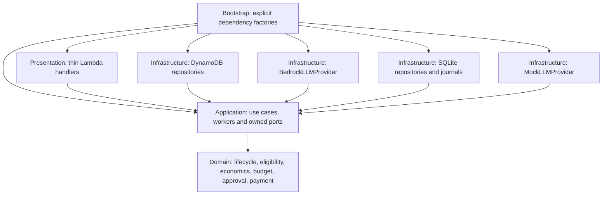
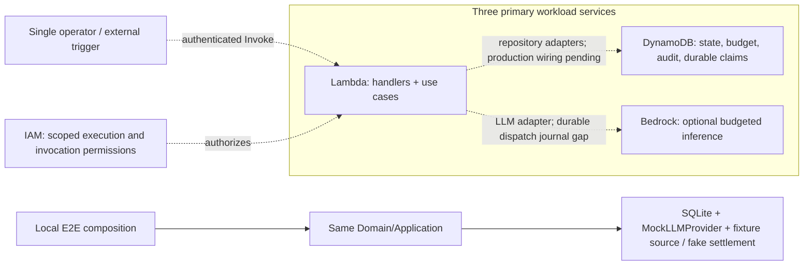

# Milestone 6D: AWS Architecture Review

Review date: 2026-10-20. Scope: existing code through Milestone 6C, repository
documentation/ADRs and offline verification. This report creates no resources,
changes no runtime behavior and grants no deployment approval.

## Decision report

**Retain Lambda, DynamoDB and Bedrock as the three primary workload services.**
They are sufficient for a bounded, operator-triggered workshop architecture.
The repository is not yet a deployable end-to-end AWS agent. Several remaining
composition and durability gaps must be resolved before live execution.

| Question | Finding |
| --- | --- |
| 1. Are the three services sufficient? | Yes for bounded compute, durable state and optional inference, with explicit operator invocation and human approval. This is architectural sufficiency, not evidence of a completed deployment or an autonomous scheduler. |
| 2. Is another AWS service strictly required? | No additional primary workload service is established as necessary. IAM is a required AWS security foundation for Lambda execution roles. A literal restriction to only three AWS services in total would therefore be inaccurate. |
| 3. Why required for correctness/security? | IAM supplies the Lambda service trust relationship and scoped permissions to access the table/model. It is required authorization infrastructure, not a business role system or convenience feature. No IAM resources were created in this review. |
| 4. Is AWS code outside Domain/Application? | Yes. DynamoDB and Bedrock adapters live in Infrastructure; Lambda event parsing/result mapping lives in Presentation; composition lives in Bootstrap. Static import checks pass. |
| 5. Can AgentMine run locally? | Yes: offline E2E composes SQLite, workers, QA, simulated operator approval and fake external services. The startup CLI only validates configuration; it is not a continuous agent runner. |
| 6. Can MockLLMProvider replace Bedrock? | Yes, through the existing LLMProvider port. Offline flows use the mock without credentials or paid calls. Provider replacement needs explicit composition, not a new domain contract. |
| 7. Can local persistence replace DynamoDB? | Yes, by injecting SQLite implementations of the same ports. Both backends exercise application workflows. This does not imply identical consistency/performance or automatic migration of existing data. |

Lambda's required execution role and direct invocation mechanism are documented in
[AWS execution roles](https://docs.aws.amazon.com/lambda/latest/dg/lambda-intro-execution-role.html)
and [synchronous invocation](https://docs.aws.amazon.com/lambda/latest/dg/invocation-sync.html).
The bounded-workshop sufficiency conclusion is this review's engineering judgment.

## Architecture diagram

Solid arrows below show code dependencies or adapter implementation of an inner
port, not an application import of concrete infrastructure.



The deployment view below is a **target composition**, not a deployed system.
The three primary services are boxed together. IAM is a supporting security
foundation. Dotted paths require additional composition/implementation.



Current Lambda callables cover discovery, normalization, outcome tracking and
payment verification only. A complete cloud Research/Data execution loop, human
review interface and production submission/payment connectors are not shipped.
Human approval remains a persisted application/domain prerequisite; it is not
replaced by IAM authorization to invoke a function.

## Evidence in the repository

| Concern | Evidence and limits |
| --- | --- |
| Dependency direction | `tests/unit/test_architecture.py` scans Domain/Application/Presentation imports. Domain/Application contain no AWS SDK or concrete adapter imports. Static AST checks are a guard, not a general proof against arbitrary dynamic imports. |
| Thin runtime | `presentation/lambda_events.py`, `presentation/lambda_handlers.py`, `bootstrap/lambda_runtime.py`: bounded parsing, dependency resolution, existing use cases, safe errors and correlation logs. No global SDK clients or business decisions in handlers. |
| Persistence substitution | `bootstrap/local.py`, `bootstrap/dynamodb.py`, `infrastructure/sqlite/`, `infrastructure/dynamodb/`; SQLite and Moto integration tests exercise unchanged application contracts. |
| Inference substitution | `application/ports/services.py`, `infrastructure/llm/mock.py`, `infrastructure/llm/bedrock.py`; structured responses, budget authorization and test-only provider clients. |
| Local completeness | `tests/e2e/test_local_agentmine.py`, `tests/e2e/local_flow.py`: Research/Data, QA, explicit simulated approval, accepted/paid distinction, verified value and budget restoration. These are synthetic evidence, not real marketplace earnings. |
| AWS adapter checks | `tests/integration/test_dynamodb_persistence.py`, `tests/integration/test_lambda_dynamodb.py`: Moto, not live AWS. Bedrock tests use fake clients. |

## Gaps before cloud execution

1. **Paid-call dispatch durability:** `BedrockLLMProvider` directly requires the
   SQLite `LLMJournal` in `infrastructure/llm/journal.py`. Worker/QA DynamoDB journals
   do not replace this journal. A per-environment file would lose global dispatch
   ownership and allow duplicate paid calls across concurrent/cold invocations.
   Introduce a durable conditional DynamoDB implementation behind an appropriate
   adapter boundary before cloud paid execution; retain unknown-call reconciliation.
   This can stay outside Domain/Application and needs no fourth workload service.
2. **Raw-source durability:** `infrastructure/marketplaces/raw_archive.py` uses
   SQLite. Live Superteam ingestion must retain its raw captures across invocation
   environments. A bounded DynamoDB archive is a possible future solution, not an
   implemented adapter. Specify payload limits/retention before enabling it.
3. **Production composition:** Lambda dependencies are injected; there is no shipped
   deployment binding, IAM policy, resource provisioning or end-to-end cloud runner.
   Select region/model/table, trusted clock and permitted credentials explicitly.
   Never trust an arbitrary event's claimed operator identity as human approval.
4. **Bounded artifacts and execution:** DynamoStore rejects items over 380 KiB
   and bounds transactions to 100 actions/3800 KiB. Growing aggregate snapshots,
   research evidence and CSV/JSON artifacts can exceed those limits. There is no
   chunking/offload implementation. Define workshop limits and fail closed.
   Standard Lambda invocations have a 900-second ceiling; long work requires
   bounded stages and durable resumption, not waiting in a function for a human.
5. **Consistency and recovery:** GSIs are eventually consistent and can temporarily
   omit candidates. They must not authorize spending or prove a payment. Base-table
   reads/conditional transactions protect authoritative state. Retry handling does
   not make arbitrary external effects exactly once. Preserve dispatch claims,
   submission ownership and reconciliation of unknown effects.
6. **External contracts:** No production SubmissionGateway or PaymentVerifier is
   wired. No live Bedrock/model/region compatibility, marketplace access, IAM policy
   or AWS fault behavior was validated. Fixture acceptance/payment cannot stand
   in for independent payment evidence in production.
7. **Operational accounting:** Net value subtracts recorded costs. Model token
   pricing is supplied configuration; actual AWS infrastructure billing is not
   automatically reconciled. Application AI budgets do not cap all AWS charges.
   A workshop must label unmeasured cost rather than imply complete profit accounting.

AWS documents that [Lambda temporary storage is unique to each execution environment](https://docs.aws.amazon.com/lambda/latest/dg/configuration-ephemeral-storage.html),
the [standard function timeout is at most 900 seconds](https://docs.aws.amazon.com/lambda/latest/dg/configuration-timeout.html),
and [DynamoDB item/transaction size constraints apply](https://docs.aws.amazon.com/amazondynamodb/latest/developerguide/Constraints.html).
The durability findings above follow from those constraints and the current code.

## Additional-service assessment

| Service or capability | Required now? | Decision/rationale |
| --- | --- | --- |
| IAM | Required security foundation for AWS execution | Scoped execution role and authorized invoker; not additional product scope or multi-user business roles. No resources added. |
| CloudWatch Logs | Standard operational integration, not a fourth business engine | Lambda normally sends logs here with execution-role permissions. Specify retention and safe INFO logging at deployment. Persisted business audit remains in the repository, not only logs. CloudWatch metrics also accompany Lambda; do not describe the deployment as literally touching only three services. |
| EventBridge Scheduler | Conditional, not required for operator-triggered workshop | No scheduler is implemented. Accepting an EventBridge-shaped event does not schedule it. If unattended AWS-managed schedules become mandatory, revisit the trigger decision explicitly; manual invocation does not satisfy that requirement. |
| S3 | Not strictly required for bounded workshop | Current artifacts must fit persistence limits. Large artifact storage is an unresolved future design choice, not justification to silently add S3 now. |
| SQS / Step Functions | No demonstrated requirement at current scope | Durable states and operator-driven bounded invocations can coordinate this workshop. Queue/workflow services could improve operations later; current code does not implement a continuous scheduler/retry coordinator. |
| Secrets Manager | No demonstrated strict requirement for this workshop | Use execution-role credentials for AWS; keep marketplace secrets outside prompts/logs and supply them securely at composition. Managed rotation would require a separate requirements decision. No secret store is provisioned here. |
| KMS customer-managed key | No demonstrated requirement to provision one | DynamoDB encryption at rest already uses AWS KMS with default AWS-owned key options. Separate customer-managed keys need an explicit key-control requirement; do not confuse default managed encryption with a new custom key deployment. |
| API Gateway / Cognito | Not required for single-operator direct invocation | A web review portal is not V1 scope. A future cloud approval entrypoint still needs authenticated, attributable operator actions and existing approval guards. |

See [Lambda log delivery](https://docs.aws.amazon.com/lambda/latest/dg/monitoring-cloudwatchlogs.html),
[automatic Lambda metrics](https://docs.aws.amazon.com/lambda/latest/dg/monitoring-metrics.html)
and [DynamoDB encryption](https://docs.aws.amazon.com/amazondynamodb/latest/developerguide/EncryptionAtRest.html).
These supporting AWS capabilities are disclosed, not newly enabled by this review.

## Verification

Commands run from the repository root using the existing virtual environment:

```powershell
.\.venv\Scripts\python.exe -m ruff check .
.\.venv\Scripts\python.exe -m ruff format --check .
.\.venv\Scripts\python.exe -m mypy
.\.venv\Scripts\python.exe -m pytest -q -p no:cacheprovider
git diff --check
```

Results: Ruff check passed; formatting passed for 215 files; mypy passed for
169 source files; pytest **889 passed in 29.62 seconds**. The first sandboxed
pytest run was interrupted after temporary-directory setup errors; a diagnostic
`pytest -x -q -p no:cacheprovider` confirmed Windows access denial to pytest's temp
directory. The full run then passed with the necessary filesystem permission.
No dependency installation, deployment, live marketplace call or paid inference
was part of validation. The suite's network block remained active.

## ARCHITECTURE GATE

Review completed; deployment readiness remains conditional. Before implementation
of deployment wiring, the owner must approve:

- Interpret the constraint as **three primary workload services**, with IAM and
  disclosed standard AWS operational/encryption facilities.
- Use operator/direct triggers for the bounded workshop, or explicitly revisit
  scheduling if unattended AWS-managed operation is mandatory.
- Require durable shared LLM dispatch claims and raw-source retention before
  live cloud paid calls/ingestion; never use Lambda `/tmp` as their authority.
- Set artifact/runtime/retention bounds and define reconciliation for unknown
  external effects and unmeasured infrastructure costs.
- Approve concrete least-privilege deployment wiring and any live, billable smoke
  test separately once prepared; keep production submission/payment disabled
  until verified contracts and independent payment evidence exist.

These are pending deployment decisions, not new accepted ADRs. No user action or
AWS credentials are needed to reproduce the offline review tests.
