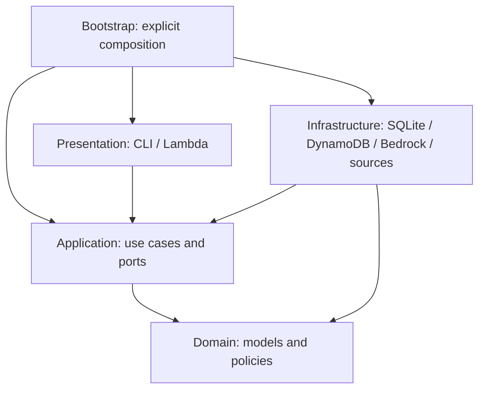

# Clean Architecture audit

Reviewed: 2026-10-22. Scope: repository dependency direction, responsibility placement,
composition, persistence boundaries and architecture regression tests. No product
features, external integrations, dependencies or deployment changes.

## Violations and fixes first

### A-01 — Operator presentation owned review orchestration (fixed)

`presentation/operator_cli.py` loaded an opportunity through a repository, required
a deliverable and constructed its submission approval scope. It also read review and
decision records directly. These imports pointed inward, but the presentation layer
owned part of the application workflow rather than only parsing and rendering.

Moved preparation to `PrepareOperatorReview.for_submission` and reads to
`GetOperatorReview` in `application/use_cases/operator.py`. Added the typed
`RecordedOperatorReview` response in `application/contracts/operator.py`.
`bootstrap/operator.py` now injects these use cases into `OperatorServices`; that
presentation-facing bundle no longer exposes repositories. CLI syntax, review
identity, deliverable binding, error behavior and mandatory approval remain intact.
Approval still does not submit externally.

Regression coverage checks pending/completed review reads, missing deliverables,
missing reviews, repeated preparation, conflicting destinations and no submission
side effect. Existing SQLite CLI integration coverage exercises the changed wiring.

### A-02 — Architecture enforcement gaps (fixed; not a production import violation)

The previous import guard accepted every standard-library module, including HTTP
and SQLite, and did not check infrastructure dependency direction or import cycles.
`tests/unit/test_architecture.py` now rejects database/network and dynamic-import
entry points in inner layers, checks infrastructure points inward, detects static
production import cycles, and prevents direct repository dependencies returning to
the operator CLI. Synthetic tests exercise the guards, including indirect cycles.

## Dependency review

All 125 production Python modules were included in the static import review.
Imports inside functions and type-checking blocks are included. No backwards
production imports or static import cycles were found.

| Requirement | Evidence and conclusion |
| --- | --- |
| Domain independent of infrastructure | Domain imports domain modules and standard-library primitives; no AWS, SDK, HTTP or database imports. |
| Application independent of concrete infrastructure | Application uses domain models and its own contracts/ports; adapters are composed in bootstrap. |
| Infrastructure implements inner ports | SQLite/DynamoDB repositories, Superteam source and Bedrock/Mock providers implement application protocols structurally. Explicit protocol inheritance is not required. |
| Presentation invokes use cases | Lambda parses/maps events and invokes injected workflows. Operator review preparation/read now follow the same boundary as other operator commands. |
| AWS outside business logic | SDK calls, DynamoDB keys/transactions and Bedrock request/response handling remain in infrastructure and composition code. Lambda runtime parsing remains presentation. |
| Marketplace models outside domain | Superteam wire fields and normalization live in marketplace adapters; domain consumes normalized facts, references and unknown values. |
| Bedrock models outside domain | Model IDs, provider envelopes, usage counting and transport handling stay outside domain. Structured application contracts describe business operations. |
| Database schemas do not define domain semantics | Domain owns lifecycle/financial invariants. Adapters implement serialization, access patterns, optimistic concurrency and durable uniqueness. |
| Local replacement remains possible | Local composition uses SQLite and mock/fake services. Offline integration/E2E tests exercise these alternatives without changing domain rules. |



Presentation may use domain value objects/enums to parse typed inputs or render
results. The essential restriction is that it does not own business decisions or
construct concrete adapters. Bootstrap is the composition root, outside the inward
business dependency chain.

## Responsibility and smell review

| Area | Assessment |
| --- | --- |
| God classes / giant services | No confirmed violation requiring a split. Opportunity and Budget are cohesive aggregates; SubmitTask and worker classes coordinate a single workflow. Their size is a maintenance watch point, not sufficient evidence for a refactor. |
| Business rules in handlers | Confirmed operator review issue fixed above. Lambda handlers retain parsing, dependency resolution, correlation logging, invocation and safe error/result mapping. |
| Business rules in repositories | CAS/revision checks, transactional ledger writes and submission/payment uniqueness enforce port persistence guarantees. Moving these checks out of transactions would weaken correctness. Eligibility, scoring and spending decisions remain inward. |
| Serialization defines semantics | SnapshotCodec uses explicit permitted types and legacy handling. Rehydration touches aggregate internals under the documented trusted-storage boundary; constructors/history checks and domain models remain authoritative. This coupling merits care when adding migrations, but no schema-driven business rule was identified. |
| Generic utilities | No generic utils dumping ground found. Application context helpers coordinate use-case operations; adapter helpers have specific transport/storage responsibilities. |
| Duplicate domain rules | No confirmed divergent duplicate policy found. Boundary validation and atomic persistence guards are intentionally repeated at different trust/concurrency boundaries. |
| Circular dependencies | Static production graph passes cycle detection. |
| Global mutable state | No hidden mutable runtime service instance found. Services/stores are injected instances; module export metadata is not runtime application state. |
| Hidden service locators | Explicit bootstrap factories and typed dependency bundles are composition mechanisms, not ambient lookup services. |
| Unnecessary abstractions | Existing protocols isolate replaceable persistence/providers and test fakes. No speculative abstraction or new framework added. |

## Files changed

- `src/agentmine/application/contracts/operator.py`
- `src/agentmine/application/use_cases/operator.py`
- `src/agentmine/presentation/operator_cli.py`
- `src/agentmine/bootstrap/operator.py`
- `tests/unit/application/test_operator_approval.py`
- `tests/unit/test_architecture.py`
- `tests/integration/test_operator_interface.py`
- `docs/clean-architecture-audit.md` and README documentation link

No domain model, existing repository port, persistence schema or dependency changed.
No unrelated refactor was performed.

## Validation

Commands used with the existing local virtual environment:

```powershell
.\.venv\Scripts\python.exe -m ruff check .
.\.venv\Scripts\python.exe -m ruff format --check .
.\.venv\Scripts\python.exe -m mypy
.\.venv\Scripts\python.exe -m pytest -q -p no:cacheprovider
git diff --check
```

- Ruff: passed.
- Format: 231 files already formatted.
- Mypy: passed, 180 source files.
- Full test suite: **948 passed in 24.74 seconds**, including architecture,
  application, contract, local integration, DynamoDB emulation and E2E tests.
- Tests use network blocking/fakes/emulation; no paid API call or deployment.

## Remaining limitations

Static import checks are regression guards, not a Python sandbox or proof against
every reflective import technique. Responsibility placement still requires human
review. No live AWS deployment or marketplace validation was performed. Snapshot
rehydration and large cohesive aggregates remain areas to inspect as they evolve.
The emulator concurrency caveat documented in `security-review.md` remains; this
audit does not establish production DynamoDB behavior from emulator tests alone.
